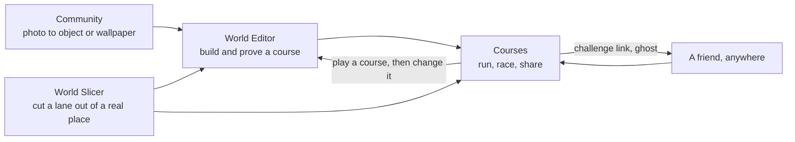
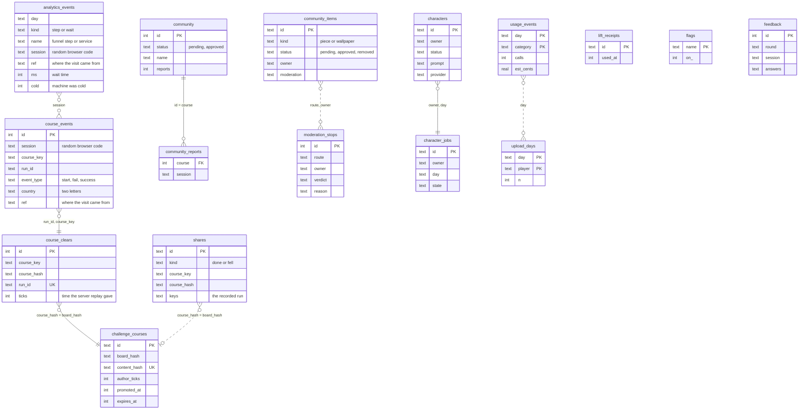
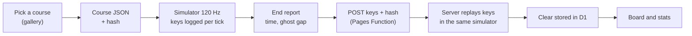
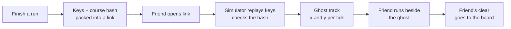
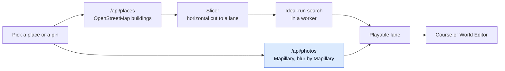
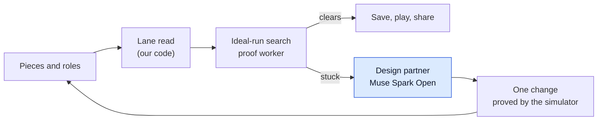
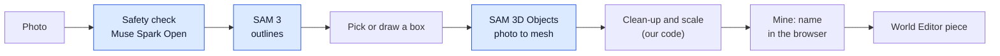

# ConquerCourse

*Train slow. Run fast.*

A ninja-warrior physics game where real parks, real streets and real objects become the course.
Built for the Meta Global AI Developer Hackathon (2026-10-26 to 2026-11-04), indie track.
Live: https://conquercourse.pages.dev/

## In one minute
- You run, jump, hang, swing and climb a small runner through obstacles.
- The obstacles come from the real world: a pin on a map, a photo of a bench, a park you know.
- The physics is the same on every run, so a time is a fact and a friend can race your run.
- Four features, one top bar on every page: **Courses**, **World Editor**, **World Slicer**, **Community**.
- We do not grade or coach a person's technique, use a chat tutor, or leave Earth's physics.

## Core innovation
- **A deterministic simulator is the judge, and AI only proposes.**
  - Meta's models turn the real world into pieces (a photo into a 3D object, a street into a lane, a sentence into a character).
  - The same fixed-step simulator plays every course, so the same keys always give the same result.
  - That makes a time a fact: a friend can replay your run, and the server proves a clear by playing it again.
- **A course you can prove.**
  - The ideal-run search finds a plan of key presses that clears the course, and proves it.
  - If a layout that an AI or a player made cannot be cleared, the game says so and offers a fix it has already checked.
- **Real world in, real world out.**
  - A pin on a map or a photo of a bench becomes a course, and the physics you learn on it is the physics of the real thing.
  - Players learn by doing; the game never grades or coaches a person's technique.
- **One clock.**
  - Physics, motion, replay and film all run on the same 120 Hz clock, so a replay, a ghost and a shared link cannot drift apart.

## Tech stack
| Layer | What we use |
|---|---|
| Game and editor | TypeScript, Vite, three.js (3D), MapLibre (maps), mp4-muxer (film capture in the browser) |
| Simulator | Pure TypeScript, fixed 120 Hz, no dependencies, guarded by golden hashes |
| Server | Cloudflare Pages Functions and D1 (SQLite), wrangler for deploys |
| Meta AI | Muse Spark Open (Baseten), Muse Image, SAM 3, SAM 3.1, SAM 3D Objects, SAM 3D Body, DINOv3, Meta-Llama-3-8B-Instruct (inside Kimodo), MusicGen, Mapillary |
| Other open models | Kimodo (NVIDIA), MoGe 2, TRELLIS.2, torchvision detectors |
| GPU jobs | Modal (Python), for build-time pipelines and the live photo-to-3D and character jobs |
| Tests | Vitest (about 2,400 tests), Playwright browser checks, golden traces of the simulator |
| Tooling | Node, Python, ffmpeg, Linear, GitHub pull requests |

## Set it up
- You do not need an API key to run the game itself.
- For a quick look, `git clone --depth 1 https://github.com/gitgithan/conquercourse.git` downloads about 115 MB; a plain `git clone` also brings the whole history (about 440 MB), which shows how the work grew day by day.
- Install the packages with `npm ci`.
- Start the local site with `npm run dev`, then open http://localhost:5173.
- For the Meta Model API tools, copy [.env.example](.env.example) to `.env` and put your key in `META_API_KEY`.
- Load that file in your shell before running those tools: `set -a; . ./.env; set +a`.
- Keep `.env` private: git ignores it, and keys stay on the server side, never in the browser.
- Checks and more detail: `npm run test:quick`, [testing](docs/testing.md), [dev setup](docs/dev-setup.md), [deploying](docs/deploy.md) and [trust and safety](docs/trust-and-safety.md) and the [feedback card](docs/feedback.md).

## The four experiences

### How they fit together
- Community turns your photos into wallpapers and 3D objects.
- World Slicer turns a real place into a lane.
- World Editor mixes both into a course you can prove, tune and save.
- Courses is where you and everyone else run, race ghosts and share.



### At a glance
| | Courses | World Slicer | World Editor | Community |
|---|---|---|---|---|
| **What it is** | Where the game is played | A real place cut into a lane | Build a course from pieces | Your photos become pieces |
| **You can** | Run, race a ghost, read your report, share a link or clip | Pick or pin a place, see street photos, choose buildings | Place 19 real objects and shapes, give roles, press Fix it | Pick a photo, pick a thing in it, make a 3D piece |
| **You get** | A time the simulator replays, a link, a clip | A checked lane from a real place | A saved, proved course | A piece in your tray, or a wallpaper |
| **Why it is unique** | A time cannot be faked; race a stranger's ghost | Your own street becomes a course | The simulator says in plain words what to change | A thing you walk past becomes something to jump over |

- Details for each: [Courses](docs/obstacles.md), [World Slicer](docs/street-photos.md), [World Editor](docs/features.md), [Community](docs/community-flow-guide.md).
- Community status: suggested outlines and the 3D lift need their server jobs switched on; the full path ran for real on the preview site ([click by click](docs/community-flow-guide.md)).

## Folder tree
- The top level, and one level inside each folder.

```text
conquercourse/
├── src/          the game (TypeScript, runs in the browser)
│   ├── sim/        the 120 Hz simulator, one file per move
│   ├── modes/      one screen per mode: course, editor, map, community, dojo
│   ├── slice/      World Slicer: place to lane, ideal-run proof
│   ├── world/      the lane and the objects in it
│   ├── render/     drawing with three.js
│   ├── motion/     body motion clips and the plausibility gate
│   ├── characters/ the Rookies and user-made skins
│   ├── community/  photo to piece, sharing
│   ├── course/     course files, ghosts, challenge links
│   ├── park/       the park scenes
│   ├── share/      links and clips
│   ├── film/       the film camera shots
│   ├── lab/ labs/  the university Labs
│   └── ui/         buttons, report, turntable, music
├── functions/    the server (Cloudflare Pages Functions)
│   ├── api/        one file per web address (courses, photos, admin)
│   └── _lib/       shared server code
├── migrations/   database tables, numbered 0001 and up
├── public/       files the site serves
│   ├── assets/     objects, music, park photos
│   ├── brand/      logo and icons
│   ├── film/       film pieces
│   └── admin/      the private usage page
├── pipelines/    build-time Python: photo to 3D, video to motion
│   ├── ccpipe/ charmaker/ objbake/ partllm/   the tools
│   └── posekimodo/ spectacle/ video_to_motion/ tests/
├── scripts/      checks, film recorders, ship script
│   ├── film-b/ film-c/ film-d/   film shots by round
│   └── lib/        shared helpers
├── tests/        Vitest tests (physics laws first)
│   ├── fixtures/   saved inputs
│   ├── golden/     golden hashes of the simulator
│   └── helpers/    shared test code
├── docs/         the spec, lessons, assets and one page per feature
│   ├── spec/       SPEC.md, the source of truth
│   ├── labs/       one page per Lab
│   └── evidence/ feedback/ film-a/ film-b/ research/
├── data/         experiment trail
│   ├── eval/       README and run.json per experiment (raw output stays out of git)
│   └── assets/ footage/
├── demo/         small stand-alone demo (src, data)
├── course/       the course file schema
├── tools/        small helpers (fetch_commons.py, mhr_look)
├── server/       local proxy for the model tools
├── index.html    the page; vite.config.ts builds it
├── wrangler.toml Cloudflare settings (live and preview)
└── CLAUDE.md     rules for agents
```

## Database tables (D1)
- The tables live in Cloudflare D1; `migrations/` has one numbered file per change.
- No table uses a foreign key.
- Tables link by shared values: a course key, a course hash, a run id, a random browser code or a row id.
- Each line in the picture is labelled with the value that links two tables; dotted lines are looser links.



- **Play record:** `course_events` logs starts, fails and successes; `course_clears` keeps only runs the server replayed; the board and the growth chart read these two.
- **Sharing:** `shares` holds a recorded run, and `challenge_courses` holds a made course that others can try before it is promoted.
- **Community:** `community` holds photo courses, `community_items` holds pieces and wallpapers, and `community_reports` holds one report per browser per course.
- **Made things:** `characters` and `character_jobs` track make-a-character runs.
- **Safety and cost:** `moderation_stops`, `lift_receipts`, `usage_events`, `upload_days` and `flags` support the safety check and the owner-only page.
- **Feedback:** `feedback` stores answers from the in-page forms.
- **Visits and waits:** `analytics_events` holds funnel steps and how long the rented machines took to answer.
- All migrations up to 0019 are applied on the live database.

## Experiences that are not possible in real life
- **Race a ghost of a stranger.**
  - A run is a list of key presses, so anyone's best run can run beside you, see-through, on the same clock.
  - The gap is a plain fact ("Ghost is 0.8 s ahead"), never a grade ([challenge](docs/challenge.md)).
- **Race the ideal run.**
  - The simulator searches for the best line and any shortcut, then shows it as a ghost.
  - No coach and no judge: it is a line to chase.
- **Run a course that does not exist.**
  - A bench, a canal railing and a coaster rail on one lane, built in minutes.
  - Real objects at sizes and gaps that would need a crane to build.
- **Try a move again and again with no cost.**
  - Falling costs one key press (R), so a hard swing can be tried fifty times in a minute.
- **See why a swing worked.**
  - The debug view (B) shows the pendulum, the grab circle and the release point.
- **Design a course without being a designer.**
  - The design partner and Fix it say what to change; the simulator proves the change.
- **Run in a place you have never been.**
  - A pin on Earth, or a friend's neighbourhood, becomes a lane; a place already seen comes from a cache and takes a second or two, and a new place can take longer (not timed).
- **Share a run that nobody can fake.**
  - The challenge link carries the keys, so the time is what the simulator says.

## Technical introduction

### The simulator
- Pure TypeScript, fixed 120 Hz, deterministic: the same keys give the same result, guarded by golden hashes (`src/sim`).
- One clock drives physics, motion and film.
- The ideal-run search (`src/sim/ideal.ts`) finds a plan of key presses that clears a course, and proves it.
- Physics-law tests come first; no motion is shown before it passes the plausibility check.

### Move primitives
- Keys and numbers for each move are in [obstacles](docs/obstacles.md).

| Move | Keys | Code | Teaches |
|---|---|---|---|
| Run | arrows or A D | `src/sim/runner.ts` | speed builds and drops |
| Jump | Space | `src/sim/runner.ts` | flight is decided at take-off |
| Step | none up to 0.3 m | `src/sim/terrain.ts` | small things need no jump |
| Squat and roll | S, X | `src/sim/drop.ts`, `src/sim/roll.ts` | bending softens a landing |
| Slide | tap S or ↓ while running | `src/sim/slide.ts` | friction wears speed away; a low body passes under a head-high ball |
| Vault | V | `src/sim/vault.ts` | speed carries you over a box |
| Wall climb | hold E | `src/sim/climb.ts` | reach is spent as height |
| Warped wall | run, hold E | `src/sim/wall.ts` | speed becomes height |
| Hang and swing (bar, Lache pair) | hold E, arrows, let go | `src/sim/holds.ts` | a pendulum swaps height and speed |
| Rope | reach it, Space lets go | `src/sim/rope.ts` | a pendulum on a rope |
| Trampoline | Space at the bottom | `src/sim/trampoline.ts` | stored energy returns |
| Elastic band | hold left, then right | `src/sim/band.ts` | stretch, turn, throw |
| Cannon recoil | K, tilt with up and down | `src/sim/recoil.ts` | momentum is conserved |
| Trebuchet | run, then Space at the hint | `src/sim/trebuchet.ts` | a lever throws a rider |
| Coaster cart | ride, S brakes | `src/sim/cart.ts` | height becomes speed |
| Pole vault | E picks up, hold E plants | `src/sim/pole.ts`, `src/sim/pole-ride.ts` | a bending pole stores a run |
| Drone ferry | E boards, lean and climb | `src/sim/drone.ts` | a vehicle that leans where it flies |
| Timed balls (drums) | none, choose when to cross | `src/sim/drums.ts` | timing and relative motion |
| Cannon balls | Space jumps, tap S slides, E climbs a wall | `src/sim/shots.ts` | timing, and a low body passes under a high ball |

### Object primitives
- The shared set of shapes, with sizes in metres, is in [primitives](docs/primitives.md).

| Primitive | Role | Teaches |
|---|---|---|
| `platform` | stand | stopping and starting on a deck |
| `gap` | hazard | flight is decided at take-off |
| `wall` | vault, grab | height is spent from speed or reach |
| `mound` | stand | running over a curved top |
| `ramp` (line or arc) | stand, grab | speed becomes height |
| `spring` | stand | stored energy returns |
| `ropeAnchor` | grab | a pendulum swaps height and speed |
| `movingHazard` | hazard | timing |
| `water` | hazard | failure is cheap |
| `bar` (proposed) | grab | hanging and swinging |

- In the World Editor a piece is one of these sources:
  - `obj:` a real object from [the object index](public/assets/objects/index.json), including pull-up frames with a bar height (`hang_m`: 2.2 m green, 2.05 m black).
  - `box:` a plain box, `hold:bar` a swing bar, `track:` a coaster rail, `device:` a launcher or similar device.
  - `user:` an object you made in Community.
- Roles a piece can play: plain ground, Warped Wall, rope anchor, trampoline bed, swing bar.
- A 3D model is only a skin: the physics shape always comes from the lane read, not from the mesh.

## Architecture and happy paths
- Each diagram follows one happy path through the real code.
- Blue boxes are Meta models; grey boxes are our code or other tools.

### 1. Play a course
- Happy path: pick a course -> run with the keys -> the simulator steps at 120 Hz -> the report -> optional tag -> challenge link.
- The page loads a course (JSON of ground, holds and devices) and builds the world.
- Each key press is logged against the simulator tick.
- At the end, the keys and the course hash go to the server, which plays them again and keeps the time only if it matches.



### 2. Replay, share and leaderboard
- Happy path: finish a run -> keys packed into a link -> friend opens it -> simulator replays the keys -> ghost beside the friend.
- The link carries keys and a checkpoint, never a time.
- A different build or a changed course (different hash) offers the ideal ghost instead.
- A run reaches the board only when the player presses Publish; the server replays the keys first.
- View Run replays a published run in the browser straight away, and Chase Ghost loads it as the ghost.
- The board keeps one best verified run per player, in non-overlapping UTC day and week windows.



### 3. World Slicer: real place to lane
- Happy path: pick a place or pin -> buildings fetched -> street photos found -> a lane cut -> the simulator proves it -> play or open in the editor.
- `/api/places` asks several map servers at once and keeps the answer on the edge for 30 days.
- The Slicer cuts the place with a horizontal plane (`src/slice/slicer.ts`), and a worker checks the lane with the ideal-run search (`src/slice/slicer-core.ts`).
- `/api/photos` fetches Mapillary photos with the token kept on the server; the pictures stay on Mapillary, its own face and plate blur applies, and photos with a close-up person are left out of the lists.



### 4. World Editor: pieces to a proven course
- Happy path: pick a ready course or place pieces -> give roles -> the simulator reads the lane -> ideal run proves it -> Fix it if not -> save or play.
- The editor reads the lane from the pieces, so the preview and the built course cannot drift apart.
- The design partner calls Muse Spark Open through a server function; the simulator is its tool and the judge.



### 5. Community: photo to object
- Happy path: photo -> safety check -> pick an outline -> SAM 3 mask -> SAM 3D Objects lift -> clean-up and scale -> object in "Mine".
- `/api/segment` suggests outlines (SAM 3 on a copy with people blurred).
- `/api/object-lift` checks the photo with Muse Spark Open, then starts the Modal job (`pipelines/photo_to_object.py`).
- The server stores nothing: the object comes back to the browser and is saved there.
- A wallpaper skips the lift; it is a picture behind the lane.



### 6. Build time: models to files
- Happy path: photos and video -> masks -> 3D objects and body poses -> checked motion -> files the game loads.
- Models run once on Modal GPUs and the game ships the result as files.
- The whole map of models is in [meta-ai-pipelines](docs/meta-ai-pipelines.md); recipes are in [pipelines](docs/pipelines.md).


## Hackathon

### Meta tool use
Diagrams are in [docs/meta-ai-pipelines.md](docs/meta-ai-pipelines.md); the full table and what is not Meta are in [docs/hackathon.md](docs/hackathon.md).

| Feature | Tool | What it does | Runs |
|---|---|---|---|
| Community, World Editor objects | **SAM 3 (open weights)** | Cuts a real object out of a player's photo; blurs people in video | Live job on Modal, and build time |
| Characters, video ingest | **SAM 3.1 (Meta Model API)** | Cuts the figure out of a Muse Image picture; segments obstacles in filmed video | Live for characters (Meta credit), build time for video |
| Community, World Editor objects | **SAM 3D Objects** | Photo and mask to a 3D object (the 19 editor objects and "Mine" objects) | Modal GPU |
| Motion clips | **SAM 3D Body + MHR, DINOv3** | Measures body and pose from video | Build time |
| Generated motion | **Meta-Llama-3-8B-Instruct** | Text encoder inside Kimodo (NVIDIA) for run, leap and hang motion | Build time |
| World Editor: design partner, Fix it | **Muse Spark Open** (Baseten) | Proposes a layout; the simulator checks it | Live, server function |
| Photo and upload review (outline step, 3D lift, characters, Share in Community) | **Muse Spark Open** (Baseten, `meta-models/muse-spark-open-1026`) | Reads each uploaded photo before anything is made or shared and answers ok, review or block with one reason; if it cannot answer, nothing is made | Live, server function |
| Community: move tips | **Muse Spark Open** (Baseten) | Names the moves that fit a cut-out object | Live, server function |
| Characters | **Muse Image, SAM 3.1** | A player's sentence becomes a picture (Muse Image), a cut-out (SAM 3.1) and a mesh (SAM 3D Objects on Modal); the two Rookies were built earlier with Tripo, with one Muse Image reference for Rookie B | Live: a Modal job calls the Meta Model API (Meta credit); see [docs/model-ledger.md](docs/model-ledger.md) |
| Music | **MusicGen (AudioCraft)** | An original loop per screen | Build time |
| World Slicer | **Mapillary** (owned by Meta) | Street photos along a built place, faces and plates blurred by Mapillary | Live, server proxy |

- Keys never reach the browser; the models propose and the simulator decides.
- Which credit pays for each call, and what a player can trigger: [docs/model-ledger.md](docs/model-ledger.md).
- Meta tools used while building, not in the game: Muse Wonder reviewed the simulator code (13 real bugs in 21 claims, each checked by us).

### Models that are not Meta's
- Every model below is open source or open weights, except Tripo, which is a closed service used once while building.
- Meta's models do the live work; these only helped make files that ship (licences: [docs/ASSETS.md](docs/ASSETS.md); what calls which model: [docs/model-ledger.md](docs/model-ledger.md)).

| Model | Made by | How we use it | When |
|---|---|---|---|
| **Kimodo** and the **SOMA-X** skeleton | NVIDIA (NVIDIA Open Model License) | Makes the roll and slide motion clips from a text prompt; Meta-Llama-3-8B-Instruct is its text encoder | Build time on Modal; the clips ship, the model does not run in the game |
| **Mask R-CNN, Faster R-CNN** (torchvision) | PyTorch (open source) | Finds people in a photo so they can be masked | Build time and in the upload pipeline on Modal |
| **MoGe 2** | Microsoft (open weights) | Depth for the motion-from-video step | Build time on Modal |
| **TRELLIS.2, Pixal3D** | Open source (MIT) | A side-by-side test of photo to 3D against SAM 3D Objects; nothing from them ships | Build time, one experiment |
| **Tripo** | Tripo (closed web service) | Made the two Rookie meshes once in 2026-10; no Tripo code or key is in the game | Build time only, never at runtime |
| **CMU motion capture** | CMU Graphics Lab (data, not a model) | Real moves for the clips | Build time |

- No closed AI service runs while someone plays; the live calls go to Meta's models (Muse Image, SAM 3.1, SAM 3, SAM 3D Objects) and to Muse Spark Open, which Baseten hosts.

### How we meet the judging criteria
- **Impact:** real world in, real world out; physics learned by doing; makers as well as players; no sign-in and no real names; our own captures are blurred, and Mapillary blurs its street photos.
- **Use of Meta AI tooling:** ten Meta models and services (SAM 3 and 3.1, SAM 3D Objects, SAM 3D Body with MHR, DINOv3, Llama 3, Muse Spark Open, Muse Spark, Muse Image, MusicGen, Mapillary; Muse Wonder is development only and not counted), each doing one visible job; the models propose and the simulator decides.
- **Technical depth:** a deterministic simulator, an ideal-run proof, a plausibility gate, failures written up in [lessons](docs/lessons.md).
- **Demo:** the three-minute script is in [docs/demo-script-v2.md](docs/demo-script-v2.md).
- Details for every criterion: [docs/hackathon.md](docs/hackathon.md).

### Bonus prizes
- **Most Viral:** challenge link and 15 second clip ([viral plan](docs/viral-plan.md)).
- **Best Build on Meta Open Weights:** Muse Spark Open runs the design partner.
- **Best Agentic Use-Case:** not claimed now.
  - The Course Agent loop (propose, test, repair) was proved 40 of 40 times, but only starting from a photo ([results](data/eval/cc-126-course-agent/README.md)).
  - The scope is now photo to object only, so the photo input and the editor entry were removed (2026-10-31).
  - The text-only version has not been measured.

### Safe by design
- No sign-in and no real names; a short tag of up to 12 characters at most, checked against a block list.
- People are blurred in every photo we process; street pictures use Mapillary's own face and plate blur (not a guarantee, and we never store them).
- No footage of minors in our own footage (Mapillary street photos follow Mapillary's terms), no chat tutor, no grading or coaching of technique.

## Play it
- Keys: arrows or A/D run, Space jump, S squat, E hold, V vault, X roll, R retry, H key card.
- Desktop keyboard at 1280 px is the supported setup.
- Modes: `?mode=editor`, `?mode=map`, `?mode=communities`, `?mode=dojo` (learn); Labs are on by default (`?labs=0` hides them); `I` shows the ideal run.
- Every feature, its switch and its doc: [docs/features.md](docs/features.md).
- Every obstacle, its keys and numbers: [docs/obstacles.md](docs/obstacles.md).
- Where to see street photos, and the switches: [docs/street-photos.md](docs/street-photos.md).
- The university Labs, one row each with tests and limits: [docs/labs/README.md](docs/labs/README.md).
- Why one key (Down / S) has several meanings, and why replays stay exact: [docs/input-design.md](docs/input-design.md).
- What to tick when playtesting: [docs/playtest.md](docs/playtest.md).

## User-made characters and pieces (UGC)
- We cannot design courses around characters or pieces we have never seen.
- So the game fits the person's creation to ONE skeleton and ONE set of physics rules, not the other way round.
- Characters:
  - The mesh is only a skin; the bones, the grab points and the hit box are always the Rookie's.
  - At load, a skin that faces back is first turned around (several cues vote, mostly the shoes; when they cannot tell, the skin is left as made and the fit says "facing unclear"); the story is in [docs/character-facing-bug.md](docs/character-facing-bug.md).
  - Then each arm is stretched along its bones so the skin hand meets the hand bone, and the legs and torso are fitted to the hip and shoulder heights.
  - Stretches are clamped, so a very odd shape is bent only as far as it still looks right.
- Pieces:
  - Every piece is scaled by the person-for-scale rule, so a bar is the same height for everyone.
- Courses:
  - The simulator proves a course can be cleared, whatever skin the runner wears.
- Why this scales:
  - A new character or piece needs no new course, no new test and no new physics.
  - One fit rule and one rule set cover all of them.
- Honest limits:
  - A skin with arms lost in the picture cannot be rebuilt by stretching; it is clamped and may look a little off.
  - Stretching can thin fingers or smear a pattern; the fit reports how much it stretched.
- Details and measurements: [docs/ugc-fit.md](docs/ugc-fit.md).
- The upload check and its own limits: [docs/trust-and-safety.md](docs/trust-and-safety.md).
- Parts gallery (every move and obstacle, special ones first, played live): [docs/parts-gallery.md](docs/parts-gallery.md), open `?mode=parts`.

## What is new, and what is not
- The repository starts on 2026-10-27; no code from the earlier practice project is used.
- Third-party material and licences: [docs/PRIOR-WORK.md](docs/PRIOR-WORK.md).
- Every asset, its source and licence: [docs/ASSETS.md](docs/ASSETS.md).

## Where to read more
- Source of truth: [docs/spec/SPEC.md](docs/spec/SPEC.md)
- What we learned and why: [docs/lessons.md](docs/lessons.md)
- Pipelines with diagrams: [docs/meta-ai-pipelines.md](docs/meta-ai-pipelines.md), recipes in [docs/pipelines.md](docs/pipelines.md)
- Stages and courses: [docs/stages.md](docs/stages.md), [docs/course-design.md](docs/course-design.md)
