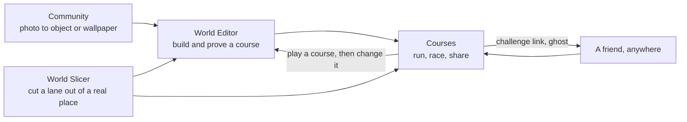
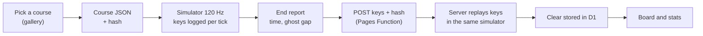
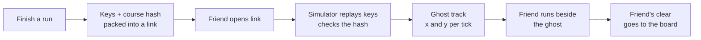
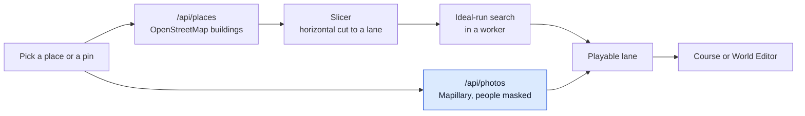
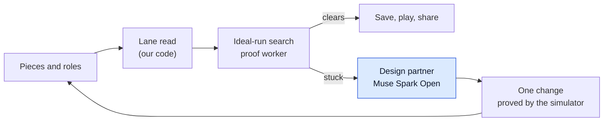
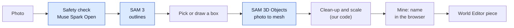

# ConquerCourse

*Train slow. Run fast.*

A ninja-warrior physics game where real parks, real streets and real objects become the course.
Built for the Meta Global AI Developer Hackathon (2026-10-26 to 2026-11-04), indie track.
Live: https://conquercourse.pages.dev/

## In one minute
- You run, jump, hang, swing and climb a small runner through obstacles.
- The obstacles come from the real world: a pin on a map, a photo of a bench, a park you know.
- The physics is the same on every run, so a time is a fact and a friend can race your run.
- Four features, one top bar on every page: **Courses**, **World Editor**, **World Slicer**, **Community**.
- We do not grade or coach a person's technique, use a chat tutor, or leave Earth's physics.

## The four experiences

### How they fit together
- Community turns your photos into wallpapers and 3D objects.
- World Slicer turns a real place into a lane.
- World Editor mixes both into a course you can prove, tune and save.
- Courses is where you and everyone else run, race ghosts and share.

### Courses
- **What it is about:** the place where the game is played; a gallery of ready courses, your own courses and challenge links from friends.
- **What you can do:**
  - Run, jump, vault, climb, hang, swing and ride, with the keys on the key card (H).
  - Chase a ghost: the ideal run, your best run, or a friend's run on the same course.
  - Read the end-of-run report, give a short name or tag (up to 12 characters, no spaces), copy a challenge link or make a 15 second clip.
  - See the board of the fastest verified runs on a course; it scrolls through the top 100 and `?board=0` hides it.
  - Press Publish to Leaderboard to put your run on the board under a name you chose; nothing is sent to the board before you press it.
  - Press View Run on any row to see the obstacles and that player's path at once, then Chase Ghost to run against it.
  - Read the card on each course: plays today and plays all time.
  - Try the Cannonballs course: cannons fire a ball every 12 seconds and show a fill meter; jump the low ones, slide under the high ones, climb a wall to wait out a double shot.
  - Try Two ways: swing high on two bars, or drop low and climb back up.
  - Start from the welcome screen on a bare visit (`?welcome=0` skips it); the course list shows a small growth strip (`?growth=0` hides it).
  - Watch a quiet line at the top for the newest published time on any course.
- **What you can generate:** a time that the simulator replays and checks, a challenge link, a clip, a tag on the board.
- **Why it is unique:**
  - A time cannot be faked: the link carries only the keys, and the simulator plays them again.
  - Every course has an ideal run that proves it can be cleared, so no course is unfair.
  - Racing a ghost needs no live friend: the other person's run is data, so you can race a person from another day or country.

### World Editor
- **What it is about:** building a course from real objects and simple shapes on one lane.
- **What you can do:**
  - Place 19 real objects (bench, low wall, hydrant, pipe, railing, a green and a black pull-up frame and more), boxes, hang bars, coaster rails and devices.
  - Give a piece a role: plain ground, Warped Wall, rope anchor, trampoline bed or swing bar.
  - Start from a ready-made course: Hang bar and Lache (the default), Park run, Coaster to a deck, or the broken park.
  - Ask the design partner why a course cannot be cleared, and press Fix it for one change the simulator has proved.
- **What you can generate:** a saved course, a share link, a repaired course.
- **Why it is unique:**
  - You do not need to know level design: the simulator tells you in plain words what to change.
  - A model may propose a layout, but the simulator decides; a course is only offered when it is proved clearable.

### World Slicer
- **What it is about:** cutting a playable lane out of a real place, the way a flat cut through a building shows its floor plan.
- **What you can do:**
  - Pick one of the ready places, or pin any spot on Earth.
  - See the buildings and the ground become a lane, with real street photos along it (people masked).
  - Pick which buildings to build, then play the lane or open it in the World Editor.
- **What you can generate:** a course from a real place, with street photos, that the simulator has checked.
- **Why it is unique:**
  - Your own street becomes a course, and a friend far away runs the same lane from a link.
  - A lane that cannot be cleared is told so before anyone plays it.

### Community
- **What it is about:** putting your own neighbourhood into the game, one photo at a time.
- **What you can do:**
  - Pick a photo (people are blurred and the photo is not kept on our side).
  - Pick a thing in it from suggested outlines, or draw a box by hand.
  - Choose a wallpaper (looks only) or a 3D object (a solid piece for the World Editor).
  - Give it a name and make it.
- **What you can generate:** a wallpaper or a 3D object saved in your browser as "Mine: name", ready to use in the World Editor.
- **Why it is unique:**
  - A photo of something you walk past every day becomes something you can jump over.
  - Nobody has to label, model or measure anything.
- **Status:** suggested outlines and the 3D lift need their server jobs switched on; the full path (photo, outline, piece or wallpaper, Share in Community, Delete) ran for real on the preview site ([click by click](docs/community-flow-guide.md)); other players cannot yet use your shared piece in their own editor.

## Experiences that are not possible in real life
- **Race a ghost of a stranger.**
  - A run is a list of key presses, so anyone's best run can run beside you, see-through, on the same clock.
  - The gap is a plain fact ("Ghost is 0.8 s ahead"), never a grade ([challenge](docs/challenge.md)).
- **Race the ideal run.**
  - The simulator searches for the best line and any shortcut, then shows it as a ghost.
  - No coach and no judge: it is a line to chase.
- **Run a course that does not exist.**
  - A bench, a canal railing and a coaster rail on one lane, built in minutes.
  - Real objects at sizes and gaps that would need a crane to build.
- **Try a move again and again with no cost.**
  - Falling costs one key press (R), so a hard swing can be tried fifty times in a minute.
- **See why a swing worked.**
  - The debug view (B) shows the pendulum, the grab circle and the release point.
- **Design a course without being a designer.**
  - The design partner and Fix it say what to change; the simulator proves the change.
- **Run in a place you have never been.**
  - A pin on Earth, or a friend's neighbourhood, becomes a lane; a place already seen comes from a cache and takes a second or two, and a new place can take longer (not timed).
- **Share a run that nobody can fake.**
  - The challenge link carries the keys, so the time is what the simulator says.

## Technical introduction

### The simulator
- Pure TypeScript, fixed 120 Hz, deterministic: the same keys give the same result, guarded by golden hashes (`src/sim`).
- One clock drives physics, motion and film.
- The ideal-run search (`src/sim/ideal.ts`) finds a plan of key presses that clears a course, and proves it.
- Physics-law tests come first; no motion is shown before it passes the plausibility check.

### Move primitives
- Keys and numbers for each move are in [obstacles](docs/obstacles.md).

| Move | Keys | Code | Teaches |
|---|---|---|---|
| Run | arrows or A D | `src/sim/runner.ts` | speed builds and drops |
| Jump | Space | `src/sim/runner.ts` | flight is decided at take-off |
| Step | none up to 0.3 m | `src/sim/terrain.ts` | small things need no jump |
| Squat and roll | S, X | `src/sim/drop.ts`, `src/sim/roll.ts` | bending softens a landing |
| Slide | tap S or ↓ while running | `src/sim/slide.ts` | friction wears speed away; a low body passes under a head-high ball |
| Vault | V | `src/sim/vault.ts` | speed carries you over a box |
| Wall climb | hold E | `src/sim/climb.ts` | reach is spent as height |
| Warped wall | run, hold E | `src/sim/wall.ts` | speed becomes height |
| Hang and swing (bar, Lache pair) | hold E, arrows, let go | `src/sim/holds.ts` | a pendulum swaps height and speed |
| Rope | reach it, Space lets go | `src/sim/rope.ts` | a pendulum on a rope |
| Trampoline | Space at the bottom | `src/sim/trampoline.ts` | stored energy returns |
| Elastic band | hold left, then right | `src/sim/band.ts` | stretch, turn, throw |
| Cannon recoil | K, tilt with up and down | `src/sim/recoil.ts` | momentum is conserved |
| Trebuchet | run, then Space at the hint | `src/sim/trebuchet.ts` | a lever throws a rider |
| Coaster cart | ride, S brakes | `src/sim/cart.ts` | height becomes speed |
| Pole vault | E picks up, hold E plants | `src/sim/pole.ts`, `src/sim/pole-ride.ts` | a bending pole stores a run |
| Drone ferry | E boards, lean and climb | `src/sim/drone.ts` | a vehicle that leans where it flies |
| Timed balls (drums) | none, choose when to cross | `src/sim/drums.ts` | timing and relative motion |
| Cannon balls | Space jumps, tap S slides, E climbs a wall | `src/sim/shots.ts` | timing, and a low body passes under a high ball |

### Object primitives
- The shared set of shapes, with sizes in metres, is in [primitives](docs/primitives.md).

| Primitive | Role | Teaches |
|---|---|---|
| `platform` | stand | stopping and starting on a deck |
| `gap` | hazard | flight is decided at take-off |
| `wall` | vault, grab | height is spent from speed or reach |
| `mound` | stand | running over a curved top |
| `ramp` (line or arc) | stand, grab | speed becomes height |
| `spring` | stand | stored energy returns |
| `ropeAnchor` | grab | a pendulum swaps height and speed |
| `movingHazard` | hazard | timing |
| `water` | hazard | failure is cheap |
| `bar` (proposed) | grab | hanging and swinging |

- In the World Editor a piece is one of these sources:
  - `obj:` a real object from [the object index](public/assets/objects/index.json), including pull-up frames with a bar height (`hang_m`: 2.2 m green, 2.05 m black).
  - `box:` a plain box, `hold:bar` a swing bar, `track:` a coaster rail, `device:` a launcher or similar device.
  - `user:` an object you made in Community.
- Roles a piece can play: plain ground, Warped Wall, rope anchor, trampoline bed, swing bar.
- A 3D model is only a skin: the physics shape always comes from the lane read, not from the mesh.

## Architecture and happy paths
- Each diagram follows one happy path through the real code.
- Blue boxes are Meta models; grey boxes are our code or other tools.

### 1. Play a course
- Happy path: pick a course -> run with the keys -> the simulator steps at 120 Hz -> the report -> optional tag -> challenge link.
- The page loads a course (JSON of ground, holds and devices) and builds the world.
- Each key press is logged against the simulator tick.
- At the end, the keys and the course hash go to the server, which plays them again and keeps the time only if it matches.

### 2. Replay, share and leaderboard
- Happy path: finish a run -> keys packed into a link -> friend opens it -> simulator replays the keys -> ghost beside the friend.
- The link carries keys and a checkpoint, never a time.
- A different build or a changed course (different hash) offers the ideal ghost instead.
- A run reaches the board only when the player presses Publish; the server replays the keys first.
- View Run replays a published run in the browser straight away, and Chase Ghost loads it as the ghost.
- The board keeps one best verified run per player, in non-overlapping UTC day and week windows.

### 3. World Slicer: real place to lane
- Happy path: pick a place or pin -> buildings fetched -> street photos masked -> a lane cut -> the simulator proves it -> play or open in the editor.
- `/api/places` asks several map servers at once and keeps the answer on the edge for 30 days.
- The Slicer cuts the place with a horizontal plane (`src/slice/slicer.ts`), and a worker checks the lane with the ideal-run search (`src/slice/slicer-core.ts`).
- `/api/photos` fetches Mapillary photos with the token kept on the server; people are masked before a photo is shown.

### 4. World Editor: pieces to a proven course
- Happy path: pick a ready course or place pieces -> give roles -> the simulator reads the lane -> ideal run proves it -> Fix it if not -> save or play.
- The editor reads the lane from the pieces, so the preview and the built course cannot drift apart.
- The design partner calls Muse Spark Open through a server function; the simulator is its tool and the judge.

### 5. Community: photo to object
- Happy path: photo -> safety check -> pick an outline -> SAM 3 mask -> SAM 3D Objects lift -> clean-up and scale -> object in "Mine".
- `/api/segment` suggests outlines (SAM 3 on a copy with people blurred).
- `/api/object-lift` checks the photo with Muse Spark Open, then starts the Modal job (`pipelines/photo_to_object.py`).
- The server stores nothing: the object comes back to the browser and is saved there.
- A wallpaper skips the lift; it is a picture behind the lane.

### 6. Build time: models to files
- Happy path: photos and video -> masks -> 3D objects and body poses -> checked motion -> files the game loads.
- Models run once on Modal GPUs and the game ships the result as files.
- The whole map of models is in [meta-ai-pipelines](docs/meta-ai-pipelines.md); recipes are in [pipelines](docs/pipelines.md).

## Hackathon

### Meta tool use
Diagrams are in [docs/meta-ai-pipelines.md](docs/meta-ai-pipelines.md); the full table and what is not Meta are in [docs/hackathon.md](docs/hackathon.md).

| Feature | Tool | What it does | Runs |
|---|---|---|---|
| Community, World Editor objects | **SAM 3 (open weights)** | Cuts a real object out of a player's photo; blurs people in video | Live job on Modal, and build time |
| Characters, video ingest | **SAM 3.1 (Meta Model API)** | Cuts the figure out of a Muse Image picture; segments obstacles in filmed video | Live for characters (Meta credit), build time for video |
| Community, World Editor objects | **SAM 3D Objects** | Photo and mask to a 3D object (the 19 editor objects and "Mine" objects) | Modal GPU |
| Motion clips | **SAM 3D Body + MHR, DINOv3** | Measures body and pose from video | Build time |
| Generated motion | **Meta-Llama-3-8B-Instruct** | Text encoder inside Kimodo (NVIDIA) for run, leap and hang motion | Build time |
| World Editor: design partner, Fix it | **Muse Spark Open** (Baseten) | Proposes a layout; the simulator checks it | Live, server function |
| Community and uploads | **Muse Spark Open** (Baseten) | Upload check and move tips | Live, server function |
| Characters | **Muse Image, SAM 3.1** | A player's sentence becomes a picture (Muse Image), a cut-out (SAM 3.1) and a mesh (SAM 3D Objects on Modal); the two Rookies were built earlier with Tripo, with one Muse Image reference for Rookie B | Live: a Modal job calls the Meta Model API (Meta credit); see [docs/model-ledger.md](docs/model-ledger.md) |
| Music | **MusicGen (AudioCraft)** | An original loop per screen | Build time |
| World Slicer | **Mapillary** (owned by Meta) | Street photos along a built place, people masked | Live, server proxy |

- Keys never reach the browser; the models propose and the simulator decides.
- Which credit pays for each call, and what a player can trigger: [docs/model-ledger.md](docs/model-ledger.md).
- Meta tools used while building, not in the game: Muse Wonder reviewed the simulator code (13 real bugs in 21 claims, each checked by us).

### How we meet the judging criteria
- **Impact:** real world in, real world out; physics learned by doing; makers as well as players; no sign-in and no real names; people masked.
- **Use of Meta AI tooling:** ten Meta models and services (SAM 3 and 3.1, SAM 3D Objects, SAM 3D Body with MHR, DINOv3, Llama 3, Muse Spark Open, Muse Spark, Muse Image, MusicGen, Mapillary; Muse Wonder is development only and not counted), each doing one visible job; the models propose and the simulator decides.
- **Technical depth:** a deterministic simulator, an ideal-run proof, a plausibility gate, failures written up in [lessons](docs/lessons.md).
- **Demo:** the three-minute script is in [docs/demo-script-v2.md](docs/demo-script-v2.md).
- Details for every criterion: [docs/hackathon.md](docs/hackathon.md).

### Bonus prizes
- **Most Viral:** challenge link and 15 second clip ([viral plan](docs/viral-plan.md)).
- **Best Build on Meta Open Weights:** Muse Spark Open runs the design partner.
- **Best Agentic Use-Case:** not claimed now.
  - The Course Agent loop (propose, test, repair) was proved 40 of 40 times, but only starting from a photo ([results](data/eval/cc-126-course-agent/README.md)).
  - The scope is now photo to object only, so the photo input and the editor entry were removed (2026-10-31).
  - The text-only version has not been measured.

### Safe by design
- No sign-in and no real names; a short tag of up to 12 characters at most, checked against a block list.
- People are blurred in every photo and street picture.
- No footage of minors, no chat tutor, no grading or coaching of technique.

## Play it
- Keys: arrows or A/D run, Space jump, S squat, E hold, V vault, X roll, R retry, H key card.
- Desktop keyboard at 1280 px is the supported setup.
- Modes: `?mode=editor`, `?mode=map`, `?mode=communities`, `?mode=dojo` (learn); `?labs=1` for Labs; `I` shows the ideal run.
- Every feature, its switch and its doc: [docs/features.md](docs/features.md).
- Every obstacle, its keys and numbers: [docs/obstacles.md](docs/obstacles.md).
- The university Labs, one row each with tests and limits: [docs/labs/README.md](docs/labs/README.md).
- What to tick when playtesting: [docs/playtest.md](docs/playtest.md).

## Run it
- `npm ci`
- `node node_modules/vite/bin/vite.js` and open http://localhost:5173
- `npm run test:quick` runs the fast checks; `npm run test:fast` runs the full set ([testing](docs/testing.md)).
- Deploying: [docs/deploy.md](docs/deploy.md).
- Keys live in private files outside the repo; none are committed.

## What is new, and what is not
- The repository starts on 2026-10-27; no code from the earlier practice project is used.
- Third-party material and licences: [docs/PRIOR-WORK.md](docs/PRIOR-WORK.md).
- Every asset, its source and licence: [docs/ASSETS.md](docs/ASSETS.md).

## Where to read more
- Source of truth: [docs/spec/SPEC.md](docs/spec/SPEC.md)
- What we learned and why: [docs/lessons.md](docs/lessons.md)
- Pipelines with diagrams: [docs/meta-ai-pipelines.md](docs/meta-ai-pipelines.md), recipes in [docs/pipelines.md](docs/pipelines.md)
- Stages and courses: [docs/stages.md](docs/stages.md), [docs/course-design.md](docs/course-design.md)
