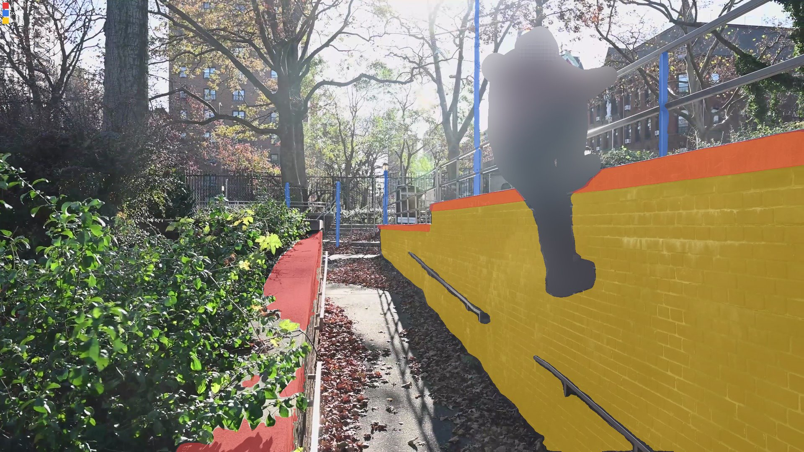
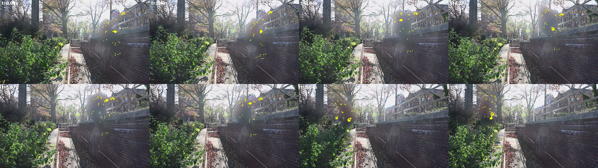
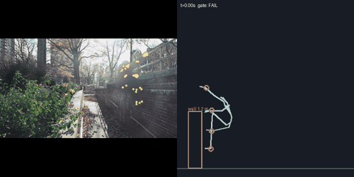

# Video ingest: cc-29-fixture-brick-wall

*Serves the Park beat and the Warped Wall: a filmed move becomes a measured move and a reusable recipe (CC-29). Run 2026-10-27.*

## So what
- **Result for the game:** a filmed `wall-run-and-grab` was measured, but it **failed the plausibility gate** (held_clips_are_held), so it is not shown and cannot be a starter clip.
- **Obstacle:** a `wall` about 1.2 m high (± 8 %), scale from body-height; the move is written as a recipe other obstacles can reuse.
- **Wall-run check (the one CC-17's text-only Kimodo clips failed 36 of 36):** passes ({'plant_m': 1.29, 'travel_m': 2.24, 'grip_frames': 81}); the clip failed the gate, so these numbers only show what was measured.
- **Recommendation:** use only the contact points as rough targets for Kimodo (they are measurements of where hands and feet went); do not play this motion back.
- **Next step:** feed the recipe's contact events to Kimodo as targets and run the move check on what it makes; re-film or re-cut if the gate failure is a measurement problem (camera moves, scale).

## Source
- **Video:** [Climb up and drop down a wall (CC-26 fixture, Pexels licence, NOT an ingest result)](https://www.pexels.com/video/a-man-jumping-off-the-wall-6002059/) by Mary Taylor
- **Licence:** Pexels License
- **Range:** 0-10 s, fetched 2026-10-27
- **Kept outside git:** the video and frames (`../conquercourse-assets/`, with `SHA256SUMS`)

## Safety
- **Adult check:** passed: `{"all_adults": "yes", "children_seen": false, "people": 1, "reasons": ["Description says 'A man jumping off the wall'", "Jumper's size vs wall and railing looks adult", "Only one person visible in all frames"]}`
- **Faces:** pixelated before any other model saw a frame; kept pictures also blur the person

## Pictures
- 
- 
-   (passing and failing moves both get a GIF)

## Gate
- **Verdict:** FAIL (failed: held_clips_are_held)
- Rules and numbers: `gate.json`

## Obstacles found (SAM 3.1)
- `wall-1` from "wall" (score 0.8476190567016602): sizes {"height": 1.242, "width": 2.0, "thickness": 0.3}; scale body-height, size uncertainty {"height": 0.078, "thickness": 0.5}; oblique view: the horizontal sizes are typical values, only the height is measured; width 2.0 m is a typical value (not visible in a side view)
- `platform-1` from "ledge" (score 0.8241757750511169): sizes {"length": 2.0, "width": 2.0, "height": 1.163}; scale body-height, size uncertainty {"length": 0.5, "height": 0.078}; oblique view: the horizontal sizes are typical values, only the height is measured; width 2.0 m is a typical value (not visible in a side view)
- `platform-2` from "ledge" (score 0.6521739363670349): sizes {"length": 2.0, "width": 2.0, "height": 1.251}; scale body-height, size uncertainty {"length": 0.5, "height": 0.078}; oblique view: the horizontal sizes are typical values, only the height is measured; width 2.0 m is a typical value (not visible in a side view)
- `platform-3` from "ledge" (score 0.5311355590820312): sizes {"length": 2.0, "width": 2.0, "height": 0.533}; scale body-height, size uncertainty {"length": 0.5, "height": 0.079}; oblique view: the horizontal sizes are typical values, only the height is measured; width 2.0 m is a typical value (not visible in a side view)

## Move recipe (`recipe.json`)
- **Move:** `wall-run-and-grab`; phases: plant 0.0-0.5 s, grip 0.0-0.167 s, hang-or-pull 0.167-9.977 s, release 9.977-9.977 s
- **Timing:** {"duration_s": 9.977, "peak_hip_speed_mps": 2.24, "speed_at_plant_mps": 0.14, "plant_to_grip_s": 0.0, "held_by_hands_s": 9.977, "longest_flight_s": 1.235}
- **Reach:** {"highest_hand_m": 2.26, "grip_height_frac": 1.82}
- **Measured vs guess:** phases: measured (from contacts of the gated 30-joint motion); contactEvents: measured times; heights measured in metres with the body model's weak vertical scale; timing: measured on the clip's own clock; athlete: measured; reach: measured; obstacle.sizes: estimated: athlete 578 px tall taken as 1.75 m (adult range 1.6-1.9 m); obstacle assumed at the athlete's depth; transfer: guess: rules by obstacle type, not tested in the simulator
- Could transfer to `ramp` (guess): swap the flat face for a curve: the plant moves higher and the run-up speed becomes the lesson
- Could transfer to `platform` (guess): as a climb onto a high deck: grab the edge, pull up
- Could transfer to `wall` (guess): a wall of another height: scale contact heights by the height ratio

## Cost (actual)
- **Modal L4:** 0 container seconds, about $0.0
- **SAM 3.1:** 30 images, about $0.075
- **Meta vision:** about $0.022
- **Expected before the run:** {"frames": 300, "gpu_container_seconds": 1200, "gpu_minutes": 20.0, "sam31_images": 30, "usd": {"modal_l4": 0.266, "sam31": 0.075, "meta_vision": 0.06}, "usd_total": 0.401}

## Files
- `inputs/source.json`, `inputs/adult_check.json`; `outputs/` (SAM 3.1 responses); `motion.json`, `contacts.json`, `gate.json`, `primitives.json`, `recipe.json`, `run.json`
