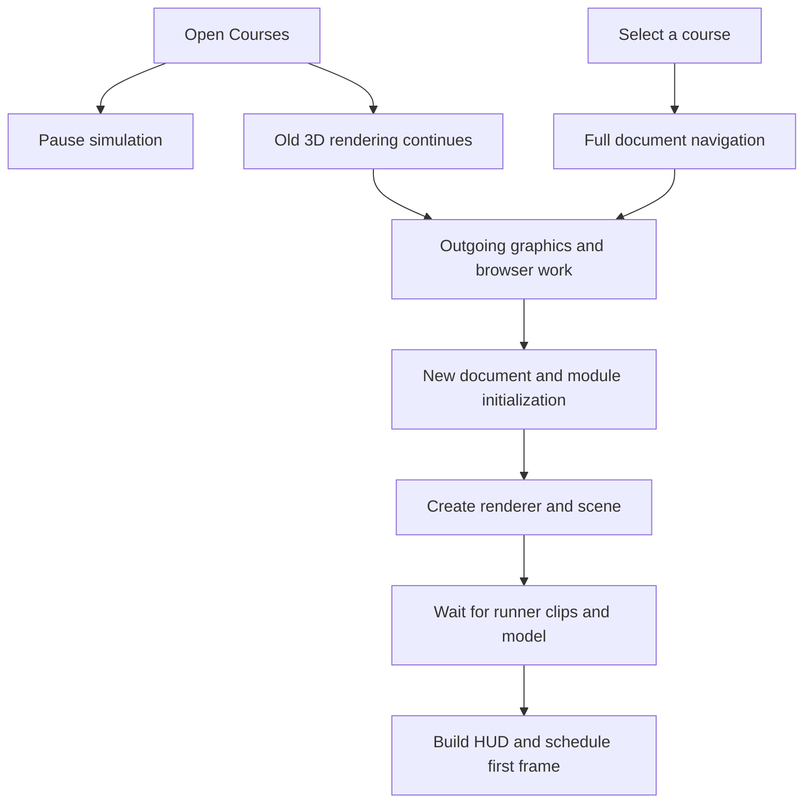

# Course loading investigation — 2026-11-04

Selecting a course rebuilds the entire game document and graphics runtime.
In this controlled software-rendering environment, switching courses was far slower than opening the first course in a fresh browser context.
The laptop was also overloaded when the investigation began.
No game-code fix was applied or deployed.

## Measured results

| Navigation | Vite development server | Optimized production build | Production build with VM-only menu render guard |
| --- | ---: | ---: | ---: |
| First Course, fresh browser context | 5.51 s | 1.59 s | 1.74 s |
| Courses → Training | 21.96 s | 19.69 s | 15.33 s |
| Courses → Montmartre | 17.41 s | 18.65 s | 11.86 s |
| Courses → Training again | 21.54 s | 19.35 s | Not measured |

- Training and Montmartre started zero simulator searches on entry; the saved plans were reused.
- The built server returned HTML in about 7–20 ms during the observed switches.
- The dominant gap was after the document response and before the new document's scripts began, rather than inside course JSON fetching or the simulator.
- Pausing RAF after the menu opened still left 15–17 s transitions.
- A control that paused RAF and requested WebGL context loss spent 18.53 s in the browser roundtrip, then loaded Training in 1.69 s.
- That control moves the wait before the click; it does not establish an overall speedup.
- The roundtrip includes queued browser/main-thread work, so it cannot isolate the native context-loss call itself.
- An early guard inside the actual gallery event handler reduced the observed delays but still left 12–15 s switches.
- A storage-neutral control reproduced long switches, so the harness's initial localStorage write does not explain the stall.
- These results strongly implicate the outgoing graphics/browser lifecycle associated with full-page navigation; they do not prove that one particular browser cleanup function is responsible.

## Source findings

- [world-picker.ts](../../../src/ui/world-picker.ts): choosing a card assigns `location.href`; there is no in-place course switch.
- [course.ts](../../../src/modes/course.ts): the gallery event pauses physics, while the animation loop still updates and draws the scene underneath the modal.
- [course.ts](../../../src/modes/course.ts): `await wear.start()` precedes HUD creation and the first scheduled frame.
- [actor.ts](../../../src/render/actor.ts): four motion files load together, followed by reach, roll, slide, hurt, climb and vault sequentially, followed by the Rookie GLB.
- Those ten motion files plus the default GLB total about 2.17 MB uncompressed; the observed runner wait was roughly 0.2–0.4 s on the local VM servers.
- [main.ts](../../../src/main.ts): Course is imported eagerly before choosing a mode.
- The cold Vite run completed 249 resources and transferred about 10.5 MB before the measured first frame; the built run completed 88 resources and transferred about 1.86 MB.
- The first render itself cost roughly 0.7–1.1 s under SwiftShader; the cold CPU profile includes shader completion, material-node building and texture upload.
- The ready dataset is published before the first rendered frame, so it is an insufficient standalone measure of visible readiness.

## Laptop contention

- At the initial sample, the laptop had 16 logical CPUs, a 1-minute load average of 35.92, about 1.6 GiB swap in use and approximately 1% CPU idle.
- Concurrent ffmpeg, headless Chromium and Node jobs were active.
- A small local HTML request took 1.23 s in one sample and about 0.03–0.04 s in the next two, demonstrating variable local responsiveness.
- Later, load fell below 10 and available memory increased to about 4 GiB; the initial figures are a snapshot, not a permanent hardware condition.
- No other agent's jobs were stopped or modified.

## Recommended implementation order

1. Move heavy captures, encoding and full tests off the laptop to the existing VM workers.
2. Add a proper course-switch lifecycle: cancel old loops and workers, release old scene data, and reuse the graphics renderer across course selections.
3. Cache parsed motion data and shared character assets; parallelize independent optional clip fetches.
4. Draw a usable initial scene and loading state before waiting for every optional character asset.
5. Benchmark cold and warm navigation on the user's actual hardware and published build before claiming a latency target.

Stopping rendering while Courses is open is useful, but the prototype shows that this alone is not a complete fix.
Explicitly losing the context is also not a complete fix; it can simply move the stall earlier.

## Reproduction and limits

- The source commit, environment, all six variants and summarized numbers are in [run.json](run.json).
- Use [instrument.py](instrument.py) only in a disposable copy of that source commit to add timing marks.
- Serve that copy with Vite, then run `PORT=5398 OUT=profile-dev node profile.mjs`.
- Build and preview the same copy, then run `PORT=5399 OUT=profile-built node profile.mjs`.
- [gallery-guard-prototype.py](gallery-guard-prototype.py) applies the early render-pause ablation in that disposable copy; rebuild before measuring it.
- `PAUSE_OLD=1` in the harness is the separate, late RAF-pause control.
- Raw network timings and CPU profiles are kept outside Git under the shared assets `eval-full/course-loading-2026-11-04/` folder.
- Each variant has one sequence; results are not median or p95 estimates.
- Chromium used software WebGL rendering on a VM. Absolute GPU times cannot be transferred to the user's physical GPU.
- The production build was served locally on the VM; this was not an end-to-end CDN benchmark of the deployed site.
