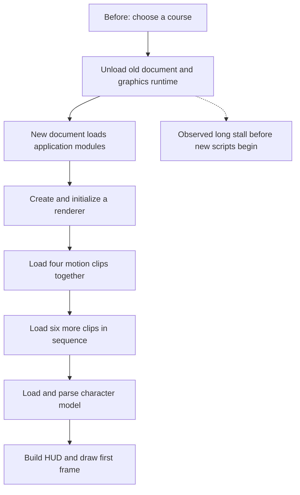
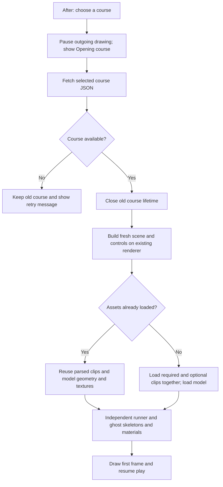
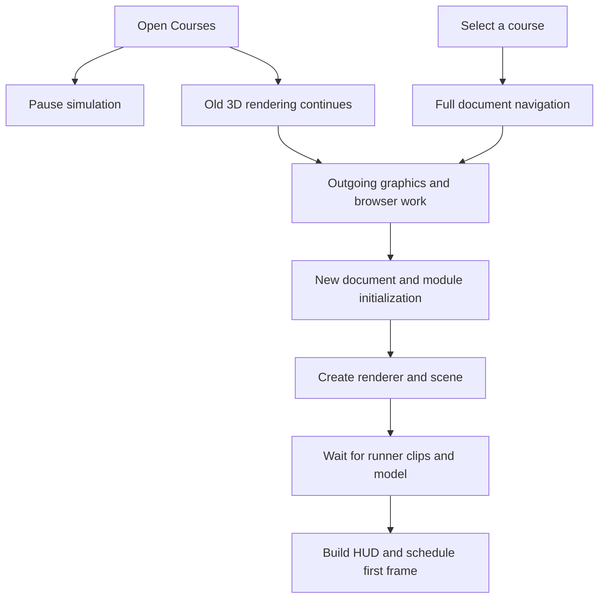

# Course loading investigation — 2026-11-04

Course selections now reuse the document, renderer, default character models and parsed motion clips.
Each selection creates a fresh course session and disposes the previous session's controls, timers, workers, HUD and scene resources.
The improvement applies to Vite, preview builds and production builds once this code is deployed.
No deployment is part of this change.

## What changed and what still blocks

- **Removed from ordinary course switches:** document unload, application reload, renderer initialization and repeated default model/clip loading.
- **Still required:** fetching the course JSON, building its scene, cloning character skeletons/materials, and drawing its first frame.
- New scene materials can still need shader compilation; a first visit still initializes the renderer and loads assets.
- The gallery pauses scene updates and rendering, rather than only pausing physics.
- Browser Back/Forward selects the corresponding course without replacing the renderer.
- Failed course fetches leave the existing course available; a construction failure falls back to reloading the selected URL.
- Other modes and special film/effects/trail/automatic-clip/explicit-touch pages continue to use document navigation.
- `?courseswitch=0` opts out of in-place switching and is retained on subsequent gallery selections.
- Default model templates share geometry and textures; player and ghost skeletons and materials remain independent.
- Custom character models keep their existing loading path; this change does not cache arbitrary custom URLs.
- The course lifetime aborts input handlers, cancels RAF and timers, disconnects observers, rejects search callers, terminates workers, removes course DOM and releases owned GPU resources.
- Shared app chrome and keyed style sheets remain; asynchronous character/photo/challenge callbacks check that their course is still alive.

## Verification method

- [reuse-browser.mjs](reuse-browser.mjs) exercises First Course → Training → Montmartre → Training, then Back/Forward, keyboard run/restart, a failed JSON request and a successful retry.
- It asserts document/canvas identity and exactly one course HUD after repeated switches, and records event listener counts and model/motion request totals.
- Its switch metric runs from immediately before the gallery card click to the end of the first application render callback.
- Baseline navigation timings below start at navigation rather than before the click; the new measurement includes click dispatch overhead.
- Run on an idle worker against both `npm run dev -- --port 5399` and `npm run build` followed by `npm exec vite preview -- --port 5399`.
- Example: `PORT=5399 OUT=reuse-output node data/eval/course-loading/reuse-browser.mjs`.
- The browser uses real local course and character assets, not model-call stand-ins.
- Unit coverage checks asset coalescing/retry, independent skeletons/materials, retained shared geometry, removed input/timer handlers, and settlement of searches whose workers never answer.

## Results after renderer and asset reuse

| Course switch | Vite before | Vite after | Optimized build before | Optimized build after |
| --- | ---: | ---: | ---: | ---: |
| First Course → Training | 21.96 s | **1.20 s** | 19.69 s | **1.60 s** |
| Training → Montmartre | 17.41 s | **4.13 s** | 18.65 s | **4.10 s** |
| Montmartre → Training | 21.54 s | **9.55 s** | 19.35 s | **10.73 s** |

- Both browser sequences passed Back/Forward, run/restart, failed-fetch recovery and retry, with no page errors.
- The same document token and canvas survived every switch; exactly one course HUD remained.
- Motion/model requests stayed at **11 total** across every switch: ten motion files and one Rookie GLB, with no repeated requests from the player or ghosts.
- Window key listeners stayed at **8 keydown and 2 keyup**, rather than growing per course.
- All measured courses reused their stored plans and started zero clearance searches.
- The repeated transition after Montmartre remains slow on SwiftShader; this change does not remove new scene construction and graphics work.
- These are one-sequence diagnostic observations on a software renderer, not latency guarantees or hardware-GPU measurements.
- The new cold harness wall time includes protocol calls after the first frame and is deliberately not compared with the baseline cold first-frame mark.
- The Vite server was warm from a prior regression run; neither column is a CDN measurement.
- [Evidence: real UI after switching and retry](../../../docs/evidence/course-runtime-reuse-1280.png).

## Baseline measured results

| Navigation | Vite development server | Optimized production build | Production build with VM-only menu render guard |
| --- | ---: | ---: | ---: |
| First Course, fresh browser context | 5.51 s | 1.59 s | 1.74 s |
| Courses → Training | 21.96 s | 19.69 s | 15.33 s |
| Courses → Montmartre | 17.41 s | 18.65 s | 11.86 s |
| Courses → Training again | 21.54 s | 19.35 s | Not measured |

- Training and Montmartre started zero simulator searches on entry; the saved plans were reused.
- The built server returned HTML in about 7–20 ms during the observed switches.
- The dominant gap was after the document response and before the new document's scripts began, rather than inside course JSON fetching or the simulator.
- Pausing RAF after the menu opened still left 15–17 s transitions.
- A control that paused RAF and requested WebGL context loss spent 18.53 s in the browser roundtrip, then loaded Training in 1.69 s.
- That control moves the wait before the click; it does not establish an overall speedup.
- The roundtrip includes queued browser/main-thread work, so it cannot isolate the native context-loss call itself.
- An early guard inside the actual gallery event handler reduced the observed delays but still left 12–15 s switches.
- A storage-neutral control reproduced long switches, so the harness's initial localStorage write does not explain the stall.
- These results strongly implicate the outgoing graphics/browser lifecycle associated with full-page navigation; they do not prove that one particular browser cleanup function is responsible.

## Baseline source findings

- [world-picker.ts](../../../src/ui/world-picker.ts): choosing a card assigns `location.href`; there is no in-place course switch.
- [course.ts](../../../src/modes/course.ts): the gallery event pauses physics, while the animation loop still updates and draws the scene underneath the modal.
- [course.ts](../../../src/modes/course.ts): `await wear.start()` precedes HUD creation and the first scheduled frame.
- [actor.ts](../../../src/render/actor.ts): four motion files load together, followed by reach, roll, slide, hurt, climb and vault sequentially, followed by the Rookie GLB.
- Those ten motion files plus the default GLB total about 2.17 MB uncompressed; the observed runner wait was roughly 0.2–0.4 s on the local VM servers.
- [main.ts](../../../src/main.ts): Course is imported eagerly before choosing a mode.
- The cold Vite run completed 249 resources and transferred about 10.5 MB before the measured first frame; the built run completed 88 resources and transferred about 1.86 MB.
- The first render itself cost roughly 0.7–1.1 s under SwiftShader; the cold CPU profile includes shader completion, material-node building and texture upload.
- The ready dataset is published before the first rendered frame, so it is an insufficient standalone measure of visible readiness.

## Laptop contention

- At the initial sample, the laptop had 16 logical CPUs, a 1-minute load average of 35.92, about 1.6 GiB swap in use and approximately 1% CPU idle.
- Concurrent ffmpeg, headless Chromium and Node jobs were active.
- A small local HTML request took 1.23 s in one sample and about 0.03–0.04 s in the next two, demonstrating variable local responsiveness.
- Later, load fell below 10 and available memory increased to about 4 GiB; the initial figures are a snapshot, not a permanent hardware condition.
- No other agent's jobs were stopped or modified.

## Follow-up order

1. **Done:** move heavy captures and full tests to the existing VM.
2. **Done:** reuse the renderer with a disposable course lifecycle.
3. **Done:** cache parsed motion/default models and parallelize clip requests.
4. Next: profile the remaining scene construction and graphics work, especially the return from Montmartre.
5. Measure on the user's physical GPU and the published preview before setting a latency target.
6. Consider an earlier usable cold-start scene; first entry still waits for the player's character assets.

Stopping rendering while Courses is open is useful, but the prototype shows that this alone is not a complete fix.
Explicitly losing the context is also not a complete fix; it can simply move the stall earlier.

## Reproduction and limits

- The source commit, environment, all six variants and summarized numbers are in [run.json](run.json).
- Use [instrument.py](instrument.py) only in a disposable copy of that source commit to add timing marks.
- Serve that copy with Vite, then run `PORT=5398 OUT=profile-dev node profile.mjs`.
- Build and preview the same copy, then run `PORT=5399 OUT=profile-built node profile.mjs`.
- [gallery-guard-prototype.py](gallery-guard-prototype.py) applies the early render-pause ablation in that disposable copy; rebuild before measuring it.
- `PAUSE_OLD=1` in the harness is the separate, late RAF-pause control.
- Raw baseline profiles and new browser records are kept outside Git under the shared assets `eval-full/course-loading-2026-11-04/` folder.
- Each variant has one sequence; results are not median or p95 estimates.
- Chromium used software WebGL rendering on a VM. Absolute GPU times cannot be transferred to the user's physical GPU.
- The production build was served locally on the VM; this was not an end-to-end CDN benchmark of the deployed site.
