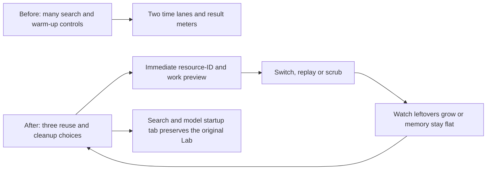

# Hide the wait: reuse or rebuild

- **Outcome:** the Lab teaches course switching through choices and visible resource ownership, with the original search/model-startup experiment still available.
- **Place:** Foundations → Search and learn → Hide the wait.
- **Goal:** remove repeated work without leaving the outgoing course alive.
- **Dependency:** the real renderer-reuse investigation and fix in [course loading](../course-loading/README.md).

## Before and after

## Method and results

- The default preview reuses renderer and asset identities, replaces course-specific resources and closes the outgoing course.
- The model gives that switch **9 work units**, compared with **31** when rebuilding everything with cleanup.
- Twenty clean switches keep active resources at **26 units**, with no leftovers.
- Three unclean switches retain **18 leftover units**, even when the renderer and assets are reused.
- Turning cleanup back on stops new leftovers; Reset clears those abandoned earlier.
- These are illustrative work/resource units, not browser latency or measured memory in MB.
- An active search is assumed in this teaching scene; the real game only starts a worker when needed.
- Playback length follows illustrative work units; reduced-motion users see the completed state immediately.
- Real VM timing observations remain clearly separated in the optional game-connection details.
- Results are produced by the actual model code, with no model API or fake network responses.

## Reproduce

- `node --import tsx data/eval/lab-wait-reuse/record.mjs` regenerates [run.json](run.json).
- `npx vitest run tests/lab-wait-reuse.test.ts tests/lab-wait.test.ts` checks conservation, ownership, repeated switches and the original scheduler.
- `PORT=5411 WEBGL2=1 node scripts/lab-wait-check.mjs` checks the real desktop page and captures screenshots.
- [Default interactive view](../../../docs/evidence/lab-wait-reuse.png).
- [Leftovers and replay](../../../docs/evidence/lab-wait-reuse-leftovers.png).
- Full verification runs on the existing VM; raw screenshots and logs stay outside Git in the shared assets `eval-full/lab-wait-reuse-2026-11-05/` folder.

## Verification

- Five model-invariant tests passed, including every policy and repeated switches.
- All 29 real-browser checks passed at desktop width, including keyboard choices, reduced-motion playback, the original experiment and the feature opt-out.
- TypeScript and the production build passed.
- The full suite ran 3,175 passing tests, 9 expected failures and 4 skips, with one existing welcome-screen URL-access policy failure.
- Replaced that raw URL read with the shared helper; all 29 focused policy/welcome/model checks passed on rerun.
- The new lesson never deliberately freezes the page or leaves real event handlers or workers behind.
