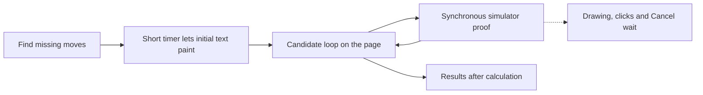
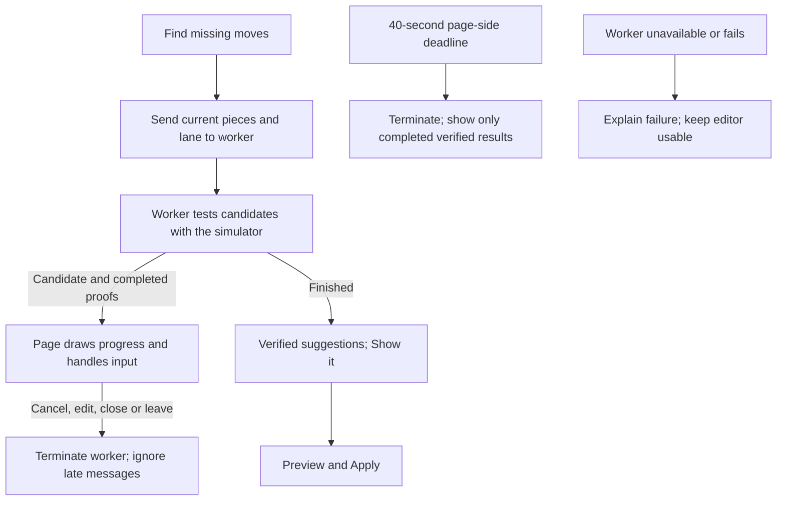

# Missing-move search: keep editing while physics runs

- The editor stays usable while **Find ways to add the missing moves** tests object roles with real game physics.
- Progress names the proposed change, counts candidates and verified suggestions, and shows elapsed time.
- Progress and Cancel appear immediately below the Moves title; starting a search scrolls them into view.
- No course changes until the player reviews a suggestion with Show it, then uses Preview and Apply.

## Dependencies and method

- Existing role candidates, course builder and `searchIdealRun` supply the same physics and candidate order.
- The initial CC-133 fix moved the calculation into `src/sim/roles-worker.ts`.
- This follow-up reuses that worker and its `roles-job.ts` protocol; it removes the blocking fallback and completes cancellation, failure handling and the time limit.
- A real two-box wall fixture is stored by [the browser check](../../../scripts/missing-moves-check.mjs).
- Chromium runs at 1280 × 900 with WebGL2 through SwiftShader on the existing 8-vCPU, 32-GB test worker.
- No model calls, new VM or mocked simulator are involved in the browser check.

## Before: the page waits for physics

- A timer delays the start; it does not move the simulation off the page thread.
- Checking the budget only between candidates cannot stop a single expensive proof.
- The initial worker fix removed the normal blocking path, but retained synchronous fallback when worker creation failed.
- Old searches also needed cancellation on lane edits, closing the panel and leaving the editor.

## After: the page controls a disposable worker

- One worker owns one search; completion, cancellation, failure and deadline all terminate it.
- The page remains free even if an individual proof runs for a long time.
- Editing geometry or lane settings invalidates the old search before it can publish stale suggestions.
- Native worker structured cloning preserves geometry arrays without a JSON conversion.
- A time limit means incomplete search, not an impossible course; only simulator-verified partial results are retained.
- Candidate progress is a count of work attempted, not a prediction of seconds remaining.

## Results and limits

- [Recorded browser results](run.json) include a page heartbeat during real physics, cancellation latency, worker termination, closing Moves, lane edits and stale-result rejection.
- [Visible search progress](../../../docs/evidence/missing-moves-search.png).
- The focused suite checks worker errors, startup/clone failure, hard deadline and late messages, plus equality between the worker job and the existing search.
- Physics cost is unchanged: this fix improves responsiveness and control, not the search algorithm.
- A deadline can stop a nearly finished proof; its unfinished candidate is not presented as verified.
- Lesson: test cancellation while the expensive operation is still running, and inspect the screenshot; a progress element can exist yet be outside the visible scroll area.
