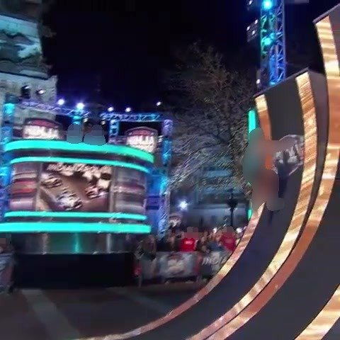
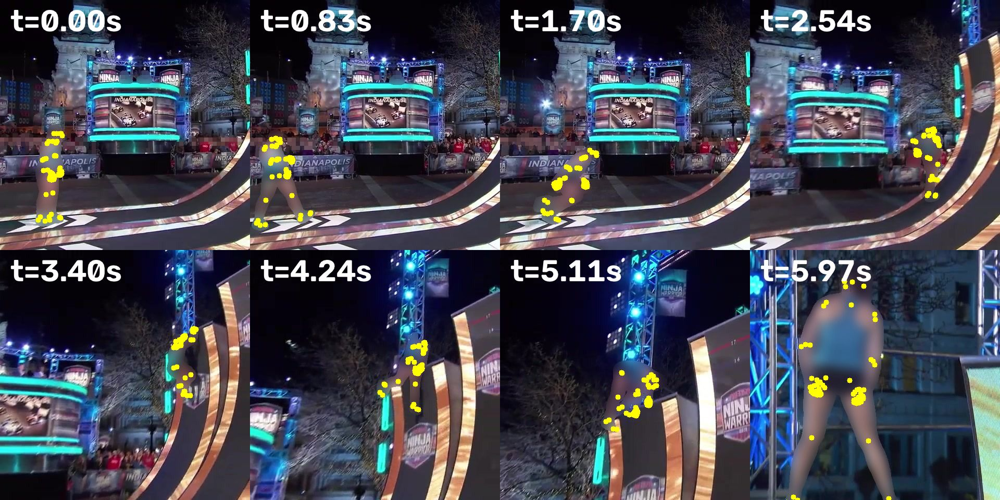
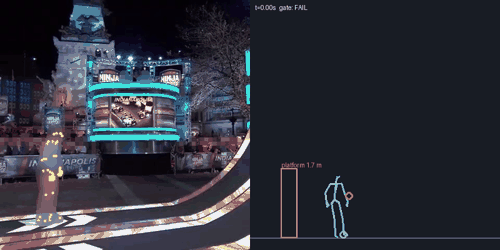

# Video ingest: muan-warped-wall

*Serves the Park beat and the Warped Wall: a filmed move becomes a measured move and a reusable recipe (CC-29). Run 2026-10-27.*

## So what
- **Result for the game:** a filmed `wall-run-and-grab` was measured, but it **failed the plausibility gate** (held_clips_are_held), so it is not shown and cannot be a starter clip.
- **Obstacle:** a `platform` about 1.7 m high (± 8 %), scale from body-height; the move is written as a recipe other obstacles can reuse.
- **Wall-run check (the one CC-17's text-only Kimodo clips failed 36 of 36):** does not pass ({'plant_m': 0.91, 'travel_m': 3.7, 'grip_frames': 4}); the clip failed the gate, so these numbers only show what was measured.
- **Recommendation:** use only the contact points as rough targets for Kimodo (they are measurements of where hands and feet went); do not play this motion back.
- **Next step:** feed the recipe's contact events to Kimodo as targets and run the move check on what it makes; re-film or re-cut if the gate failure is a measurement problem (camera moves, scale).

## Source
- **Video:** [Amazing American Ninja Warrior Nation](https://www.youtube.com/watch?v=7soV521Xk1A) by Andrew Muan
- **Licence:** Creative Commons Attribution license (reuse allowed)
- **Range:** 149.0-155.0 s, fetched 2026-10-27
- **Kept outside git:** the video and frames (`../conquercourse-assets/`, with `SHA256SUMS`)

## Safety
- **Adult check:** passed: `{"all_adults": "yes", "children_seen": false, "people": 1, "reasons": ["Mature athletic female build on warped wall", "American Ninja Warrior Indianapolis adult course", "Adult proportion to large equipment", "Crowd blurred with no identifiable child"]}`
- **Faces:** pixelated before any other model saw a frame; kept pictures also blur the person

## Pictures
- 
- 
-   (passing and failing moves both get a GIF)

## Gate
- **Verdict:** FAIL (failed: held_clips_are_held)
- Rules and numbers: `gate.json`

## Obstacles found (SAM 3.1)
- `platform-1` from "platform" (score 0.6559139490127563): sizes {"length": 4.465, "width": 2.0, "height": 1.688}; scale body-height, size uncertainty {"length": 0.079, "height": 0.08}; width 2.0 m is a typical value (not visible in a side view)
- `bar-1` from "pole" (score 0.6521739363670349): sizes {"height": 1.823, "length": 4.465, "diameter": 0.04, "orientation": "across"}; scale body-height, size uncertainty {"height": 0.079, "length": 0.079}; diameter is a typical value
- `bar-2` from "pole" (score 0.5276752710342407): sizes {"height": 2.262, "length": 3.589, "diameter": 0.04, "orientation": "across"}; scale body-height, size uncertainty {"height": 0.079, "length": 0.079}; diameter is a typical value

## Move recipe (`recipe.json`)
- **Move:** `wall-run-and-grab`; phases: plant 4.404-4.404 s, grip 4.505-4.705 s, release 4.705-4.771 s
- **Timing:** {"duration_s": 5.973, "peak_hip_speed_mps": 10.26, "speed_at_plant_mps": 1.66, "plant_to_grip_s": 0.101, "held_by_hands_s": 0.2, "longest_flight_s": 2.636}
- **Reach:** {"highest_hand_m": 2.763, "grip_height_frac": 1.637}
- **Measured vs guess:** phases: measured (from contacts of the gated 30-joint motion); contactEvents: measured times; heights measured in metres with the body model's weak vertical scale; timing: measured on the clip's own clock; athlete: measured; reach: measured; obstacle.sizes: estimated: athlete 188 px tall taken as 1.75 m (adult range 1.6-1.9 m); obstacle assumed at the athlete's depth; transfer: guess: rules by obstacle type, not tested in the simulator
- Could transfer to `wall` (guess): a step-up becomes a vault or climb when the top is higher than the hips
- Could transfer to `platform` (guess): another deck height: scale the take-off and landing heights

## Cost (actual)
- **Modal L4:** 565.4227766990662 container seconds, about $0.126
- **SAM 3.1:** 30 images, about $0.075
- **Meta vision:** about $0.0056
- **Expected before the run:** {"frames": 180, "gpu_container_seconds": 780, "gpu_minutes": 13.0, "sam31_images": 30, "usd": {"modal_l4": 0.173, "sam31": 0.075, "meta_vision": 0.06}, "usd_total": 0.308}

## Files
- `inputs/source.json`, `inputs/adult_check.json`; `outputs/` (SAM 3.1 responses); `motion.json`, `contacts.json`, `gate.json`, `primitives.json`, `recipe.json`, `run.json`
