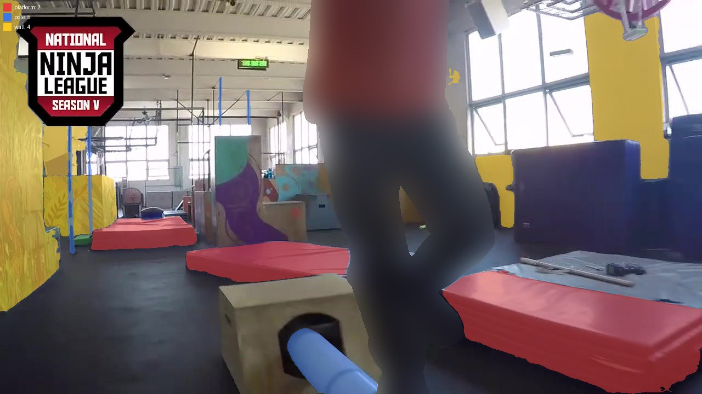
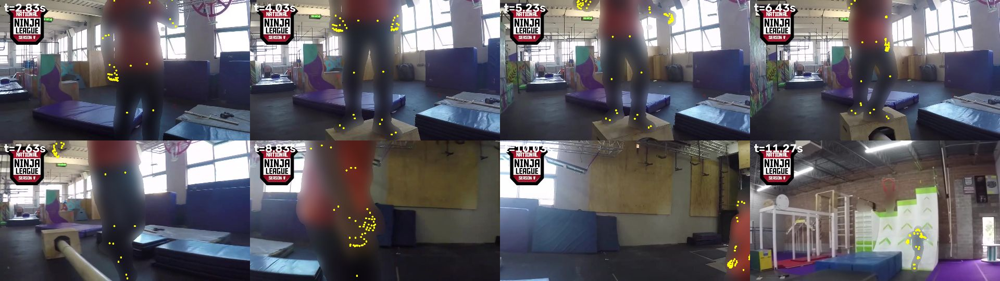
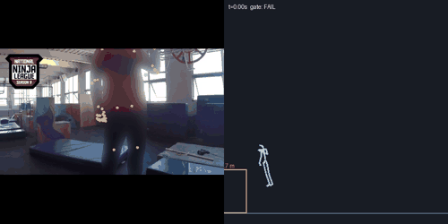

# Video ingest: wnl-new-wall-rules

*Serves the Park beat and the Warped Wall: a filmed move becomes a measured move and a reusable recipe (CC-29). Run 2026-10-27.*

## So what
- **Result for the game:** a filmed `wall-run-and-grab` was measured, but it **failed the plausibility gate** (held_clips_are_held, no_teleport), so it is not shown and cannot be a starter clip.
- **Obstacle:** a `wall` about 1.7 m high (± 8 %), scale from body-height; the move is written as a recipe other obstacles can reuse.
- **Wall-run check (the one CC-17's text-only Kimodo clips failed 36 of 36):** passes ({'plant_m': 1.49, 'travel_m': 6.4, 'grip_frames': 11}); the clip failed the gate, so these numbers only show what was measured.
- **Recommendation:** use only the contact points as rough targets for Kimodo (they are measurements of where hands and feet went); do not play this motion back.
- **Next step:** feed the recipe's contact events to Kimodo as targets and run the move check on what it makes; re-film or re-cut if the gate failure is a measurement problem (camera moves, scale).

## Source
- **Video:** [New Warped Wall Rules](https://www.youtube.com/watch?v=hb5IOXSxqt0) by World Ninja League
- **Licence:** Creative Commons Attribution license (reuse allowed)
- **Range:** 0.0-38.0 s, fetched 2026-10-27
- **Kept outside git:** the video and frames (`../conquercourse-assets/`, with `SHA256SUMS`)

## Safety
- **Adult check:** passed: `{"all_adults": "yes", "children_seen": false, "people": 5, "reasons": ["adult body size and proportions relative to large warped walls", "full-size professional ninja gym equipment and course scale", "adult athletic clothing", "National Ninja League Season V adult competition context"]}`
- **Faces:** pixelated before any other model saw a frame; kept pictures also blur the person

## Pictures
- 
- 
-   (passing and failing moves both get a GIF)

## Gate
- **Verdict:** FAIL (failed: held_clips_are_held, no_teleport)
- Rules and numbers: `gate.json`

## Obstacles found (SAM 3.1)
- `wall-1` from "wall" (score 0.7852349281311035): sizes {"height": 1.709, "width": 2.0, "thickness": 3.135}; scale body-height, size uncertainty {"height": 0.078, "thickness": 0.078}; width 2.0 m is a typical value (not visible in a side view)
- `platform-1` from "platform" (score 0.7229437232017517): sizes {"length": 0.563, "width": 2.0, "height": 0.773}; scale body-height, size uncertainty {"length": 0.079, "height": 0.079}; width 2.0 m is a typical value (not visible in a side view)
- `platform-2` from "platform" (score 0.7104072570800781): sizes {"length": 2.742, "width": 2.0, "height": 0.636}; scale body-height, size uncertainty {"length": 0.078, "height": 0.079}; width 2.0 m is a typical value (not visible in a side view)
- `bar-1` from "pole" (score 0.6831682920455933): sizes {"height": 0.459, "length": 0.925, "diameter": 0.04, "orientation": "across"}; scale body-height, size uncertainty {"height": 0.079, "length": 0.078}; diameter is a typical value
- `wall-2` from "wall" (score 0.6831682920455933): sizes {"height": 1.756, "width": 2.0, "thickness": 0.522}; scale body-height, size uncertainty {"height": 0.078, "thickness": 0.079}; width 2.0 m is a typical value (not visible in a side view)
- `platform-3` from "platform" (score 0.6604774594306946): sizes {"length": 1.289, "width": 2.0, "height": 0.265}; scale body-height, size uncertainty {"length": 0.078, "height": 0.081}; width 2.0 m is a typical value (not visible in a side view)
- `bar-2` from "pole" (score 0.6604774594306946): sizes {"height": 0.003, "length": 0.478, "diameter": 0.04, "orientation": "along"}; scale body-height, size uncertainty {"height": 2.002, "length": 0.079}; diameter is a typical value
- `wall-3` from "wall" (score 0.6559139490127563): sizes {"height": 1.925, "width": 2.0, "thickness": 0.318}; scale body-height, size uncertainty {"height": 0.078, "thickness": 0.08}; width 2.0 m is a typical value (not visible in a side view)
- `bar-3` from "pole" (score 0.6097560524940491): sizes {"height": 0.662, "length": 0.852, "diameter": 0.04, "orientation": "across"}; scale body-height, size uncertainty {"height": 0.079, "length": 0.078}; diameter is a typical value

## Move recipe (`recipe.json`)
- **Move:** `wall-run-and-grab`; phases: run-up 2.833-2.933 s, plant 2.967-6.433 s, grip 2.967-6.0 s, hang-or-pull 6.0-7.3 s, release 7.3-7.367 s
- **Timing:** {"duration_s": 8.433, "peak_hip_speed_mps": 16.14, "approach_speed_mps": 0.13, "run_up_s": 0.1, "speed_at_plant_mps": 0.25, "plant_to_grip_s": 0.0, "held_by_hands_s": 4.333, "longest_flight_s": 2.8}
- **Reach:** {"highest_hand_m": 2.985, "grip_height_frac": 1.747}
- **Measured vs guess:** phases: measured (from contacts of the gated 30-joint motion); contactEvents: measured times; heights measured in metres with the body model's weak vertical scale; timing: measured on the clip's own clock; athlete: measured; reach: measured; obstacle.sizes: estimated: athlete 600 px tall taken as 1.75 m (adult range 1.6-1.9 m); obstacle assumed at the athlete's depth; transfer: guess: rules by obstacle type, not tested in the simulator
- Could transfer to `ramp` (guess): swap the flat face for a curve: the plant moves higher and the run-up speed becomes the lesson
- Could transfer to `platform` (guess): as a climb onto a high deck: grab the edge, pull up
- Could transfer to `wall` (guess): a wall of another height: scale contact heights by the height ratio

## Cost (actual)
- **Modal L4:** 3107.01105427742 container seconds, about $0.69
- **SAM 3.1:** 30 images, about $0.075
- **Meta vision:** about $0.0116
- **Expected before the run:** {"frames": 1140, "gpu_container_seconds": 4140, "gpu_minutes": 69.0, "sam31_images": 30, "usd": {"modal_l4": 0.919, "sam31": 0.075, "meta_vision": 0.06}, "usd_total": 1.054}

## Files
- `inputs/source.json`, `inputs/adult_check.json`; `outputs/` (SAM 3.1 responses); `motion.json`, `contacts.json`, `gate.json`, `primitives.json`, `recipe.json`, `run.json`
