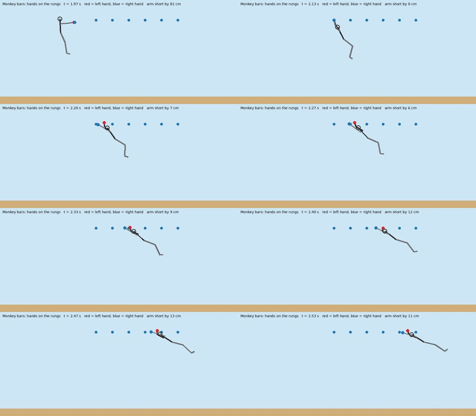

# Monkey bars: a row of rungs, hand over hand

- Serves the Course player who has learned the Lache and now wants a long hang; written for CC-133.
- Code: `src/sim/bars.ts`; tests: `tests/bars.test.ts`, `tests/bars-course.test.ts`.

## What the player does
- Hold E in the air near a rung: the hands close (same as a bar).
- Press Q (left hand) and T (right hand) to reach for the next rung.
- Left and right arrows are the kip, as in the Lache: they restart or build the swing.
- Let go of E to fly on with the swing.
- Nothing in the row makes you fall; only letting go of E does (or the hands opening at a swing the grip cannot hold, as on a bar).

## States
- `run`: not on the bars.
- `bars`: hanging from the hands, a pendulum about the point between the two hands.
- A stall is not a state: it is a reach that does nothing, and the player keeps hanging.

## Key map (new keys, and why)
- Q: left hand reaches (a fresh press only; holding it does nothing more).
- T: right hand reaches (a fresh press only).
- Both pressed on the same tick: neither hand reaches (a stall).
- Q and T were free; E, W, A, S, D, X, V, K, R, C, F, G, H, I, M, N, P are taken.
- In the replay mask they are two new bits, `reachL` and `reachR`, added after the old ones, so old recordings and hashes do not change.

## The rules (all in metres, seconds, 120 Hz)
- Both hands start on the same rung when the grab happens.
- The hands must alternate: the hand that reached last cannot reach again until the other has (wrong order is a stall).
- One pair of reaches moves the body one rung on.
- A hand reaches the next rung only when the swing is going forward (angle above 0 and speed forward, never backward).
- The shoulder is one arm length (0.7 m) down the body from the point between the hands.
- The straight arm reaches a circle of that radius about the shoulder, and the rung is at the height of the hands.
- That gives the reach: the rung must be between 0 and 2 x 0.7 x sin(angle) ahead of the point between the hands.
- So the gap a pair can cross is decided by how far the body swings, not by a timer.
- The most a rung may be ahead is 1.0 m in the editor (a 0.3 m rung needs about 12 degrees and a 1.0 m rung needs about 46 degrees at the first reach; the second reach of a pair is half as far).
- Rung spacing: 0.3 m to 1.0 m; default 0.6 m.
- Each reach costs swing: the swing speed keeps 0.93 of itself (the hand catch absorbs some).
- Swing damping: the same drag as a bar (0.04 per second).
- The kip is the only source of energy: the same pump as the Lache (6 rad/s squared, limited by the grip).
- The body is carried onto the new pivot over 8 ticks (a fifteenth of a second), as at a bar grab, so nothing jumps.

## What a stall looks like
- No swing, wrong order, or a gap too wide for the swing: the reach does nothing and nothing else changes.
- The player keeps hanging, kips with the arrows, and tries again.
- A test hangs for 20 seconds with every kind of stall and checks the runner is still on the bars.

## From a bar to the bars
- Hold E on a single bar, swing with the arrows, let go of E near the first rung, hold E again: the hands close on the rung.
- The regrab uses the same wide zone as the Lache pair (1.2 m along, 0.6 m up and down).
- A row of rungs over a lifted object works the same: the editor places the row over the object's top.

## Course data and the editor
- Course field `bars`: a list of rows `{ x, y, n, gap }` (first rung x, height, how many rungs, spacing).
- Editor piece "Monkey bars" (behind `?bars=1`; code `src/slice/bars-world.ts`, `src/modes/editor/tools/bars.ts`): rung count, spacing and height are sliders in the piece panel.
- Its src is `bars:<rungs>:<gap>`, so saving, copying and undo keep the knobs; `roleCourse` turns it into `course.bars` and `piecesFromSource` brings it back.
- "Fit to selected" (toolbar) lays a new row along the top of the chosen piece (a box, or an object lifted from a photo): its longer side, its top height, rungs and spacing to cover the length.
- In the piece panel, "Fit to the piece under it" does the same for a row already placed.
- "Bar then bars" puts a swing bar and a row after it (first rung 2.4 m on, same height): the pull-up bar to monkey bars flow.
- The panel says how to play it: hold E near the first rung, then Q and T.
- Turning: the piece bar's 15 degree buttons turn any piece, the swing bar and the row included; a row turned across the lane is ignored, like a plank.
- The piece is overhead scenery (`noGround`), so it never changes the ground lane.

## Tests (physics laws first)
- Energy never grows through a reach: the swing's energy after a reach is at most what it was before.
- Energy grows only with the kip, and not at all with the kip off.
- The reach follows the arm rule exactly: just inside works, just outside stalls.
- A stall never leaves the bars (every kind of stall, 20 seconds).
- Determinism: the same keys give the same state, bit for bit.
- Replay equals live: the recorded keys, packed into the mask and run again, end in the same place.
- Bar to bars: release near the first rung, hold E, and the hands close.
- A whole course clears with a recorded key list (`public/assets/demo/bars.run.json`).
- Swing bar to bars clears with a recorded key list (`public/assets/demo/swing-to-bars.run.json`, `tests/swing-to-bars.test.ts`).
- The editor piece: knobs in the src, not ground, found along the lane, course and save round trips, fit to an object, 15 degree turns (`tests/editor-bars.test.ts`).

## What is not done
- The ideal-run search (`src/sim/ideal.ts`) knows bars and ropes but not monkey bars, so the demo course is proved by a recorded run, not by the search.
- The arms pose for reaching hands comes later (`src/render/bars-pose.ts`); today the hang pose is drawn.

## How the body looks on the bars
- The actor hangs from the rungs with the procedural pose of `src/motion/bars-pose.ts` (hands pinned on the rungs, the shoulders one arm under them); the hook is `src/motion/bars-actor.ts`, called from the actor when the world is in the `bars` mode.
- Each hand takes about a tenth of a second to travel to its rung (the world moves it in one tick); quick keys can have both hands travelling at once.
- The legs lead the swing a little (the kip) and the knees draw up in a big forward swing.
- No switch (owner, 2026-11-03: the old hang was never shown); every other pose (vault, climb, bar, rope) is untouched.
- Picture (a side view of the pose's own skeleton on the demo run, stepped clock; not the game's look): [contact sheet](evidence/bars-pose-sheet.jpg), [clip](evidence/bars-pose.mp4).

