# The characters that ran backwards: a short story

- Written for a reader who is new to 3D.
- Short version: three of our eight made characters faced the wrong way, we fixed it, and then we learned to check in the view the player sees.
- Related: [user-made characters](ugc-fit.md), [lessons](lessons.md).

## The symptom
- Owner report (2026-11-01): 3 of the 8 starter characters ran backwards.
- They were Skater, Banana and Potato Blob.
- Their feet and joints looked wrong, because the skeleton pushed them one way and the skin faced the other.
- The other 5 looked fine.

## Why it happened
- Every character wears the same skeleton, the Rookie's.
- The skeleton has a front: its feet point along +z in its own frame.
- A made character is a 3D model with a skin of its own, and the skin has a front too.
- Nothing checked that the two fronts agree.
- The maker straightens a model by fitting the smallest box around it (`widest_side_yaw` in `pipelines/ccpipe/objbake.py`).
- A box has no front.
- It can say "the body lies along this line", but not which end is the face.
- So the turn it picks is right, or 180 degrees off.
- That is a one-in-two chance, for each character.
- The skeleton is fixed, so the skin has to be the one that moves.
- Words to know:
  - Skin: the surface you see.
  - Skeleton (rig): the bones that move the skin.
  - Yaw: a turn about the vertical axis, like turning on the spot.

## How we found it
- We did not guess from pictures.
- Step 1: the yaw table.
  - The maker records the yaw it picked for each character.
  - Skater 170.5, Banana 174.5 and Potato Blob 177.5 degrees: all close to a half turn.
  - The other five were 0 to 15 degrees.
- Step 2: the foot bones.
  - We took the dot product of each foot bone's forward direction and the run direction.
  - All eight gave 1.0, so the skeleton is not the problem.
- Step 3: the skin shoes.
  - A shoe reaches further in front of the shin than behind it.
  - We measured that reach on the skin: Skater -0.13, Banana -0.37, Potato Blob -0.36 as made; the five good ones were +0.21 to +0.41.
- The numbers (`data/eval/cc-chars-facing/facing.json`, shoe-reach score alone, positive means faces forward):

| Character | Maker yaw | Score as made | Verdict | Turned |
|---|---|---|---|---|
| Fox | small | +0.41 | forward | no |
| Skater | 170.5 | -0.13 | back | yes |
| Toy Robot | small | +0.32 | forward | no |
| Cactus | small | +0.28 | forward | no |
| Banana | 174.5 | -0.37 | back | yes |
| Robo Cat | small | +0.21 | forward | no |
| Jelly | small | -0.06 | unclear | no |
| Potato Blob | 177.5 | -0.36 | back | yes |

- Before and after, standing (first fix, side view): 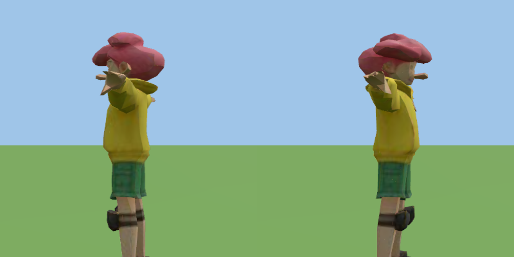
- Before and after, running (first fix, side view):

| Before | After |
|---|---|
| 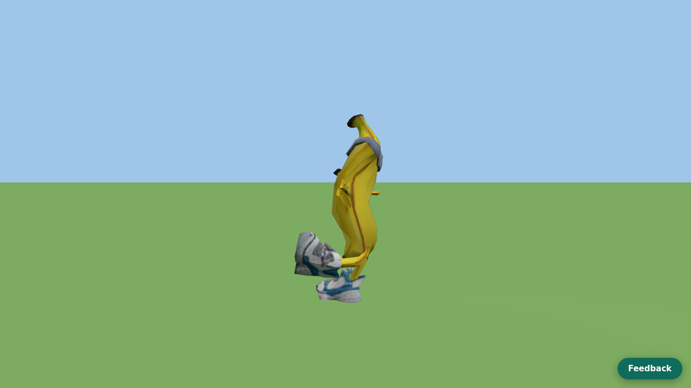 | 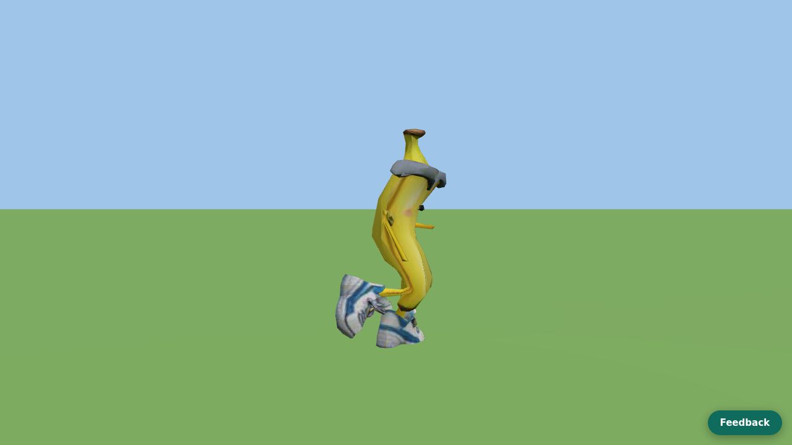 |

## The fix, and the heuristics
- At load, the game measures which way the skin faces and turns it 180 degrees about the vertical axis through the hips when it faces back.
- The left and right bone weights are swapped at the same time, so an arm that is now on the left still follows the left bones.
- The first fix used one cue (the shoes).
- The second round uses five cues that each vote, in `src/characters/facing.ts`:

| Cue | What it looks at | Weight |
|---|---|---|
| shoe reach | how far the toe reaches in front of the shin, against behind it | 1.0 |
| shoe middle | where the middle of the shoe sits against the shin | 0.7 |
| shoe top | the shoe is higher at the toe cap than at the heel | 0.6 |
| torso | chest reaches further in front than behind | 0.3 |
| hands | the arms and hands are held a little forward | 0.3 |

- Each cue has a dead zone: a lean that small counts as "no opinion".
- The result is `{score, confidence, votes, verdict, turned}`.
- Confidence is how much the cues agree, out of how many could speak.
- The game turns a skin only when it is confident (confidence 0.2 or more and a clear score).
- If it is not confident, the skin is left as made, and the fit report says "facing unclear".
- A per-character answer wins over all of this: `FACING_OVERRIDE` in `src/characters/facing.ts`, keyed by character id (`forward` or `back`).
- Honest note: on the eight, only the shoe cues carry real signal; the torso cue was wrong once and the hands cue mostly abstains on T-pose characters.
- Cues we tried and threw away, because the sign was not the same on all eight:
  - eye, jaw, toe and thumb landmarks mirrored across the body;
  - skin weights of toe against foot, eye against head (weights follow position, so they hold no front);
  - how far the head reaches forward (negative on all eight);
  - the shin's front centre;
  - surface normals (a closed surface adds up to zero);
  - the maker's yaw (a box has no front).

## Why the first fix missed the real problem
- The first fix was tested in a side-view demo of the rig.
- That demo assumed the character runs along +x.
- Players do not see that view: they see the Course, where the renderer turns the actor by its own heading and the camera looks at it from its own place.
- So the first check could have been right "for the wrong reason", and nobody would have known.
- The owner then reported that the three still seemed to run the other way when pressing right.
- We checked in the real Course scene for the Rookie and all eight, pressing Right and then Left (`data/eval/cc-chars-facing/scripts/probe-course.mjs`).
- It records, for each: how far the runner moved on screen, the heading the Course renderer gave the actor, the direction of the toe bones, and which way the skin's shoes lean on the posed skin.
- Result: see "What the real Course shows" below.

## What the real Course shows
- Table (`data/eval/cc-chars-facing/course-probe.json`, 1280 px page, the Course on `run.course.json`):

| Character | Right: moved (m) | Right: heading | Left: moved (m) | Left: heading | Standing: toe bone along heading | Standing: skin shoes lean |
|---|---|---|---|---|---|---|
| Rookie | +12.9 | +1 | -13.1 | -1 | +0.137 | +1.00 (sure 1.00) |
| Fox | +13.2 | +1 | -11.1 | -1 | +0.000 | +0.34 (unsure 0.12) |
| Skater | +12.9 | +1 | -13.0 | -1 | +0.137 | +0.32 (sure 0.29) |
| Toy Robot | +13.1 | +1 | -13.2 | -1 | +0.000 | -0.34 (unsure 0.08) |
| Cactus | +13.0 | +1 | -13.2 | -1 | +0.137 | +0.99 (sure 0.79) |
| Banana | +11.1 | +1 | -13.0 | -1 | +0.137 | +1.00 (sure 1.00) |
| Robo Cat | +11.3 | +1 | -13.9 | -1 | +0.137 | +0.88 (sure 0.60) |
| Jelly | +11.3 | +1 | -12.9 | -1 | +0.137 | +1.00 (sure 0.56) |
| Potato Blob | +13.1 | +1 | -11.1 | -1 | +0.137 | +0.53 (sure 0.47) |

- Reading it:
  - Pressing Right, every character moves right and the Course renderer turns the actor to heading +1.
  - Pressing Left, every character moves left and the renderer turns the actor to heading -1.
  - The skin is bound to the same bones as the actor, so one turn by the heading carries skin, face and toes together.
  - The skin-against-bones check (do the shoes lean the way the toe bones point) is only readable standing: mid-stride the feet are bent and the shoe cues give junk (an earlier probe that read them mid-run said "Skater faces back going left"; the pictures show it does not).
  - Standing, the skin shoes lean along the heading for every character the cues can judge; Toy Robot and Fox read as unsure there (confidence under 0.25) and are not counted.
  - Skater, Banana and Potato Blob, the three that were turned, are right in both directions.
- Pictures (real Course, Right then Left, close-up crops; the face and toes point the way the runner goes):

| Character | Pressing Right | Pressing Left |
|---|---|---|
| Rookie | 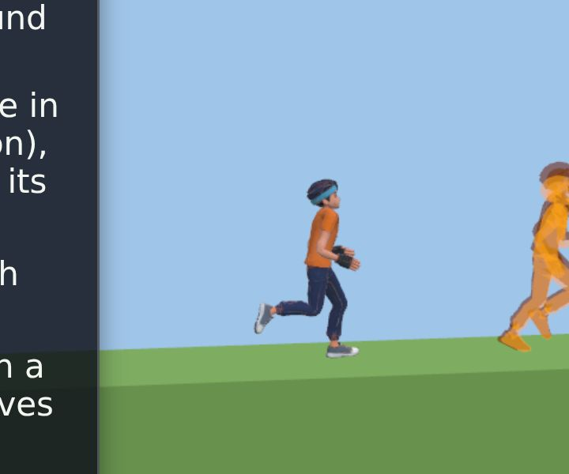 | 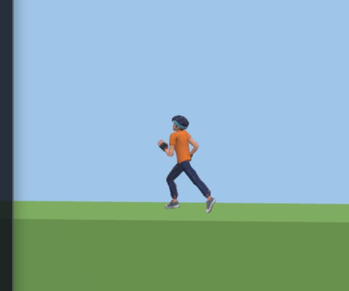 |
| Fox | 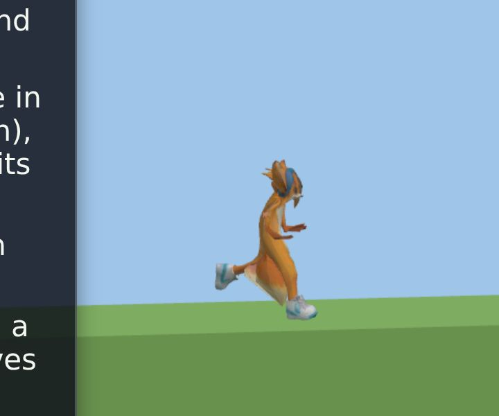 | 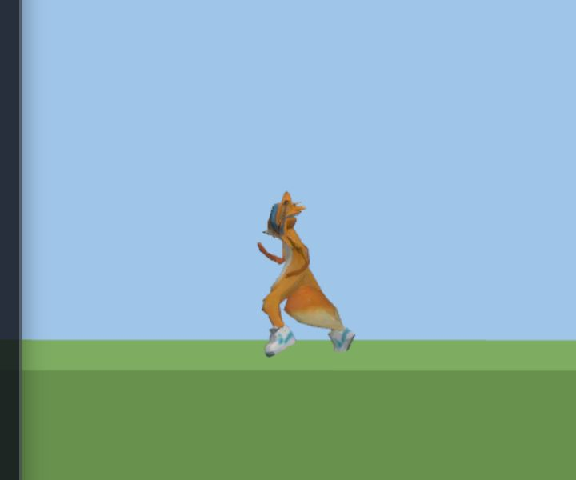 |
| Skater | 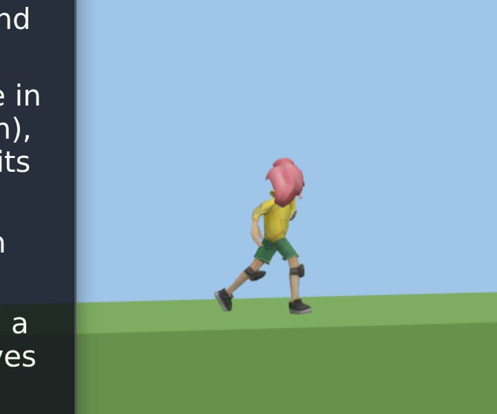 | 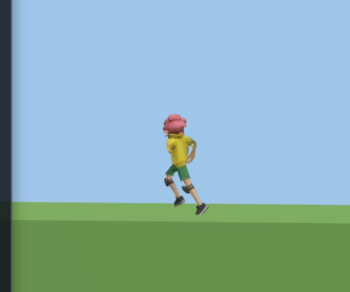 |
| Toy Robot | 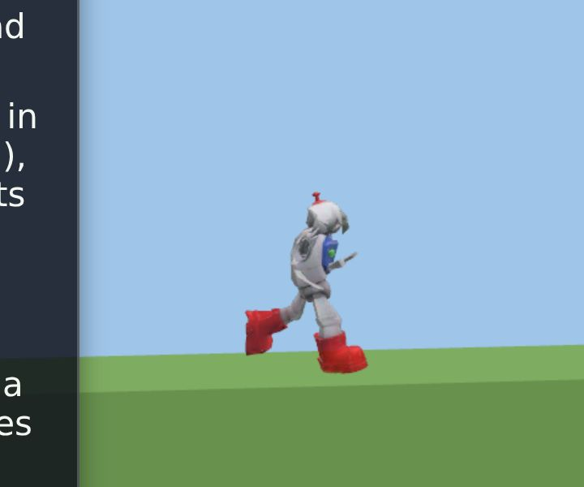 | 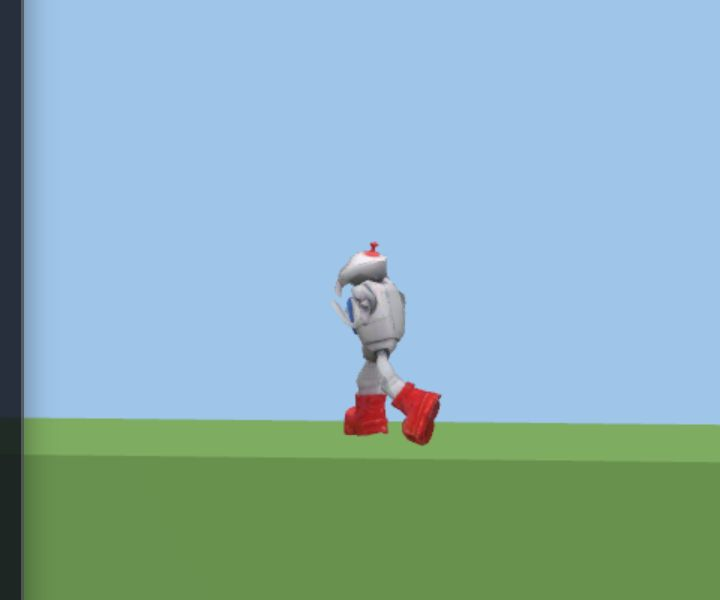 |
| Cactus | 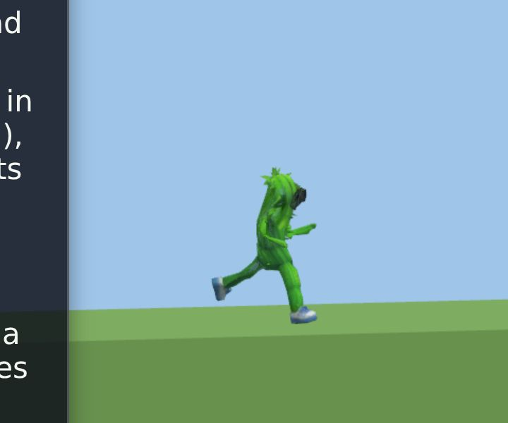 | 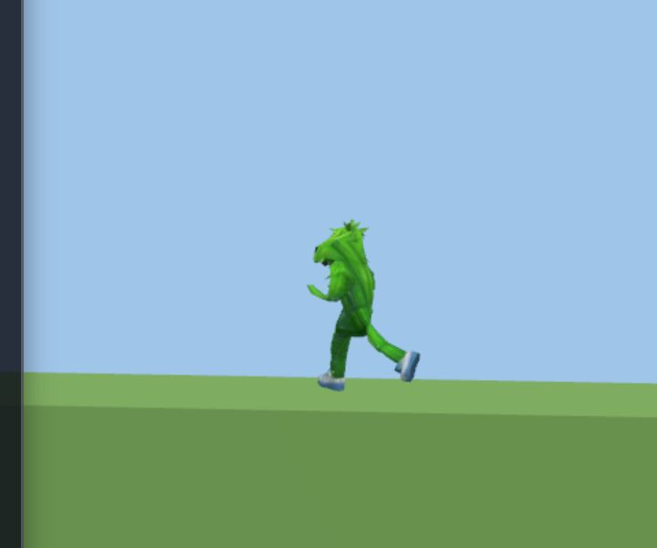 |
| Banana | 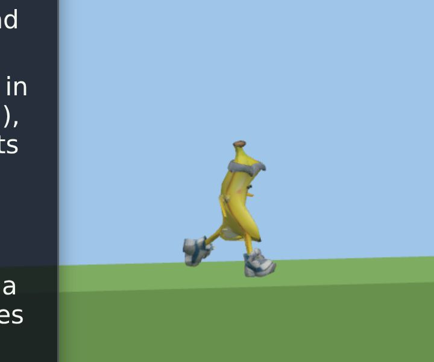 | 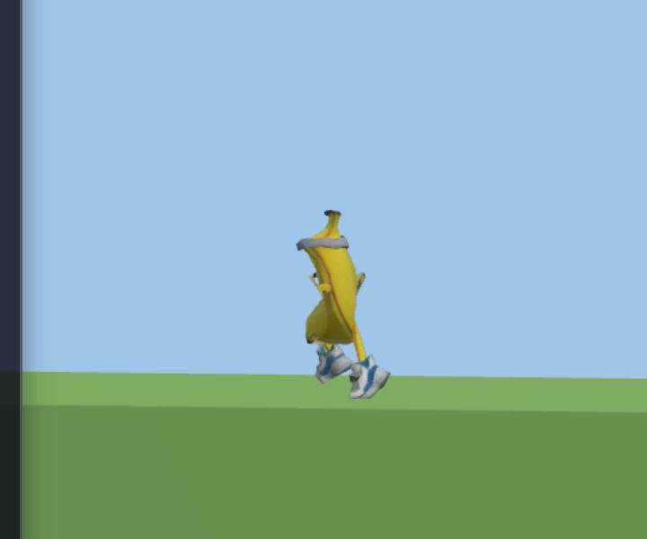 |
| Robo Cat | 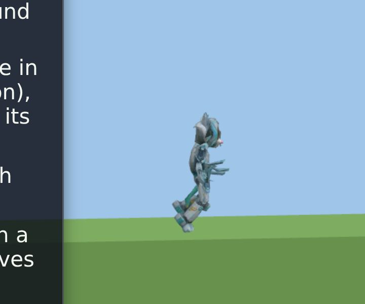 | 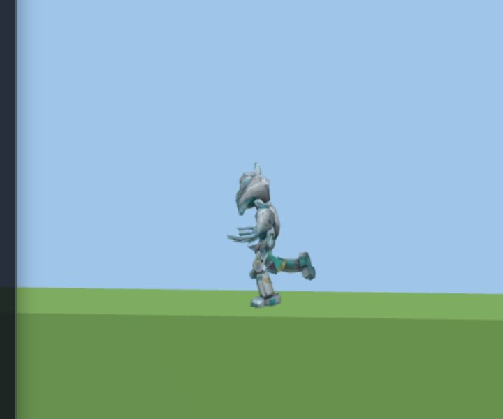 |
| Jelly | 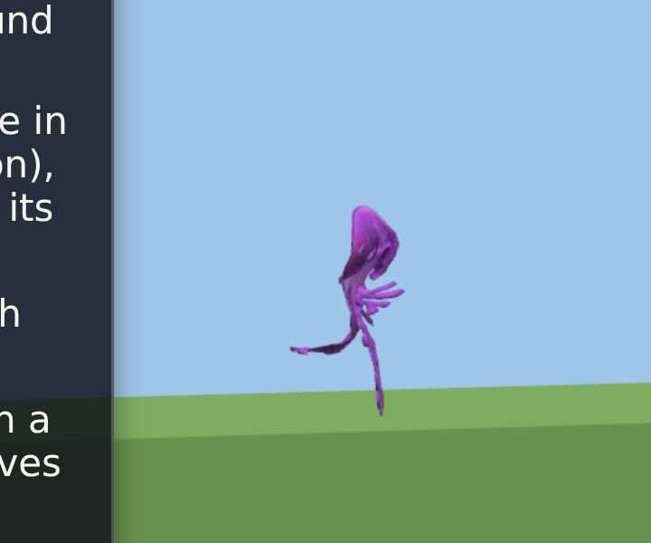 | 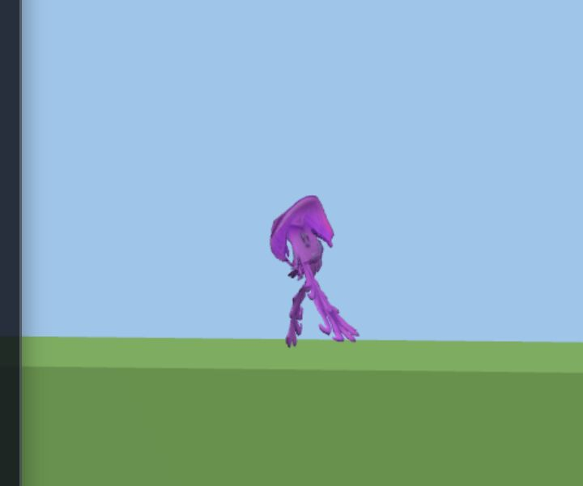 |
| Potato Blob | 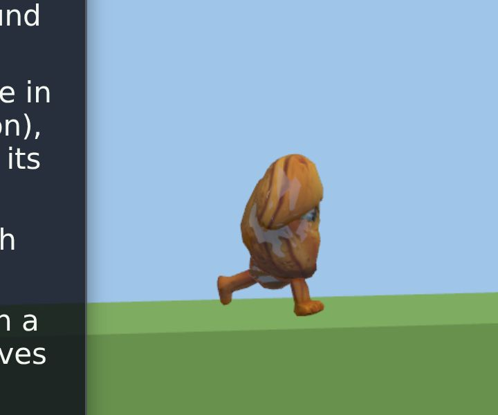 | 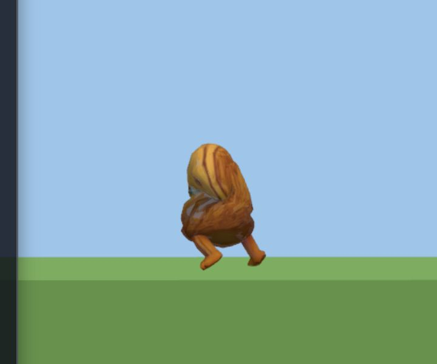 |

## What we still cannot judge
- A person-made character from outside the eight: the vote is only checked on these eight.
- A skin with no shoes (Jelly): the cues cannot tell, so it is left as made and the fit says "facing unclear".
- A character whose feet point sideways.
- Whether a face really looks forward: the cues read shoes, chest and hands, not eyes (eye and jaw landmarks gave different signs on different characters).
- Whether the owner's report of "toes right, running opposite" has a cause we did not reproduce: in the real Course on this branch it does not happen.
  - A build made before the facing fix would show it; the preview site needs a fresh deploy to carry the fix (we do not deploy from here).
- We never grade a person's technique; this is only about which way a skin faces.

## Lessons
- A rule that picks an axis must also pick a direction: the box fit found the line, not the end.
- Measure, do not eyeball: a table of yaws and dot products found the cause in minutes; pictures alone would have argued for hours.
- Test in the view the player sees: the first fix was tested in a side-view demo that assumed the run goes along +x, while players see the Course.
- A probe has its own conditions: read the shoe cues standing, not mid-stride, or the probe lies.
- Keep a way out: unclear skins are left as made, and `FACING_OVERRIDE` fixes one character in one line.
