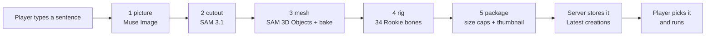
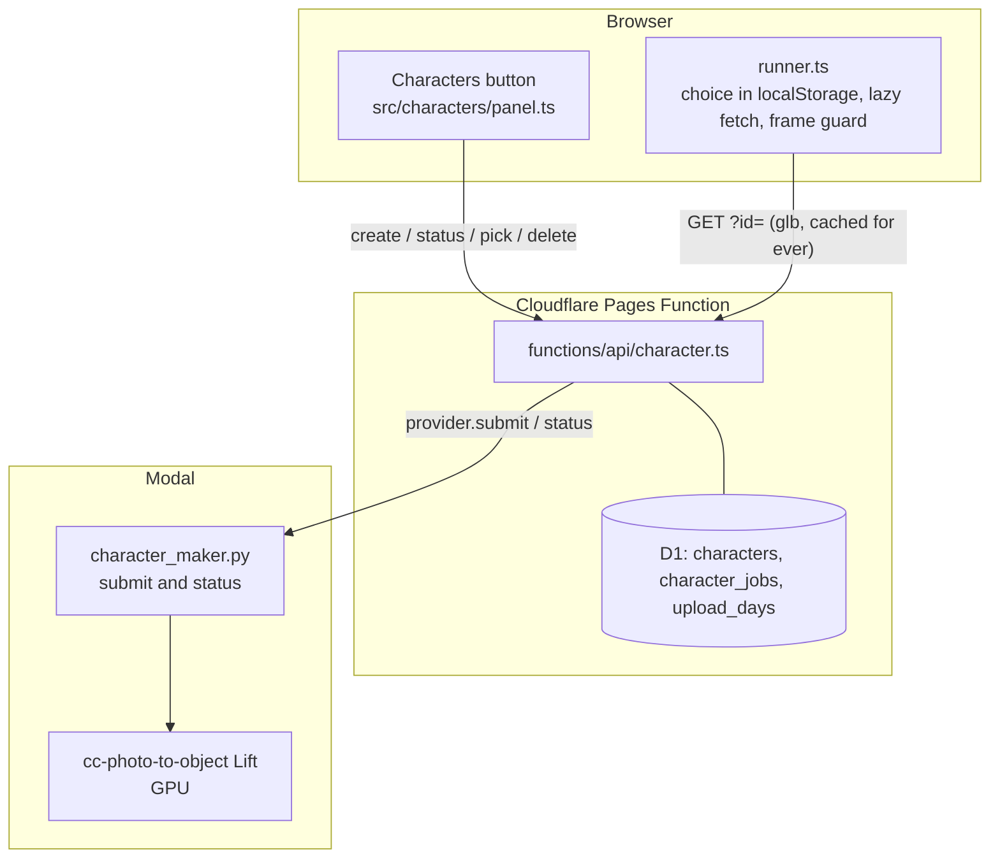
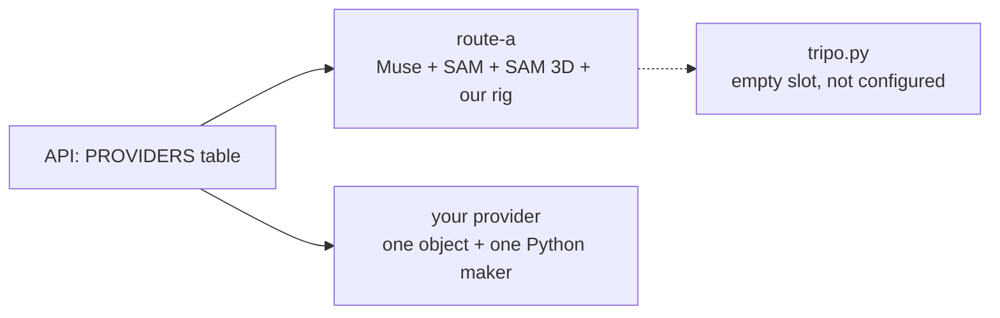
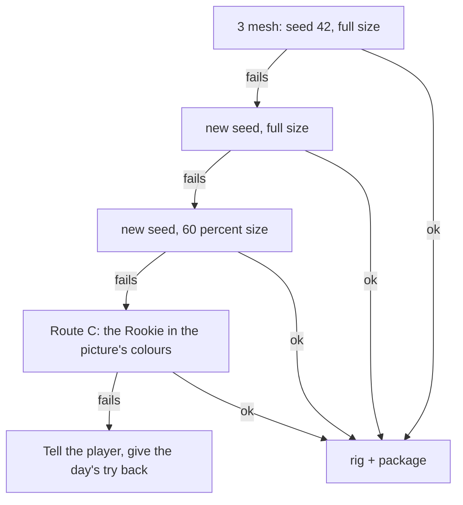

# The character pipeline: how a sentence becomes a runner (CC-108)

*Status: built behind a switch (`?characters=0` hides the button).*
*Live results, costs and frame rates are in "What we measured" at the end.*

## So what for the game
- A player types one sentence and, a few minutes later, runs the course as that character.
- The maker is a row of five steps, and each step can be swapped for another provider.
- Route A (Meta's Muse Image, SAM 3.1 and SAM 3D Objects, plus our own rigger) is the first provider and costs about five cents a character.
- Tripo made the two Rookie meshes at build time; the game has no Tripo code or key, and `pipelines/charmaker/providers/tripo.py` is an empty slot that answers "not configured".
- Every character is checked against hard size caps before the server keeps it, so a gallery of them stays cheap.
- Abuse limits: kept in the private notes.

## The five steps

- Step 1 draws one full-body character in a T-pose on a plain background.
- Step 2 cuts the figure out of the picture.
- Step 3 lifts the cut-out to a 3D shape, thins it to about 3,000 faces and paints a 256 px texture.
- Step 4 gives every vertex weights on the Rookie's 34 bones, so the real run, leap and land clips move it.
- Step 5 shrinks the file until it fits the caps and cuts a small thumbnail.

## The size caps (the server refuses anything bigger)
- 3,200 faces and 6,000 vertices at most.
- A texture of 256 px or less.
- 240,000 bytes at most for the file, and a thumbnail of 8,000 bytes or less.
- Exactly 34 bones, one skin, one mesh, no animations.
- The numbers live in `pipelines/charmaker/limits.py` and `src/characters/limits.ts`, and a test keeps the two equal.

## Where things live

- The list shows thumbnails only; a character's file is fetched when the player picks it.
- The file name is the first 16 hex characters of its SHA-256, so the same file is stored once and can be cached for ever.
- A character that nobody picked for 14 days is removed; one picked 10 times is kept (a Keeper).
- The owner is a one-way code, never an address; only the maker's code can delete a character.
- `kind` is a column, so the Objects tab and the Characters tab read one table.

## The provider slots

- A server provider is one object with `configured`, `submit` and `status` (`src/characters/providers.ts`).
- A Python maker is one class with `picture`, `cutout`, `mesh` and `fallback` (`pipelines/charmaker/contracts.py`).
- To add a provider later: write its object, add it to `PROVIDERS`, and nothing else changes.

## When a step fails

- The picture and the cut-out are each tried twice.
- Route C is the honest fallback: the lift is what failed, so there is no mesh to cut a head from, and the Rookie's own body is painted in the picture's main colours.
- A try is given back at most once, even if the player's page asks for the status many times.
- A file that breaks a cap is refused, never stored, and the try is given back.

## Safety and limits
- The prompt is cleaned and checked for weapons, children and real people, then (when a checker key is set) by the same text safety check the Community uses.
- Anything that needs a person to look is stored hidden and never listed.
- Abuse limits: kept in the private notes.

## How to run it
- Offline, with no keys: `python -m charmaker.cli OUT "a calm owl" --mock` (from `pipelines/`).
- Live: the same command without `--mock` on a machine with the Meta key file and a logged-in Modal.
- Tests: `uv run --no-project --with pytest --with numpy --with scipy --with pillow --with fast_simplification --with xatlas pytest pipelines/tests/test_charmaker.py` and `npx vitest run tests/character-api.test.ts tests/characters-limits.test.ts`.
- Deploy: `modal deploy pipelines/character_maker.py` needs a Modal secret named `cc-char` (the Meta key, the Meta base address and a shared token); the site needs `CC_CHAR_TOKEN`, `CC_CHAR_SUBMIT_URL`, `CC_CHAR_STATUS_URL` and the daily-limits secret.
