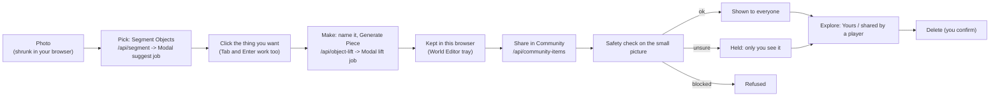
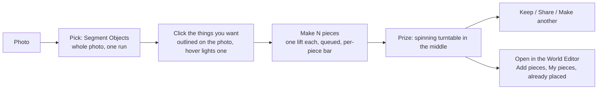
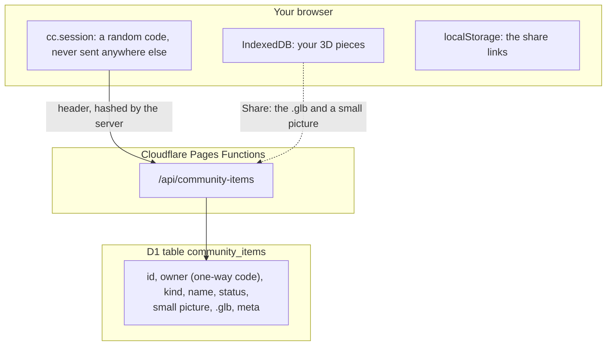
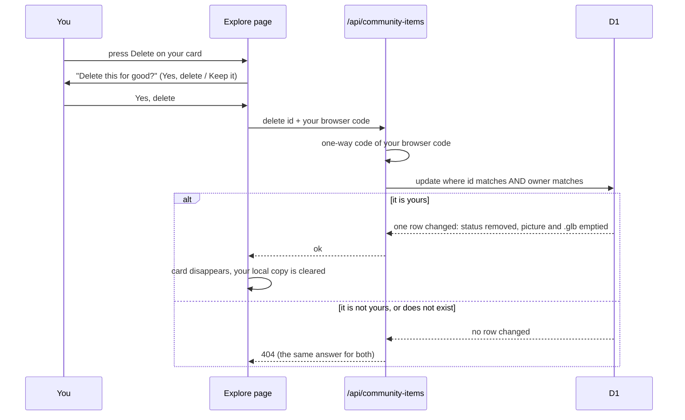

# Community flow: click by click

## So what
- Community opens on Explore, so you see what people made before you make one.
- Then one clear button, **Make your own**, takes you into the Make tab.
- Making is one screen with three steps: Photo, Pick, Make.
- The finder outlines the things in your photo and you click the one you want.
- If the thing you want is not outlined, press **Mark it yourself** and drag a box round it (owner decision, 2026-11-03).
  - This reverses the old drawing ban; the click path is still the first choice.
- Every pick becomes a 3D piece.
- Your finished piece can be shared: press **Share in Community**, see it in Explore as yours, and delete it any time.
- It is the only Community now; the old screens are deleted.

## The whole path in one picture

## What your click does
- The finder looks at the whole photo, and you click to pick.
  - Segment Objects sends the whole photo, and the finder looks at all of it.
  - It reads no box at all (`Mask.suggest` takes the photo only).
  - It tries one plain word at a time (bench, stairs, railing, wall and so on) and keeps the best, non-repeating things.
  - Each found thing is outlined on the photo.
  - Point at one and it lights up; click it and it is picked; click it again and it is put back.
  - Nothing is picked for you, and nothing is hidden from the search.
- You can reach the same things without a mouse.
  - Press Tab to move from one found thing to the next, and Enter (or Space) to pick or put back.
  - The list under the photo holds the same things in one fixed order, each with a tick box.
- If the finder finds nothing, or fails, or is switched off:
  - The page says so in plain words.
  - It offers **Try again** and **Pick a different photo**.
  - **Mark it yourself** is the fallback (owner decision, 2026-11-03; it replaces the old ban on drawing).
  - It stays on the page, so it can also be used any time, not only after a failure.
- **Mark it yourself** (CC-133, owner decision 2026-11-03; switch `markbox`, on by default, `?markbox=0` hides it):
  - Press the button under the photo, then drag a rectangle round the thing.
  - Without a mouse: Tab to the photo layer, Enter starts a box in the middle, arrow keys move it, Shift with arrow keys resizes it, Enter confirms, Esc cancels.
  - Then say what it is: bar, bench, pole, other, or your own word; the word must pass the same rule as a name (letters, spaces, hyphens).
  - Then the finder cuts out what is inside your box (owner principle, 2026-11-03: always segment first, show what is about to be lifted, then the player chooses):
    - It is one quick cut-out call on the blurred photo; the original photo is never used.
    - The cut-out is lit up on the photo in the same style as the finder's outlines, and the list says "waiting for your OK".
    - Nothing is ticked, made or paid for yet, and a click on the outline does not pick it.
    - Press **Use this** to tick it and add it to your picks, or **Redraw** to throw it away and draw the box again.
    - If the finder cannot find a clear shape, finds only a speck, lands somewhere else or lands on a person, the page says so in plain words and offers **Draw it again**; nothing is added.
    - If the finder is switched off or fails, a marked box cannot be used, because there is no cut-out to look at; the page says so and offers **Draw it again**.
  - After **Use this** it is exactly a picked outline: the same lift, the same price, the same daily count.
  - Guards:
    - The safety check and the privacy blur run on the whole photo first; the lift only ever sees the blurred photo, so a person inside a box stays blurred (nothing is un-blurred).
    - The finder also returns where it blurred people and faces (`person_boxes` in the privacy receipt); a box that mostly sits on a person, or covers a quarter of one, is refused with plain words.
    - The finder (Segment Objects and the box cut-out) both return those boxes; the app was redeployed on 2026-11-03 with the box cut-out, so the person refusal now has data to work with.
    - The cut-out is checked again against the person boxes before it is offered.
    - Size: at least 24 photo pixels or 3 percent of the shorter side, and at most 80 percent of the photo.
    - The server repeats the box limits (`requestProblem`): inside the photo, not tiny, a valid label.
  - Pictures at 1280 px, from a real browser run (the server stubbed with a real cut-out made by the deployed app): [dragging a box round the monkey bars](evidence/cc-133-markbox/1-dragging.jpg), [the cut-out waiting for Use this](evidence/cc-133-markbox/3-cutout.jpg) and [after Use this](evidence/cc-133-markbox/4-used.jpg).
  - The real cut-out on photo 2: [monkey bars lit up inside the drawn box](evidence/cc-133-markbox/real-cutout-monkey-bars.jpg); the call took 0.5 s on the L4 once warm.
  - Browser check: `scripts/markbox-check.mjs` (drag, name, cut-out shown and not ticked, Redraw, Use this, no clear shape, too small, too big, keyboard, bad word, Esc; counts lift calls and requires 0 before Use this).
  - Rules and tests: `src/slice/markbox.ts` and `src/slice/markpreview.ts` (the confirm gate), `tests/markbox.test.ts`, `tests/markpreview.test.ts`; the tool is `src/ui/mark-box.ts`.
  - Server: `/api/segment` takes an optional `box`; Modal `suggest_submit` then starts `box_job`, which runs `Mask.mask_box` (about a second on an L4 once warm, a fraction of a cent) and returns one item.
- The 3D maker later finds the real outline itself, from the photo, the picked box and the name you give it.
  - It looks for that name under the picked box, then falls back to the box alone, then to the plain box.
  - So the blue shape you see after Segment Objects is a preview, not what is lifted.
- One 3D run makes one piece.
  - A lift takes one photo, one box and one name, and returns one .glb.
  - Several pieces are several runs, one after another, and each costs its own GPU seconds.
  - The recorded price is about 2 cents for a warm piece and 3 to 4 cents for the first one after a quiet spell (`docs/pipelines.md`, `docs/community-characters.md`).
  - Segment Objects is one run for the whole photo, however many things it finds, so choosing among them is free.
- Why both jobs are slow sometimes: it is a cold start.
  - Each of the two GPU programs (finder and 3D maker) is set to keep one machine, `max_containers=1`, and to switch it off after 240 s with nobody asking (`scaledown_window=240`).
  - After a quiet spell the first call has to start a machine and load the model: a first piece took 90 to 100 s and the model load alone was 45 to 54 s (`data/eval/cc-38-photo-to-3d/README.md`, `docs/community-characters.md`).
  - A warm run is quick: in the live run of 2026-10-31 (`docs/evidence/cc-247-upload-run.json`) Segment Objects took about 18 s and a piece 32 s.
  - Only one machine each means two people at once wait in line; this page also queues your own pieces one at a time.
- Money, as a recommendation only (nothing was changed on Modal):
  - Keeping one machine always on costs about $1.95 an hour for each of the two programs (L40S), about $47 a day each.
  - Built instead (CC-133): the page wakes the machines early, so the cold start is hidden while the person is busy.
  - Opening the Make tab wakes the finder (Mask, an L4).
  - Pressing Segment Objects wakes the 3D maker (Lift) while the outlines are computed and the person picks a thing.
  - Each page load asks at most once for each machine, and `?warmup=0` turns it off.
  - The call goes to `/api/segment` with `{action: "warm", which}`; it sends no photo and nothing is processed.
  - It uses the same on/off switch as the outline finder and a small per-visitor burst limit.
  - The cost is a short idle window (60 s for the finder, 240 s for the 3D maker) for each visit that wakes a machine; it is not measured yet.
  - It needs the Modal function `warm` deployed and the setting `CC_SEGMENT_WARM_URL` (`docs/environments.md`); without them the call is quietly skipped.

## The flow in short

- You normally draw nothing: press Segment Objects and the finder outlines the things.
- If it missed yours, **Mark it yourself** adds a box you drag (see the next section).
- After it you may click several things, up to a small limit, and each picked piece is its own run.
- The list of found things is in one fixed order: biggest first, then top to bottom, then left to right.
- Pointing at a thing lights it; nothing is rebuilt, so nothing moves under the mouse.

## Where is my piece?
- Your finished piece is kept in this browser (IndexedDB) and was always saved.
- The editor's Add pieces window is a picture grid built from our own list, and the buttons for your pieces were hidden behind it, and only built when the address had `uploadobj=1`.
- Now they are always read, and the grid shows them as cards under **My pieces** at the very top, on every tab.
- The prize screen's **Open in the World Editor** opens `?mode=editor&place=<id>` and the piece is placed for you.

## Where things are kept

- The photo itself is never stored on our side; only the small picture of your area and the finished .glb.
- The owner column is a one-way code of your browser's random code, not an address.
- Status is `pending` (only you see it), `approved` (everyone sees it) or `removed` (you deleted it).

## Delete, and who may do it

## How to open it
- `?mode=communities&welcome=0`, or the Community button in the top bar.
- The old gallery and Park addresses (`?mode=gallery`, `?mode=park`) open Explore.
- `&tab=make` opens the making flow directly.

## The two tabs
- **Explore** (opens first), top to bottom:
  - **Make your own**: the button that opens the Make tab.
  - **Pieces people made**: our examples (only those with a picture), then yours from this browser, then pieces shared by players.
  - Each card has a small source crop picture, **See Object** (opens the same 3D turntable as a new piece) and **Use in my World Editor**.
  - A search box (by name) and **Show more** keep the list short.
  - There is no courses block and no kind filter.
- **Make**: the three steps below.
  - Your pick stays if you look at Explore and come back.

## Click by click (Make tab)
1. **Photo.**
   - Click "Choose file" and pick a JPEG, or click one of our sample place photos.
   - You land on Pick by yourself.
2. **Pick.**
   - Press **Segment Objects**.
   - A stepped bar shows the job: Checking the photo, Finding the things in it, Done.
   - The bar shows the seconds so far, and **Cancel** stops waiting.
   - The finder looks at the whole photo and outlines what it found.
   - Hover lights one; click picks it; click again puts it back (see "What your click does").
   - Pick several to make several, up to a small limit.
   - Tab and Enter do the same without a mouse.
   - If nothing is found, or the finder fails or is off, the page offers **Try again** and **Pick a different photo**.
3. **Make.**
   - Each picked thing has a small picture and a name box; every pick becomes a 3D piece.
   - Name a piece with a plain word (bench, railing, stairs, wall).
   - Press **Generate Piece** and watch the bar (the first one of a day can take minutes).
   - The bar steps through: Checking the photo, Cutting out the object, Building the 3D shape, Adding colour, Done.
   - The bar shows the seconds so far, and **Cancel** stops waiting.
   - The names come from the job itself, so the bar moves when the job moves.
   - The piece is saved in this browser and appears in the World Editor tray as "Mine: name".
   - Before you press, a line beside the button says how many pieces you can make a day and how many are left today.
     - Both numbers are read from the server when the Make step opens, so the page never has its own copy.
     - If the page cannot read them, it says so, and the server still decides when you press.
   - The line also says that one lift makes one object, so more pieces cost more (about 2 to 4 cents each).
   - Several pieces are several lifts, so N pieces cost N times as much as one.
   - If you queued more pieces than are left today, a red warning says so.
     - **Make N pieces** counts only the ones that can start.
     - The extra pieces have their own button switched off, with the reason beside it ("try again tomorrow").
   - **Share in Community** (a button on each finished piece) sends the small picture and the .glb to the Community list.
     - The server looks at the small picture again with the safety check.
     - If it says all clear, everyone sees it in Explore.
     - If it is unsure, only you see it ("waiting for the safety check") until it is approved.
     - If it is blocked, nothing is stored and the page says so.
   - "What next" then offers: Open the World Editor, See it in Explore, Start with another photo.

## Seeing and deleting what you shared
- Explore, in "Pieces people made", shows your shared items after our examples: "Yours: name", with a small picture.
- Items that other players shared and the safety check cleared show below them, as "shared by a player".
- Your own cards have a **Delete** button.
  - It asks "Delete "name" for good?" with **Yes, delete** and **Keep it**.
  - After Yes, the card goes, the shared copy is emptied on the server and your saved copy in this browser is cleared too.
- Only you can delete your item.
  - The server checks the one-way code of your browser's random code.
  - Anyone else gets "not found", the same as for an item that does not exist.
- If you clear your browser data you lose the random code, so you can no longer delete the old item yourself; the site owner can remove it (see `docs/deploy.md`).

## When a limit stops you
- Each message says who is stopped and when to try again, as a clock time in your own time zone.
- Your own daily limit: "You have used all of your 3D pieces for today. Try again tomorrow at 02:00."
- Everyone's daily limit: "Everyone together has used up today's 3D pieces. Try again tomorrow at 02:00."
- Too many in a short time: "You asked for a lot in a short time. Try again at 14:30."
- The service is busy: "The 3D maker is busy right now. Try again at 14:30."
- When the wait is over, a stopped **Generate Piece** button comes back on its own.
- The numbers behind the limits are in the private notes, not here.
- The server sends `retryAfterSeconds` in the body and a `Retry-After` header; the page turns it into the clock time.

## Things to know (gaps)
- Segmentation finds outlines on its own; a click only chooses among them.
- If the thing you want is not outlined, press Segment Objects again or pick a different photo; there is no way to draw one.
- Cancel stops the page waiting; the job on the server may still finish, and it still counts for today.
- Pieces stay in this browser until you press Share in Community.
- A shared item is held for a person to approve whenever the safety check is unsure (`npm run community items` lists them; see `docs/deploy.md`).
- The World Editor "Share to Community" button and the contributed-photo rule are not built yet.
- The tray badge is a camera sign on the "Mine:" buttons; the place name is not on it yet.
- Pieces appear in the tray only with `?uploadobj=1` (the "Open the World Editor" button adds it).
- Generate Piece uses the paid photo-to-3D job; the existing daily limits and safety check apply.
- The unit tests stub the network; `scripts/community-upload-e2e.mjs` runs the whole path against the preview site with the real jobs (live run of 2026-10-31).
- Pictures of that run, in order:
  - [Photo uploaded](evidence/cc-247-upload-1-upload.jpg)
  - [Outline found](evidence/cc-247-upload-2-segment.jpg)
  - [Piece generated](evidence/cc-247-upload-3-generated.jpg)
  - [Gallery shows it as yours](evidence/cc-247-upload-5-gallery.jpg)
  - [Delete asks first](evidence/cc-247-upload-6-delete-confirm.jpg)
  - [Gone after a reload](evidence/cc-247-upload-7-gone.jpg)
  - [Run record](evidence/cc-247-upload-run.json)
- Desktop at 1280 px only.

## Using other players' pieces
- In Explore, another player's piece (once it has passed the safety check) has **See Object** and **Use in my World Editor**.
- Use in my World Editor adds it to your own list, then offers **Open the World Editor**.
- In the editor it sits under **Shared pieces** in Add pieces, and you place it like any other piece.
- Pieces that are waiting, held or blocked never get the button, and the server will not hand their model to anyone but the maker.
- A course with a shared piece keeps the piece's id.
- When a friend opens the short link, the piece is fetched from the community store.
- If it cannot be fetched, the course still loads and the piece shows as a plain grey shape.
- If the maker deletes it, the editor says "no longer available" and skips it.

## Long lists
- The shared list in Explore comes one page at a time, with a **Show more** button.
- It has a search box (searched by name on the server).
- In the editor, **My pieces** and **Shared pieces** show a dozen cards at a time, then **Show more**.
- Typing in the Add pieces search also looks through pieces other players shared, a page at a time.
- The built-in object list (the 19 photo objects) is a shipped file and does not grow with players' work.

## Click-to-pick pictures (CC-247)
- [Hover lights one found thing](evidence/cc-247-click-pick/1-hover.jpg)
- [Picked](evidence/cc-247-click-pick/2-picked.jpg)
- [The daily line beside the button](evidence/cc-247-click-pick/3-daily-line.jpg)
- [More queued than left today](evidence/cc-247-click-pick/4-queue-over-left.jpg)
