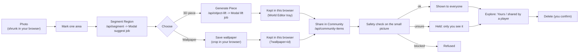
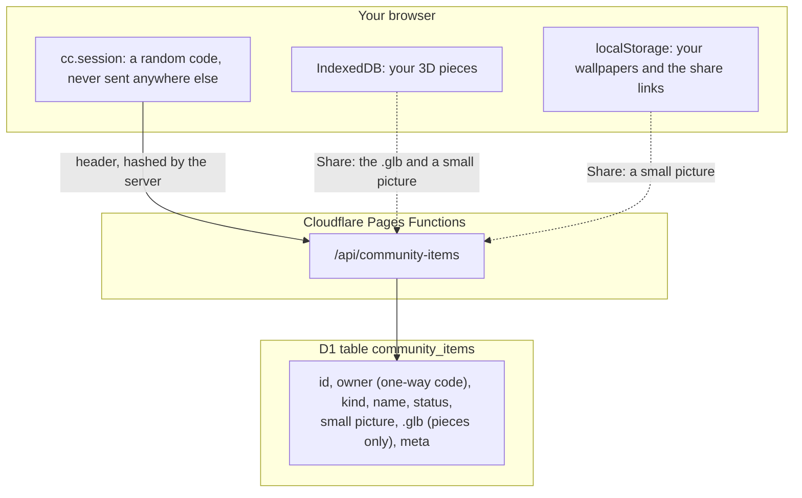
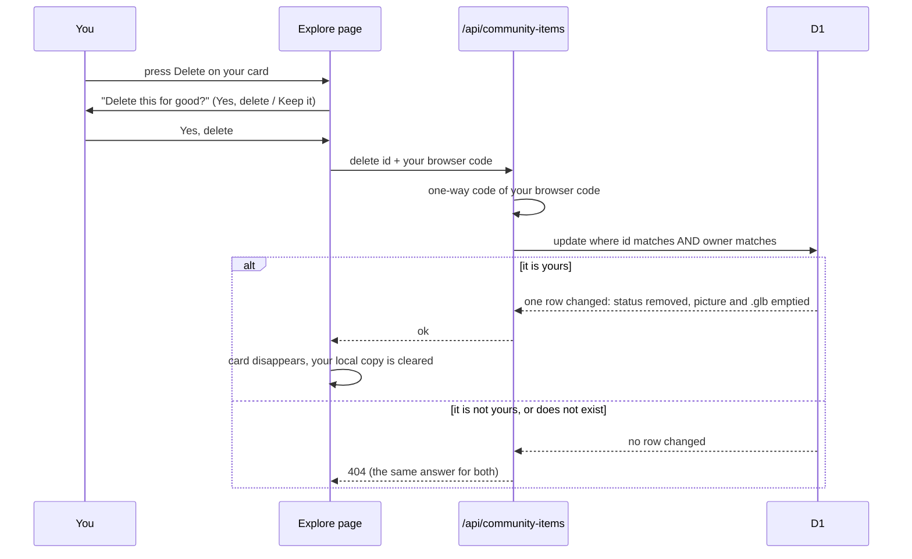

# Community flow: click by click

## So what
- Community opens on finished work first, so you see what a completed creation looks like before you make one.
- Then one clear button, **Make your own**, takes you into the making flow.
- The making flow is one screen: Photo, Mark, Segment, Choose, Make.
- You never choose "wallpaper or object" up front.
- You mark one area; it becomes a piece or a wallpaper.
- A photo gives objects and wallpapers only; courses come from World Slicing and the Editor.
- It is the only Community now; the old screens are deleted.
- Your finished piece or wallpaper can be shared: press **Share in Community**, see it in Explore as yours, and delete it any time.

## The whole path in one picture

## Where things are kept

- The photo itself is never stored on our side; only the small picture of your area and, for a piece, the finished .glb.
- The owner column is a one-way code of your browser's random code, not an address.
- Status is `pending` (only you see it), `approved` (everyone sees it) or `removed` (you deleted it).

## Delete, and who may do it

## How to open it
- `?mode=communities&welcome=0`, or the Community button in the top bar.
- The old gallery and Park addresses (`?mode=gallery`, `?mode=park`) open Explore.
- `&tab=make` opens the making flow directly.

## The two tabs
- **Explore** (opens first), top to bottom:
  - Courses people made: the finished courses, each card with a Play button.
  - Now make your own: the **Make your own** button.
  - Pieces and wallpapers: finished examples first (sample places as wallpapers, our example pieces with their credit lines), then yours from this browser.
- **Make your own**: the stepper below. 
  - Your mark stays if you look at Explore and come back.

## Click by click (Make your own tab)
1. **Photo.**
   - Click "Choose file" and pick a JPEG, or click one of our sample place photos.
   - You land on Mark by yourself.
2. **Mark.**
   - Click the photo: a ready-made box drops where you clicked.
   - Or drag on the photo to draw your own box.
   - Only one box is kept: a new box replaces the old one.
   - Drag the box to move it; drag the green corner to resize it.
   - Delete removes it, Ctrl+Z undoes.
   - Press "Next: Segment" when the area is marked.
3. **Segment.**
   - Press **Segment Region**.
   - A stepped bar shows the job: Checking the photo, Finding the things in it, Done.
   - The bar shows the seconds so far, and **Cancel** stops waiting.
   - The server finds exact outlines; your box takes the outline that sits on it.
   - A blue shape shows the outline; a chip below names it.
   - A button "Use "stairs" instead" appears when it found something else; click it to swap your area for that.
   - "Use my box as the outline" goes on without an outline.
   - If the finder is switched off, the page says so and uses your box as the outline.
4. **Choose.**
   - Your area has a small picture, a name box and two buttons: **3D piece** and **Wallpaper**.
   - Name a piece with a plain word (bench, railing, stairs, wall).
   - Press a button again to un-choose it.
   - "Next: Make" opens when the area has a choice.
5. **Make.**
   - A 3D piece shows **Generate Piece**; press it and watch the bar (the first one of a day can take minutes).
   - The bar steps through: Checking the photo, Cutting out the object, Building the 3D shape, Adding colour, Done.
   - The bar shows the seconds so far, and **Cancel** stops waiting.
   - The names come from the job itself, so the bar moves when the job moves.
   - The piece is saved in this browser and appears in the World Editor tray as "📷 Mine: name".
   - A wallpaper shows a name, a course list and **Save wallpaper**; the crop is your box widened to the course's wide look.
   - **Share in Community** (a button on each finished piece or wallpaper) sends the small picture, and for a piece the .glb, to the Community list.
     - The server looks at the small picture again with the safety check.
     - If it says all clear, everyone sees it in Explore.
     - If it is unsure, only you see it ("waiting for the safety check") until it is approved.
     - If it is blocked, nothing is stored and the page says so.
   - "What next" then offers: Open the World Editor, Play a course with the wallpaper, See them in Explore, Start with another photo.

## Seeing and deleting what you shared
- Explore, in "Pieces and wallpapers", shows your shared items first: "Yours: name", with a small picture and what it is.
- Items that other players shared and the safety check cleared show below them, as "shared by a player".
- Your own cards have a **Delete** button.
  - It asks "Delete "name" for good?" with **Yes, delete** and **Keep it**.
  - After Yes, the card goes, the shared copy is emptied on the server and your saved copy in this browser is cleared too.
- Only you can delete your item.
  - The server checks the one-way code of your browser's random code.
  - Anyone else gets "not found", the same as for an item that does not exist.
- If you clear your browser data you lose the random code, so you can no longer delete the old item yourself; the site owner can remove it (see `docs/deploy.md`).

## When a limit stops you
- Each message says who is stopped and when to try again, as a clock time in your own time zone.
- Your own daily limit: "You have used all of your 3D pieces for today. Try again tomorrow at 02:00."
- Everyone's daily limit: "Everyone together has used up today's 3D pieces. Try again tomorrow at 02:00."
- Too many in a short time: "You asked for a lot in a short time. Try again at 14:30."
- The service is busy: "The 3D maker is busy right now. Try again at 14:30."
- When the wait is over, a stopped **Generate Piece** button comes back on its own.
- The numbers behind the limits are in the private notes, not here.
- The server sends `retryAfterSeconds` in the body and a `Retry-After` header; the page turns it into the clock time.

## What the wallpaper path looks like
- It is the same marks, so there is no second crop tool.
- At Choose you press **Wallpaper** for that area.
- At Make you pick the course it hangs behind and press Save wallpaper.
- "Play a course with the wallpaper" opens that course with `&wallpaper=<id>` and the crop is the sky behind the lane.
- It is looks only; the course plays the same.

## Things to know (gaps)
- Segmentation finds outlines on its own; it does not take a mark as a hint.
- Your box picks the outline that sits on it.
- Cancel stops the page waiting; the job on the server may still finish, and it still counts for today.
- Wallpapers and pieces stay in this browser until you press Share in Community.
- A shared item is held for a person to approve whenever the safety check is unsure (`npm run community items` lists them; see `docs/deploy.md`).
- Other players can see your shared item in Explore, but cannot yet put your piece in their World Editor tray or a wallpaper behind their course.
- The World Editor "Share to Community" button and the contributed-photo rule are not built yet.
- The example pieces in Explore are pictures with credits; they open the World Editor, not a 3D view.
- The wallpaper shows only on the Course screen, and only with `?wallpaper=<id>` in the address.
- The tray badge is a camera sign on the "Mine:" buttons; the place name is not on it yet.
- Pieces appear in the tray only with `?uploadobj=1` (the "Open the World Editor" button adds it).
- Generate Piece uses the paid photo-to-3D job; the existing daily limits and safety check apply.
- The unit tests stub the network; `scripts/community-upload-e2e.mjs` runs the whole path against the preview site with the real jobs (see `docs/evidence/cc-247-upload-*.jpg`).
- Desktop at 1280 px only.
