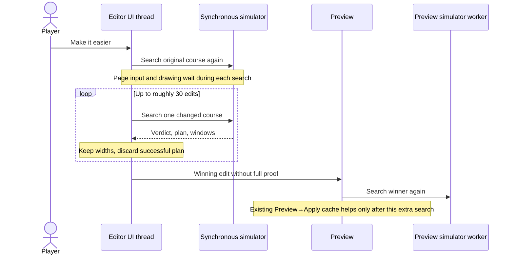
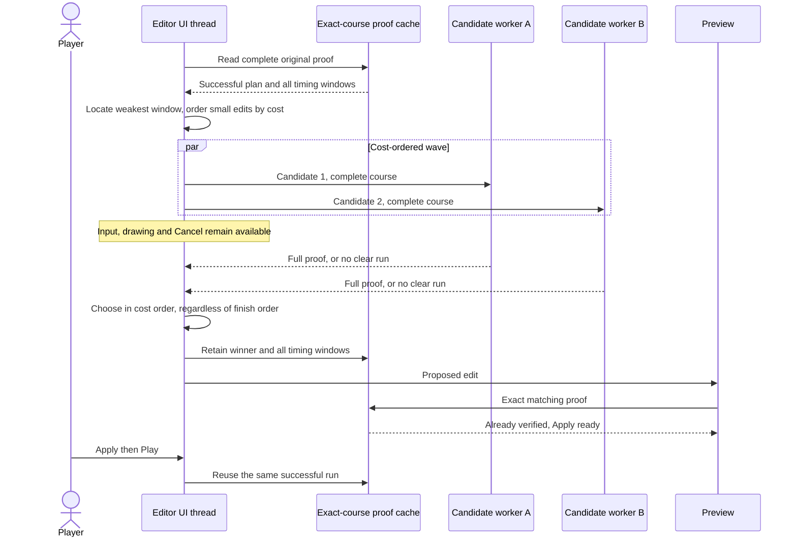
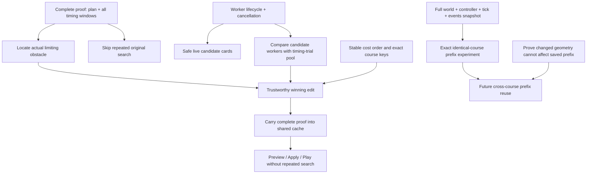
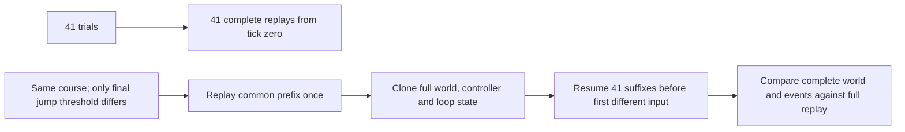

# Make it easier: show the work and keep its proof

- Updated 2026-11-04.
- The editor can stay responsive while the simulator tries small changes.
- A verified proposal keeps its successful run through Preview, Apply and Play.
- No model decides clearance or invents a run.
- The measured method comparison and prefix experiment are in the [experiment report](../data/eval/easier-search/README.md).

## What changed, and why

| Change | What it removes or improves | Limit |
| --- | --- | --- |
| Reuse the exact current-course proof | Removes the baseline search when a complete matching proof exists | Legacy stored bar/device proofs without full timing metadata need one enrichment search |
| Retain the winning plan, windows and course | Removes the extra winner search at Preview and after Apply | Changing a checkbox or any physics input needs its own matching proof |
| Run whole candidates in two workers | Keeps simulation off the UI thread; lets two candidate searches overlap | Does not make every course twice as fast; more workers also use more memory |
| Cancel, edit or leave the editor | Terminates both workers and rejects queued work immediately | Already completed cache entries remain valid for their exact course |
| Small candidate profiles | Shows the changed layouts, their status and measured press windows | Profiles are layouts, not a picture of every timing trial or a physical CPU core |
| Target the weakest measured window | Spends the first edits near the limiting obstacle instead of near an unrelated selection/start | Unknown obstacle labels fall back to the selected area |
| Deduplicate identical course inputs | Reuses rounded/clamped candidates and the baseline | Keys include current device settings; different inputs cannot share a proof |

- Candidate cards are on during local development, or with `?mode=editor&easierview=1`.
- `easierview=0` hides the cards while keeping worker searches and cancellation.
- Production leaves the new visualization opt-in.
- Grey profiles show the current course; teal shows a candidate.
- “Verified” means that candidate's simulator found a successful run.
- The number in milliseconds measures the narrowest supported press window, not search duration.
- Nothing moves in the editor until the normal Apply action.

## Before: simulation blocks the page, then the proof is lost

## After: workers calculate; the page shows progress

- A wave waits for both answers before choosing in edit-cost order.
- A faster, more expensive result cannot displace a cheaper qualifying edit still running.
- This preserves the “smallest edit first” rule, at the cost of waiting for a slow wave member.
- The first change that widens the window by at least 25% wins.
- If none reaches 25%, the best improvement of at least 15% is offered.
- The existing 40-second ordinary / 150-second hold search budgets are checked between waves.
- A wave can overrun that soft budget; the Cancel button stops it immediately.

## What blocks what

- Merely adding cards before moving calculation off the page cannot keep cards updating during a synchronous search.
- Merely caching a boolean cannot give Play the actual successful run.
- Rendering windows contain only position-based markers; bar hang/reach windows are different data.
- The cache now keeps `timingWindows` as well as the existing filtered `windows` used by the lane drawing.
- The shipped positive preset proofs were enriched with full timing metadata without changing their successful plans.
- New stored preset proofs also save full timing metadata.
- An older stored positive proof still proves clearance; its incomplete timing metadata is enriched once when required for Make it easier.
- A changed course is always rebuilt with only the devices currently in the editor.
- Results are bounded to 24 cached courses; the winning proof is reinserted immediately before Preview.

## Reusing a run prefix: measured investigation, not enabled in production

- The prototype uses the real `inputFor` and `stepWorld` functions.
- It saves every controller field, event history, maximum distance, stuck counter and elapsed tick count.
- It stops the common prefix before the earliest final-jump threshold can change an input.
- It rejects batches that differ in any earlier control setting.
- It compares full final worlds and events, beyond comparing only clearance scores.
- Cross-course reuse remains blocked on geometry and device dependency checks.
- Moving a platform can alter collision, terrain lookup, start placement, finish placement or contacts earlier than its visual location suggests.
- General prefix reuse belongs inside the trial evaluator, after exact equivalence tests for each supported obstacle family.
- The current experiment does not change production physics, the optimizer, or trial execution.

## Source map and checks

- [Search and bottleneck selection](../src/slice/easier.ts).
- [Worker lifecycle](../src/modes/editor/easier-workers.ts).
- [Candidate profiles](../src/modes/editor/easier-progress.ts).
- [Editor integration](../src/modes/editor/helper.ts).
- [Shared proof cache](../src/modes/editor/search.ts).
- [Reproducible benchmark](../scripts/bench-easier.ts) and [prefix prototype](../scripts/easier-prefix.ts).
- Unit checks cover worker limits, queued cancellation, malformed proofs, out-of-order completion, timing metadata and exact prefix replay.
- Browser checks use real simulator searches and verify Cancel, candidate cards, cached Preview and cached Apply.
- Marketing clips and accompanying post text are local throwaway outputs and are deliberately outside the repository.
