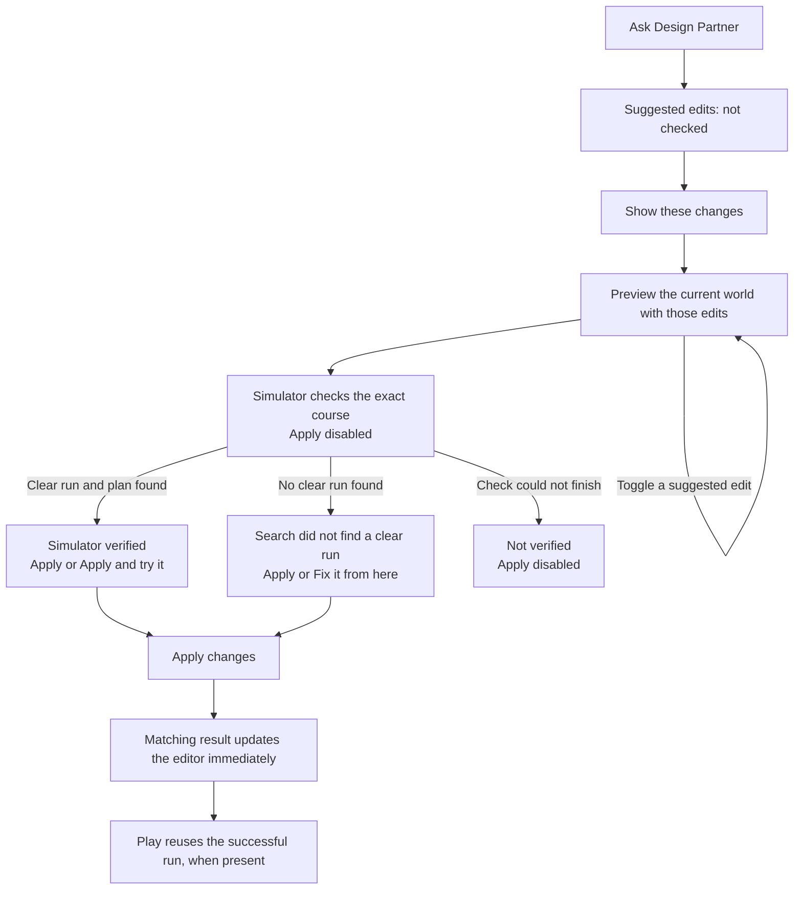
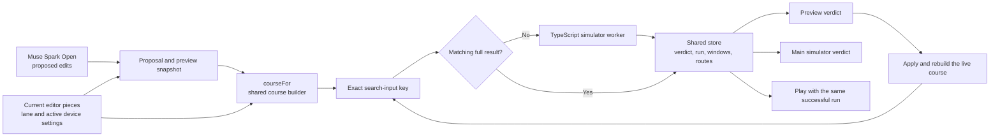

# Design Partner suggestions and simulator proof

- Updated 2026-11-04.
- The Design Partner proposes edits; the TypeScript simulator supplies every clearance verdict.
- Preview, the applied editor lane and Play use the same course builder and share complete simulator results.

## What changed in the editor

- Ask shows that the Partner has suggested changes that are not checked yet.
- The UI shows concrete edits instead of displaying the model's free-text answer as a clearance claim.
- Show these changes builds a preview without moving the current pieces.
- Apply stays disabled while the simulator is checking the preview.
- A successful check says "Simulator verified: this lane can clear."
- A failed search says it did not find a clear run; it does not claim the course is impossible.
- Apply is available after a completed positive or negative check.
- Apply and try it is available only after a positive check.
- A stopped or failed preview check supplies no proof and leaves Apply disabled.
- Switching a change off invalidates the preview proof until that exact selection has been checked.
- Switching back to an already checked selection reuses its result.
- Apply updates the main simulator verdict immediately from the matching proof.
- Play receives the same successful run and timing windows instead of searching again.
- Editing a physics input or a device setting requires a check for the new course.

## Data flow

- [helper.ts](../src/modes/editor/helper.ts) turns accepted model edits into a proposal and a preview snapshot.
- [lane.ts](../src/modes/editor/lane.ts) builds both preview and live courses through `courseFor`.
- [search.ts](../src/modes/editor/search.ts) gives preview and live checks independent workers with a shared result store.
- A stored result contains the clearance verdict, successful run, timing windows and routes returned by the simulator.
- The result key serializes the search input, including terrain, movement parameters and active device settings.
- Source metadata, hazard appearance and designer-marked shortcuts are excluded from that key.
- The store holds at most 24 checked course variants for the current editor session.
- Apply compares the preview course with the checked course before changing the world.
- The applied course must match a stored result before the UI says its verified run is ready.
- [verify.ts](../src/modes/editor/verify.ts) stops an obsolete live search and publishes a matching result without starting a new search.
- `withProof` attaches the successful run and timing windows when the course is sent to Play.
- Cancelled workers and late preview answers cannot overwrite a newer preview.
- A positive worker response without a run plan is rejected rather than displayed as verified.

## Only devices currently added are checked

- Preview checks the current setup after the proposed edits, including a device's proposed position.
- It does not add devices or try configurations that are absent from the editor.
- When more than one device is present, the existing Play precedence is preserved: trebuchet, drone, recoil launcher or cannon, then elastic band.

| Added device | Settings included in the shared course |
| --- | --- |
| Trebuchet | Counterweight, arm setting, pin angle and pivot position |
| Drone | Payload, battery, pad position and pad length |
| Launcher or cannon | Kind, projectile mass, muzzle speed, pad position and pad length |
| Elastic band | Current stiffness and the existing band defaults |
| None | The ordinary lane with no device added |

## Checks and evidence

- [Proof handoff tests](../tests/editor-proof-handoff.test.ts) replay a real simulator plan and verify reuse, changed-input invalidation, cancellation and missing-plan rejection.
- [Device tests](../tests/editor-preview-devices.test.ts) compare preview and live courses for each currently supported device.
- [Verdict tests](../tests/editor-verify.test.ts) check that a matching proof updates the main verdict without another search.
- [Live browser check](../scripts/partner-proof-check.mjs) calls the actual Muse Spark Open endpoint and uses actual simulator workers.
- The browser check verifies disabled Apply during checking, reuse after toggling, immediate Apply and reuse in Play.

- [Live run record](../data/eval/partner-proof-handoff/README.md) records the two real model calls and their validation results.
- Screenshots: [checking](evidence/partner-proof/checking.jpg), [verified](evidence/partner-proof/verified.jpg), [applied](evidence/partner-proof/applied.jpg).
