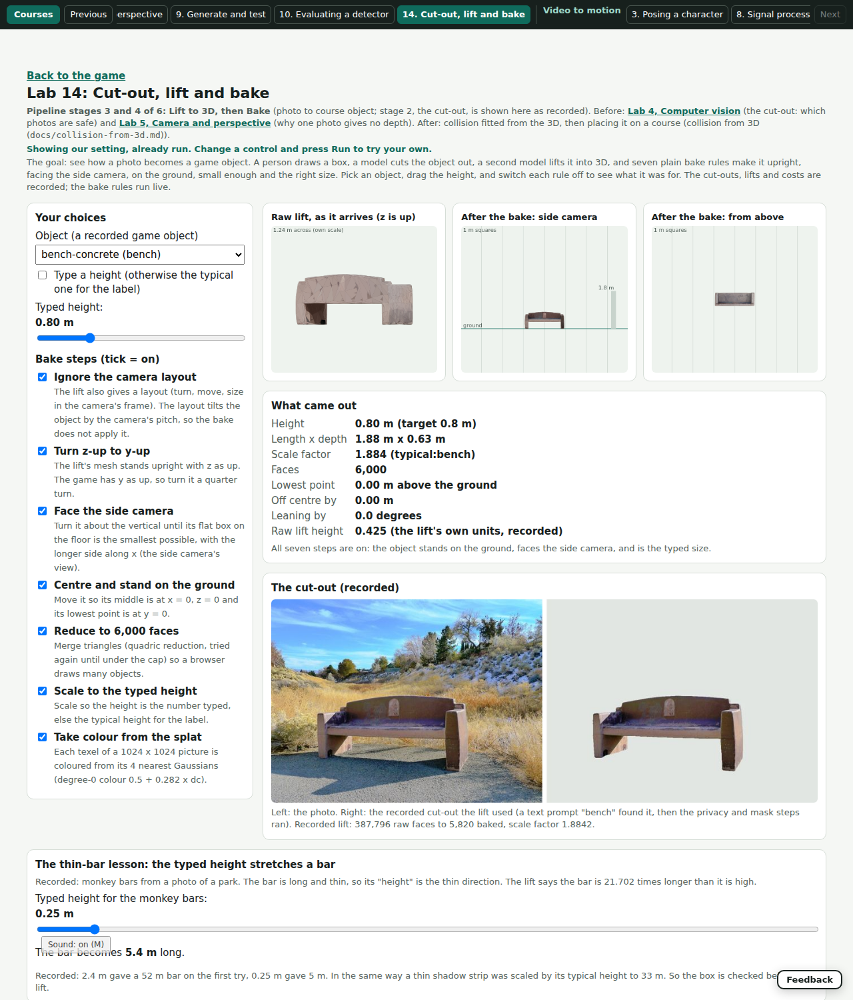

# Lab 14: Cut-out, lift and bake (photo to game object)

*Pipeline stages 3 and 4 of 6 (Lift to 3D, then Bake) in the photo-to-course-object path; stage 2, the cut-out, is shown here as a recorded result and taught in Lab 4 and Lab 10.*
*Before: [Lab 4, Computer vision](vision.md) (which photos are safe) and [Lab 5, Camera and perspective](camera.md) (why one photo gives no depth).*
*After: [collision fitted from the 3D](../collision-from-3d.md), then placing the object on a course and proving it with the simulator.*
*The recipe it teaches is step 7 of [pipelines](../pipelines.md); the lessons behind it are in [lessons-obstacle-creation](../lessons-obstacle-creation.md).*

## When you open it
- Live: it opens on the recorded concrete bench with all seven bake steps on; the three pictures, the facts, the cut-out and the cost table are filled.
- A small label says "Showing our setting, already run".
- Address: `?mode=lab-lift&labs=1`.

## The question
- How does a photo of a real thing become a game object of the right size, standing the right way, and what was each bake step for?

## What the player does
- Picks one of the 19 recorded game objects in `public/assets/objects/`, drags the typed height, and switches each of the seven bake steps off.
- Reads the facts after the bake: height, length and depth, scale factor, faces, lowest point, off-centre distance, lean.
- Drags the typed height of the monkey bars and sees the bar grow to 52 m (the thin-bar lesson).
- Reads what one object cost in seconds and money, as recorded.

## What runs, and what is recorded
- **Runs live (our code):** the bake rules of `docs/pipelines.md` step 4, written in `src/labs/lift/lift-core.ts`: ignore the camera layout, z-up to y-up, face the side camera (smallest horizontal bounding box, longer side on x), centre and stand on the ground, cap at 6,000 faces, scale to the typed height or the typical one for the label.
- **Recorded (not run now):** the cut-outs (`public/assets/lab/lift/`, made by `scripts/lab-lift-pictures.py` from the recorded masks), the raw lifts' size, turn, tilt and face counts for the bench and the railing (`data/eval/cc-38-photo-to-3d/r3/*/mesh.json`), the monkey-bars lift receipt (`docs/evidence/cc-133-lifts/monkey-bars-lift.json`) and the cost numbers of `docs/pipelines.md`.
- **Stand-in:** the raw lifts are hundreds of thousands of faces and are not in the repo, so the Lab turns a recorded, baked object back into a raw-looking lift (`unbake`: z up, turned, tilted by the camera layout, in the lift's own size, off the ground) and bakes it again.
  - For the bench and the railing the raw size and face count are the recorded ones.
  - For the other 17 objects the raw size, turn and tilt are stand-ins, and the Lab says so on screen.
  - The colour of each triangle is read from the baked object's own picture at the triangle's middle.

## What each step does when it is off
- **Ignore the camera layout off:** the object leans back by the camera's pitch, so its footprint and top are wrong.
- **z-up to y-up off:** the object lies on its side; the old height shows up as depth.
- **Face the side camera off:** the object keeps the angle the lift gave it; its flat footprint box is larger.
- **Centre and ground off:** it floats, sinks or sits off to one side.
- **Reduce off:** it keeps its raw faces (387,796 for the bench; 84,204 for the railing).
- **Scale off:** it keeps the lift's own size (0.42 for the bench, where the game needs 0.8 m).
- **Colour off:** plain grey.

## How it was designed
- **The one question:** what is each of the seven bake steps for?
- **The choice:** to build a teaching bake on the baked objects we already have rather than ship a raw lift (the files are far over the 300 KB limit, and a new model run is not allowed for this Lab).
- **The real code:** the page reads the real `.glb` files with the game's `readGlbMesh` and draws them with the same triangles the game uses; the bake rules are the pipeline's, rewritten in TypeScript.
- **Order of the screen:** choices, three pictures (the raw lift, the baked side view, the baked top view), the facts and what breaks, the recorded cut-out, the thin-bar lesson, the recorded cost, the maths on request, then what we chose.
- **Overlaps, linked and not repeated:** Lab 4 (which photos are safe; the mask thresholds), Lab 5 (one photo gives no depth, which is why the size comes from a typed or typical height), Lab 10 (whether a detector points at the right part, after the object exists).

## How we prove the lesson is right
- `tests/lab-lift.test.ts` (19 tests):
  - The recorded bench stands on the ground, is centred, is under 6,000 faces and is as tall as its record says.
  - For four recorded objects, unbake then bake returns the recorded height, length and depth, stands on the ground, centres, and caps the faces.
  - Each of the six geometry steps, switched off, breaks the bench in the way the table above says (lean, side, footprint, floating, raw faces, raw size).
  - The typical heights equal the table in `docs/pipelines.md`, and every recorded object's height matches the typical table when its label has one.
  - The thin-bar numbers (0.25 m gives 5.4 m, 2.4 m gives 52 m) come from the recorded lift check.
  - The cost and time numbers equal the files they came from (`mesh.json` of CC-38 round 3, the lift receipt) and the lines of the pipeline doc.
- `scripts/lab-lift-check.mjs` opens the Lab at 1280 px and checks it opens already run, the slider and the toggles change the facts, the thin bar reaches 52 m and there is no page error.
- The Lab's claim would be false if: unbaking then baking did not return the recorded object, or a step switched off changed nothing.

## Limits
- The raw lift is a stand-in made from the baked object, not a real SAM 3D Objects output; a real raw lift has holes, noise and its own layout that we never shipped.
- The "reduce" step only reports the face count; it does not run a quadric reduction.
- Colour is sampled per triangle from the baked picture; the real bake colours from the Gaussian splat, which is not shown.
- Only the bench and the railing have a recorded raw size, turn and tilt; the other 17 use stand-ins.
- Mural walls from CC-38 are not in the picker (no game object kept).
- The cut-outs are recorded masks: the Lab cannot draw a new box or run a model.
- Cost numbers are the pipeline doc's own: the doc says the idle cost of warming the models is not measured yet.
- The leaning test uses the camera pitch the Lab chooses (at least 12 degrees), not the recorded 1.7 degrees, so the lean is easy to see.

## How to make the lesson better
1. Ship one small raw lift (a decimated real one) so the bake runs on a real SAM 3D output.
2. Add the quadric reduction (a small TypeScript decimator) so "reduce" shows the shape change.
3. Let the player draw a box on the recorded photo and show the recorded mask nearest to it.
4. Show the splat colour next to the baked picture.
5. Link to the collision Lab when it lands.

## Evidence
- 
