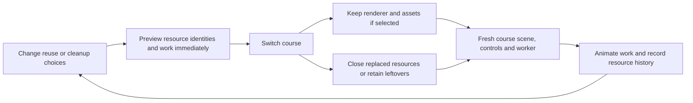

# Hide the wait

*A Foundations Lab, in the Search and learn group (its number is its place in the Labs list in `src/ui/labs-series.ts`).*
*Before it: Search (how the simulator looks for a clear run) and Generate and test (the proposals it throws out).*
*Used in: the photo pipeline (the lift and the "prove it" step) and the idea pipeline (the Check step).*

## Reuse or rebuild: the course-switching experiment

- The default experiment is **Switching courses**, with a complete preview already visible.
- **Search and model startup** opens the original experiment with its existing controls, recordings and live worker measurement.
- Three choices update the preview immediately: keep the renderer, keep models and motion, and clean up this course.
- The diagram shows outgoing and incoming courses with stable resource IDs, making reuse visible as identity rather than a smaller number alone.
- Teal means reused, gold means new, grey means closed and red means left alive; words and IDs carry the same meaning without relying on colour.
- **Switch course** commits the model transition and animates its stages; replay, pause and the scrubber let the learner inspect what blocks the first frame.
- The resource chart records completed switches, so repeated switches expose old scenes, controls and workers accumulating when cleanup is off.
- Turning cleanup on prevents future leftovers; **Reset** clears the earlier ones and starts a fresh comparison without changing the choices.
- **Rebuild everything** and **Our setting** are comparison presets, not answers that hide the controls.
- The model uses illustrative work/resource units, not measured milliseconds or memory in MB.
- The initial course is already loaded, so this experiment teaches subsequent switches rather than cold startup.
- Recorded real VM results (17–22 s before, 1–11 s after) are labelled separately and retain the slow return from Montmartre.
- The teaching scene assumes a search is active; the real game only creates search workers when needed.
- No real worker is leaked and the browser is never deliberately frozen to illustrate the broken choice.
- Implementation: `src/labs/wait/reuse.ts` owns deterministic resource accounting and `reuse-view.ts` owns the view and animation.
- The Lab remains in Foundations → Search and learn → Hide the wait, with a link to the System design finale.
- `?waitreuse=0` restores the original experiment as the only choice.

## When you open it
- The course-switching experiment opens on **Our setting**, with reuse and cleanup enabled.
- In **Search and model startup**, Our setting uses four workers and early model warm-up on the recorded trap-chain course.
- Every experiment opens with filled outputs; the original experiment retains its two lanes, meters, challenges and frame strip.
- A small label says "Showing our setting, already run"; change a knob to try your own.
- Open it at `?mode=lab-wait&labs=1`.

## The question
- Some work is slow and cannot be made zero: a simulator search, a Modal machine waking up.
- How do you make the wait short, keep every frame smooth, and never leave the person looking at nothing?

## What runs
- The jobs are the real search's: `scripts/lab-wait-record.ts` runs `searchGen` from `src/sim/ideal.ts` on three courses (the trap, the rail, the swing to bars) and saves what each job cost in simulator ticks, in `public/assets/lab/wait-recorded.json`.
- Early exit is the game's: a batch that may stop at its first clear is cut there, as `driveSync` does.
- The rest is a model in `src/labs/wait/core.ts`: a frame scheduler, a worker pool, a remembered-jobs pattern, coarse-to-fine passes, and the two lanes.
- The "time the real search" button runs the real search in a worker (`src/labs/wait/worker.ts`) and sets the slowdown knob from your machine.
- No paid call, no GPU.

## What we measured, and what we assumed
- Measured in the repo: 330 ticks per ms on the dev machine; the Modal model load 45 to 54 s; a first piece cold 90 to 100 s; warm, Segment about 18 s and a piece about 32 s; the finder stays warm 60 s and the lifter 240 s; a pool is 5 to 14 times one thread (CC-70), one thread 1.5 to 3 times the first version (CC-69).
- Assumed: a frame is a 4 ms draw plus the jobs started in it, rounded up to the 16.7 ms screen beat; at least one job runs per frame, so a frame can run over by one job; a message to a worker costs a little; the page-open to Segment-press gap defaults to 8 s.
- In our recording, with nothing hidden, the freeze costs 428 missed frames on the bars course; slicing costs none but takes about 1.7 times longer; four workers take about a third of the freeze time and miss none.

## The knobs
- Workers, and slices of work between frames (when there are no workers).
- Early exit, jobs remembered from before, coarse-to-fine passes, a slower machine.
- Cold-start length, the gap from tab to press, and when the Modal machines are woken.
- What the person sees: "working" at once, progress, a stand-in then a rough ghost, and keep editing meanwhile.

## The challenges
- First word on screen in under 300 ms.
- No frame over 16.7 ms.
- Finish the search in the least wall time without a missed frame.
- Fewer than 10 s with nothing to see or do during a cold start.
- Each runs in a fixed scene so a knob cannot cheat it.

## How it was designed
- The two lanes come from one idea: a wait is only bad when nothing useful is on screen.
- The person's lane is split into three states (nothing to see or do, only told it is working, something useful); the felt wait is the first two.
- The real job costs are used so the speed-ups are not made up; only the scheduling around them is modelled.
- The maths (job time, frame, a bound on speed-up, cold wait) is behind one button, last.

## How we prove the lesson is right
- `tests/lab-wait.test.ts` pins laws first: work is conserved, no frame is over budget unless one job is, N workers never beat N times, early exit never adds work, the lanes partition the wait, and a warm-up never makes it longer.
- The recording matches the game: `node --import tsx scripts/lab-wait-record.ts --check` finds drift, and the recorded plan is the game's own.
- `scripts/lab-wait-check.mjs` opens the page at 1280 px and checks both experiments, instant choices, repeated switches, replay, cleanup, the old lanes, meters and presets.
- `tests/lab-wait-reuse.test.ts` checks conservation and ownership across every policy, flat memory under cleanup, persistent earlier leftovers and immutable input states.

## Limits
- The worker pool and the cache are a model, not the pool code itself; the real pool measured 5 to 14 times, the model gives the same range only for the courses recorded.
- The remembered-jobs knob is a pattern, not the game's proof cache.
- Three courses only; the cold-start numbers come from our Modal logs, not a live call.
- It does not teach loading bars or animation craft; it teaches where the time goes.

## How to make the lesson better
- Record more courses, and a search with a real worker pool trace.
- Add a live Modal ping with its cost stated first.
- Let the lanes replay a real logged Make-tab session.

## Design principles

- Put a large visual beside a small set of meaningful choices.
- Update the picture on input, without a separate Run step for cheap calculations.
- Show the causal chain and stable identities, not just a score.
- Open already populated, and offer reset, comparison presets and an inspectable replay.
- Label teaching models, recorded measurements and live execution distinctly.
- Explain the real game connection after the experiment, with optional details and equations.
