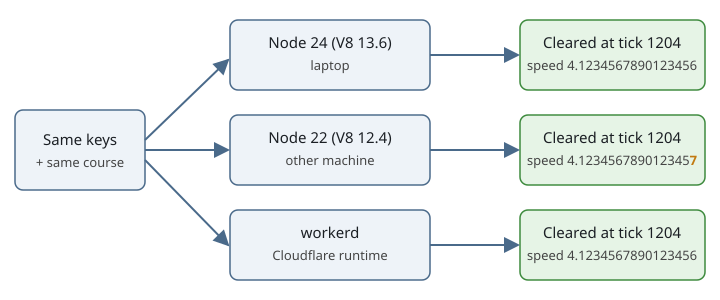

# Lesson: test on a different machine

*A shareable lesson from CC-133.*
*The numbers below are real; the picture uses made-up digits to show the idea.*

## So what
- Our promise is "same keys, same result".
  - A friend can replay your run.
  - The server can prove you cleared a course by replaying your keys.
- We tested that promise on a second machine with another Node version, and in Cloudflare's runtime.
- The outcome held: 7,525 runs gave the same tick count, the same clear or fall, and the same end place on Node 22, Node 24 and local `workerd`.
- The exact bits did not hold at first: the fingerprint (hash) of a run differed between Node 22 and Node 24 on six courses.
- Fixed on 2026-11-03: the sim now uses only `+ - * /` and `Math.sqrt` where it used `**` and `Math.pow`.
  - Node 22 and Node 24 now give the same hash for every course in the trace test (100 runs).
  - Workerd still differs in the last digit on courses where the tick uses sin, cos, tan or exp (found while checking the fix).
- So the rule for the game is:
  - Judge a run by its outcome (levels 1 and 2); that holds everywhere.
  - Exact bits (level 4) can be the cross-machine check between Node versions; for workerd it needs our own sin, cos, tan and exp first.

## The ways to say "these two runs match"
- Same keys can be checked at four levels, from loosest to strictest.
- Each level answers a different question, so pick the one that fits the claim.

| Level | What must be equal | Question it answers | Held across Node 22, Node 24 and `workerd`? |
|---|---|---|---|
| 1. Outcome | Cleared or fell | "Did your run clear the course?" | Yes, 7,525 runs |
| 2. Tick count and end place | Level 1, plus the tick count and the end position to 6 decimals | "Is it the same run, to the eye and the clock?" | Yes, 7,525 runs |
| 3. Close enough | Every tick's state within a small tolerance (about 1e-9) | "Did the physics stay on the same path?" | Yes in the probes (the biggest gap seen was about 1e-13) |
| 4. Exact bits | Every number identical to the last digit, as one hash | "Are the two engines doing the same arithmetic?" | Before the fix: no, six courses differed. After the fix (2026-11-03): Node 22 and Node 24 yes; `workerd` yes on plank and plank-two, no where the tick uses sin, cos, tan or exp |

- Level 4 is the strictest and the least useful for our promise, though it is now cheap between Node versions.
  - A friend replaying your run, and the server proving a clear, only need levels 1 and 2.
  - A last-digit difference of about 1e-13 never flipped a result in any of the 7,525 runs.
- So the exact-bits check was too strict for the question we ask.
  - It still earns its place as a tripwire on one engine family: it tells us the moment our own code changes the physics.
  - It must not be the thing that says "the promise is broken" on another machine.
- What we do: levels 1 and 2 on every machine, and level 4 on Node 22 and Node 24 (see section 5).
- A run that sits on a razor-thin margin could in theory flip at level 1 on another engine; none did, and the pow fix removed the Node-version source of that risk.

## 1. Why test on another machine
- A game that only runs well on the author's laptop is not a shared game.
- The question we ask is narrow:
  - Can a friend on another browser replay your run and see the same thing?
  - Can the server on Cloudflare replay your keys and agree you cleared?
- Our sim has no random numbers and a fixed time step, so on paper the answer is yes.
- On paper is not a test; so we ran the same code on a different CPU, a different Node version and a different runtime.

## 2. What we found
- Outcomes were identical in 7,525 runs.
  - That is every shipped course, the ideal plan, and 300 key-mash seeds each.
  - Node 22 (V8 12.4) against Node 24 (V8 13.6).
  - The 1,806 runs on the six affected courses also matched in `workerd`.
- Bits were not identical on six courses.
  - plank and plank-two (beam bending), drone (rotor power), lache, lache-wide and training (cart rails or vault curve).
  - The gap starts in the 16th digit.
  - After a plank walk it grows to about 1e-13 in speed.
  - That is far too small to flip a clear in any run we tried.
- The CPU was not the cause.
  - The failure that first showed on the VM reproduced on the laptop with the same Node 22.

## 3. Where differences can come from, in general
- **The JavaScript engine version.**
  - What we hit: `x ** 3` and `Math.pow(x, 1.5)` round one step differently in V8 12.4 and V8 13.6 (fixed 2026-11-03).
  - What we found next: in workerd, `sin`, `cos`, `tan`, `atan`, `exp`, `log`, `asin` and `acos` give other last digits than in Node; `sqrt` and `hypot` match.
- **Math functions the spec lets differ.**
  - `sin`, `cos`, `exp`, `pow` and friends may give slightly different last digits on different engines.
  - `+ - * /` and `sqrt` are exact by the IEEE rule, so they are the same everywhere.
- **CPU float habits.**
  - Old x87 chips used extra-wide registers; modern SSE does not.
  - A fused multiply-add (FMA) rounds once instead of twice.
  - JavaScript engines rarely expose this, but compiled code (WebAssembly, C, GPU) can.
- **Sort order.**
  - A sort that is not stable can order equal items differently.
- **Maps and sets.**
  - If you loop over a hash map whose order is not fixed, results can change.
  - JavaScript `Map` keeps insertion order, which is safe.
- **Time and place.**
  - `Date`, time zone and locale (for example how numbers print) differ between machines.
- **Threads and GPUs.**
  - Adding numbers in a different order gives a different last digit.
- **Other browsers.**
  - Firefox (SpiderMonkey) and Safari (JavaScriptCore) are different engines; we did not run them.

## 4. How we found it
- A fingerprint after every tick (`dump.ts`), not just at the end.
  - A failing end hash says "different"; a per-tick hash says when.
- A first-difference tool (`firstdiff.mjs`).
  - It named the tick and field: tick 292 on drone (`drone.power`, one unit in the last place) and tick 628 on plank (`runner.y`).
- A Math probe (`mathprobe.mjs`).
  - It hashes 200,000 results per Math function on each Node.
  - Only `pow` and `**` differ; sin, cos, tan, atan, atan2, exp, log, sqrt, cbrt, hypot, asin and acos match.
- The same commit on both Node versions.
  - Same code, different engine, different result: that rules out our own change.
- A Worker in `wrangler dev` for the Cloudflare side.
  - It gave the same outcome lines, and `Math.pow(13.1, 1.5)` matched Node 24.

## 5. The rules we take
- In the sim step, use only `+ - * /` and `Math.sqrt` where you can.
  - Avoid `**` above 2 and `Math.pow`.
  - If you must use a fuzzy function, accept a tolerance.
- The trace test (`tests/sim-trace.test.ts`) checks tick count, outcome and the stored hash on Node 22 and Node 24.
- A source scan (`tests/sim-no-pow.test.ts`) fails if `**` or `Math.pow` comes back where a tick, a replay or a course fingerprint can reach.
- The fix we took (2026-11-03, the owner's call):
  - `x ** 3` became `x * x * x`, `x ** 2` became `x * x`, and `Math.pow(T, 1.5)` became `T * Math.sqrt(T)`.
  - `data/eval/trace-machines/pow-fix.patch` listed six sites; a search of all of `src` found about twenty more (cart splines, vault curve, pole, trebuchet, drums, predict, experiments), and all were changed.
  - 15 of the 100 stored trace hashes changed (the plank, plank-two, drone, lache, lache-wide and training entries); the tick counts and outcomes in them did not.
  - Before regenerating, 7,525 runs and both recorded runs (`bars`, `swing-to-bars`) were replayed on old and new arithmetic: no run changed its tick count, outcome or end place (6 decimals).
  - `tests/golden/course-hashes.json` did not change: it hashes course data, not play.
- What is still open: workerd's `Math.sin`, `cos`, `tan` and `exp` differ from Node's in the last digit.
  - Our drone, lache and training plans use them, so their hashes differ in workerd although the outcomes match (1,806 runs).
  - The next step is our own sin, cos, tan and exp (a fixed-formula version) used in the sim step, or a tolerance for those courses on workerd.

## 6. What this does not cover
- Real production `workerd`; we ran it locally (wrangler 4.153, workerd 1.20261023.1).
- Chrome, Firefox and Safari.
  - Chrome follows V8, so it lands on one side of the same change.
  - Firefox and Safari use other engines and are untested.
- The original VM itself was shut down; we reproduced its failure on the laptop.
- A run with a razor-thin margin could still flip on another engine; we found none.

## Try it yourself
- Run the probe on two Node versions and compare the files: `data/eval/trace-machines/mathprobe.mjs`.
- Full numbers and scripts: [data/eval/trace-machines/README.md](../data/eval/trace-machines/README.md).
- The short entry in [lessons](lessons.md).
