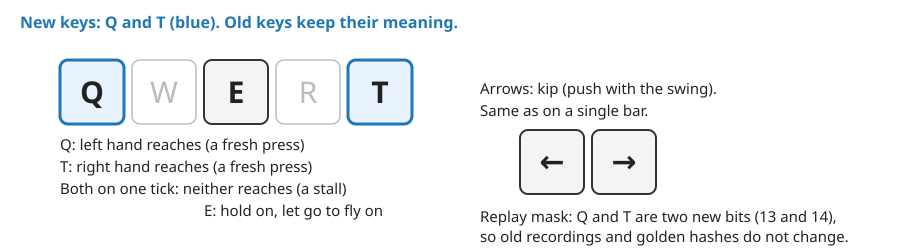
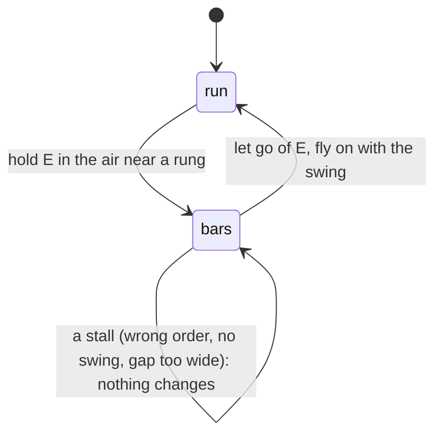
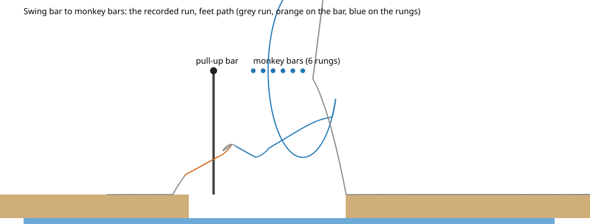
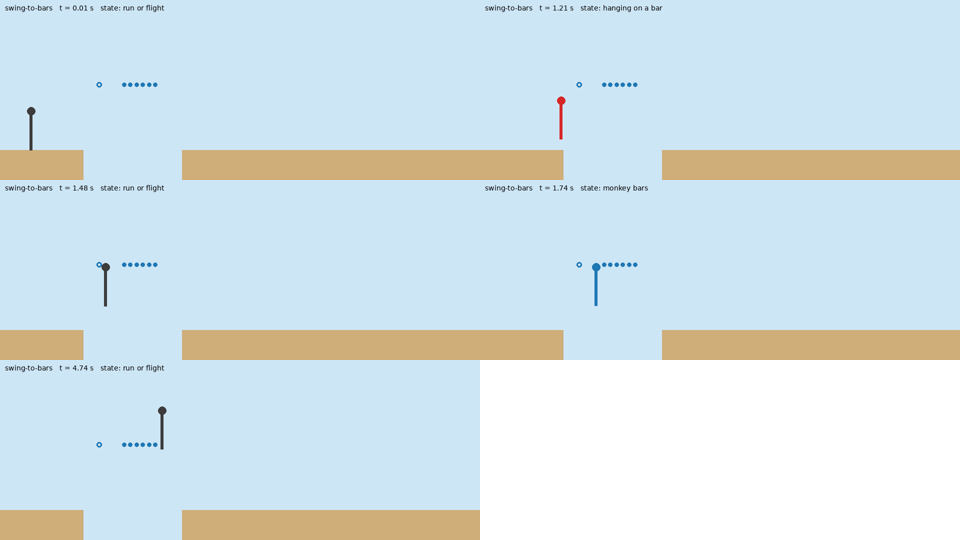
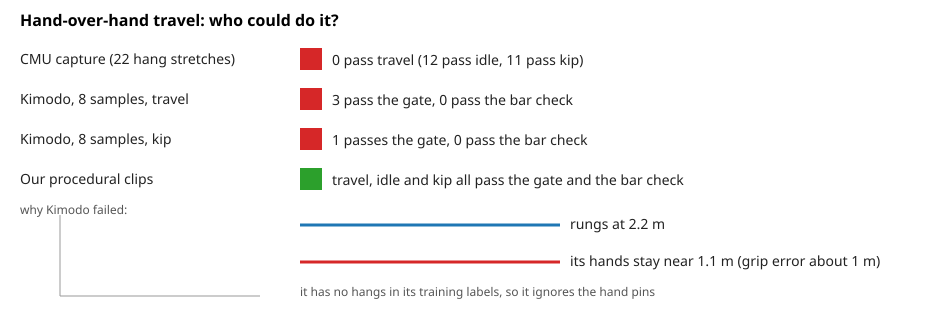
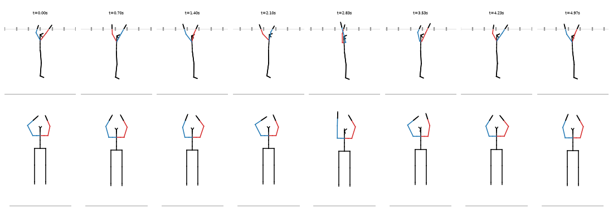
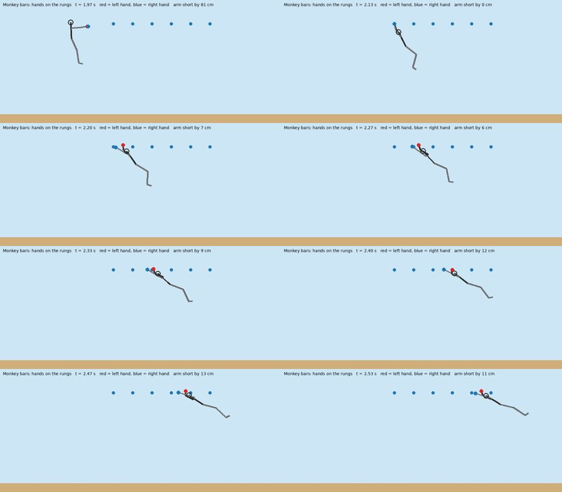

# Lesson 1: how we create a move (a player verb)

- Part of CC-133, written for people who want to learn game design and physics-game building from this project.
- Every number and file below was read from the repo; where we did not measure something, the page says so.
- The three lessons are a set: this one (a move), [obstacle creation](lessons-obstacle-creation.md) (a world object), [move and obstacle interactions](lessons-move-obstacle-interactions.md) (how the two meet).

## So what: what you can do after reading
- You can take one physics idea and turn it into a new key press that the player learns in a minute.
- You can write the rules so the same keys always give the same result, bit for bit, on any machine.
- You can prove the move with tests that check a law of physics before you check the feel.
- You can show it with a body that passes a plausibility check, or fall back to a plain drawn body when no real motion works.
- Worked example: the monkey bars (`src/sim/bars.ts`), with the pole climb, the vault and the wall climb as short side examples.

## The 5-step recipe
1. **Pick the saying.**
   - Write one line that holds one tension, true of the physics, with no formula.
   - Rules for the line are in [sayings.md](sayings.md).
2. **Design the keys.**
   - Say what a fresh press and a held key mean in each state.
   - Keep new keys apart from old ones ([input-design.md](input-design.md)).
3. **Write the states and numbers, and test the laws first.**
   - Pure functions, metres and seconds, the fixed 120 Hz step.
   - Write the physics-law tests before the feel tests.
4. **Make it replay exactly.**
   - A run is only its keys, so new keys are new bits added after the old ones.
   - The old golden hashes must not change.
5. **Give it a body, behind a switch.**
   - Use a clip that passes the plausibility gate, or a plain procedural pose.
   - Put the feature behind a switch and add a row to the key card.

## Worked example: the monkey bars

### Step 1: the saying
- Saying: *"The swing gets your hand to the next rung; a gap too wide asks for a bigger swing."* (the Monkey bars row in [sayings.md](sayings.md)).
- The tension is: the swing is both what carries you forward and what you must pay to keep.
- It is true because a straight arm reaches only 0.7 m about the shoulder, so a far rung is out of reach until the body swings forward enough.
- It is also earned: the player finds out by stalling on a wide gap and then kipping harder.

### Step 2: the keys

*Notice: only the two blue keys are new; everything the player already knew still works on the bars.*

- E holds on and lets go, as on a single bar.
- The left and right arrows kip the swing, as on the Lache pair.
- Q reaches the left hand and T reaches the right hand, each as a fresh press (holding does nothing more).
- Both on one tick is a stall, so the simulator never guesses which hand was meant.
- Q and T were free: E, W, A, S, D, X, V, K, R, C, F, G, H, I, M, N and P were already taken.
- The state decides the meaning: off the bars nobody reads the Q and T bits.
- The design rule behind this is one key, many meanings, decided by the situation ([input-design.md](input-design.md)).

### Step 3: states and numbers

*Notice: a stall is a loop back to the same state, so nothing in the row can make you fall; only letting go does.*

- Two states only: `run` and `bars`; a stall is not a state, it is a reach that does nothing ([bars.md](bars.md)).
- The reach rule: a rung is reachable when it is between 0 and 2 x 0.7 x sin(angle) ahead of the point between the hands, and the swing is going forward.
- So the gap a pair can cross is decided by how far the body swings, not by a timer.
- Each reach keeps 0.93 of the swing speed; damping is the same as on a bar; the kip is the only source of energy.
- The body is carried onto the new pivot over 8 ticks, so nothing jumps.
- Rung spacing in the editor runs from 0.3 m to 1.0 m, default 0.6 m.
- The numbers sit as named constants at the top of `src/sim/bars.ts` (`DEFAULT_BARS`), so a test and the editor read the same ones.

### Step 3b: physics-law tests first
- `tests/bars.test.ts` checks laws, not feel:
  - A reach never creates swing energy.
  - Without the kip the swing only loses energy over a whole reaching sequence.
  - The kip adds energy, and only the kip.
  - The arm rule is exact: just inside the reach works, just outside stalls.
  - A stall never leaves the bars (every kind of stall, held for 20 seconds).
- Then the plain rules: hands alternate, a held key does not reach twice, both keys on one tick do nothing.
- Then the hand-off tests (a release near the first rung puts the hands on the rung; a release too early does not break anything).

### Step 4: determinism and replay at 120 Hz
- A run is its keys: one bitmask per tick, run-length packed (`src/sim/replay.ts`).
- Q and T are two new bits (13 and 14), added above the old ones, so old recordings and golden hashes do not change.
- Tests: the same keys give the same state bit for bit; keys packed into the mask and played again end where the live run ended; the new bits sit above the old ones.
- The full course is proved by a recorded key list (`public/assets/demo/bars.run.json`) because the ideal-run search does not know monkey bars yet ([bars.md](bars.md), "What is not done").

*Notice: the recorded run is a real path from the simulator, so a reader can see where the body lets go and where it lands on the row.*

- A short clip of the same run, drawn from the simulator one picture per four ticks (a stepped clock): swing-to-bars.mp4 (video kept outside git).

*Notice: the body colour changes with the state (grey run or flight, red hanging on the bar, blue on the monkey bars).*

### Step 5: motion, behind a switch, on the key card
- The simulator is truth; looks never change physics ([lessons.md](lessons.md), Physics and time).
- Nothing is shown before it passes the plausibility check.
- We tried captured motion first, and it failed:
  - CMU capture: 22 hang stretches of 1.5 s or more, none passes the hand-over-hand travel check.
  - Kimodo: 0 of 8 travel samples pass the bar check, because its hands stay near 1.1 m while the rungs are at 2.2 m.

*Notice: the red rows are the sources that could not do it; the green row is the fallback we shipped.*

- The fallback is a procedural pose from our own code (`src/motion/bars-pose.ts`), with clips made by `scripts/bars-fallback-clips.ts`.
- All three clips (travel, idle, kip) pass the gate and the new bar checks; they look stiff, like a stick figure, and the README says so.
- What the fallback looks like, one frame per step of the stepped clock (top row from the side, bottom row from the front):

*Notice: the two coloured arms take turns, and the hips stay under the hands.*

- Clips: travel (video kept outside git) and idle (video kept outside git); the full story and the ranked next steps are in [data/eval/bar-motion/README.md](../data/eval/bar-motion/README.md).
- The pose now drives the actor on the bars (hook `src/motion/bars-actor.ts`, always on), the hands on the rungs the world says they hold:

*Notice: the hands sit on rungs and the body swings under them; the legs still look like a stick figure.* Clip: bars-pose.mp4 (video kept outside git).
- The switch: `?bars=1` shows the Monkey bars editor piece; a course that already has monkey bars always plays them (`src/switches.ts`).
- The key card shows a "Q  T" row only on a course that has monkey bars.
- The Parts gallery row lists the code, the saying and the bits it covers ([parts-gallery.md](parts-gallery.md)).

## The same recipe on the other moves

| Move | Saying | Keys | What the numbers say | File |
|---|---|---|---|---|
| Pole climb | none yet (a gap in [sayings.md](sayings.md)) | hold E next to a pole; let go to slide | a fixed 1 m/s up, 0.045 of the energy store per metre, slide speeds up at 4 m/s squared to at most 3 m/s | `src/sim/pole-climb.ts`, [fork.md](fork.md) |
| Vault | "A jump buys height with speed; a vault keeps the speed but needs a hand on the obstacle." | V a little before the step | needs at least 3 m/s, a top 0.35 to 1.3 m up, keeps 0.92 of the speed | `src/sim/vault.ts` |
| Wall climb | "Speed gets you to the wall; arms get you over it." | hold E at a tall wall | run speed is lost at the wall; the arms pull the body up | `src/sim/climb.ts` |

- The pole climb reused the one-key press-and-hold of the rope and the wall: no new key at all (`E` is the only key).
- The pole's direction comes from the key and never its speed ("the key sets the direction, never the speed").
- The pole climb is behind `?fork=1`, and old courses never reach its code because a course with no `climbPoles` skips it, so their golden hashes did not change.

## How long each step took
- We did not time the steps with a clock, so there is no honest hours table.
- Issues are sized to about half a day each ([CLAUDE.md](../CLAUDE.md)).
- The commit stamps of 2026-11-03 show the order and the spacing of the finished pieces:
  - Pole climb and fork course landed at 14:36.
  - Procedural bar motion at 14:47.
  - Bars simulation with Q and T at 14:51.
  - Editor piece and demo course at 15:12.
- Those are the times the commits landed, not hours worked, and several agents worked in parallel.
- The costs we did record: the two Kimodo runs for the bars were about 2 minutes each on a Modal L4, about 0.10 USD in all.
- Try it yourself: write the start and end time of each of the five steps for your own move, and compare.

## Mistakes and fixes
- **A "helpful" physics rule held up a whole course.**
  - A rule that flew the rope to the player's hands needed the course rebuilt once the catches became honest ([lessons.md](lessons.md)).
  - Fix: no helpful rules; a stall does nothing and says nothing else changes.
- **The simulator's grab was easier than a body can do.**
  - At 7 m/s its wall grab put the hands 2.4 m from the hips, and an arm reaches 1.07 m ([lessons.md](lessons.md)).
  - Related fix: the hand reach became 0.15 m everywhere, with the demo plans and golden hashes re-made (commit `83c49f15`, CC-243).
- **A captured clip does not exist for every move.**
  - CMU has hangs and kips but no hand-over-hand; Kimodo ignores hand pins 2.2 m up ([lessons.md](lessons.md)).
  - Fix: the procedural pose, shipped honestly as stiff.
- **A move check says what a clip shows; the gate only says a body could do it.**
  - A front flip once passed the gate as a roll until the check required a low body that keeps touching the ground ([lessons.md](lessons.md)).
  - Fix: add a bar check with negative controls (a standing body and a plain hang must fail travel).
- **The ideal-run search did not know the new move.**
  - So the demo course is proved by a recorded run, and the limit is written in the doc.
  - Fix: say so, and keep a ranked next step ("teach the search about monkey bars").
- **Adding a mode touched tests that count modes and cards.**
  - Commits `82a601e4` (mode count is 15 with the bars and the pole climb) and `3df9520a` (registry and card tests) fixed that after the fact.
  - Fix: before shipping a move, grep for the lists that count modes, switches and cards.
- **A doc broke the doc-style test.**
  - Commit `cf937a12`: `fork.md` had a second sentence in a bullet, found by `npm run test:quick` on the VM.
  - Fix: run `node scripts/doc-style.mjs` before you commit a doc.
- **The recorded demo run sits on a one-tick spot.**
  - Sweeping the release of the pull-up bar one tick at a time (`scripts/lesson-trace.ts`) shows that tick 28, the stored run's release, clears alone, while ticks 32 to 68 (308 ms) all clear.
  - Fix, not done yet: store a release from the wide part so the demo is not brittle.

## Checklist
- [ ] One saying, no formula, true of the physics.
- [ ] Each key is a fresh press or a held state, and the meaning is decided by the state.
- [ ] New keys are free, and they are new replay bits added after the old ones.
- [ ] States are few; a failure is a loop, not a fall.
- [ ] Law tests exist and fail when the law is broken.
- [ ] Same keys give the same state, bit for bit; golden hashes are unchanged.
- [ ] Motion passed the plausibility check, or a plain pose is shown and called what it is.
- [ ] A feature switch, a key card row and a row in `docs/ASSETS.md` for any file.
- [ ] A doc, with the limits and the ranked next steps.

## Try it yourself
- Pick a move that is not in the game: for example, a wall run along a fence.
- Write its saying in under 12 words with one tension.
- List its keys on a table with columns state, fresh press, hold, and check that no cell does two moves.
- Write three law tests in words (for example: "it never gains energy", "just inside the reach works, just outside fails", "the same keys give the same result") before any code.
- Decide which replay bit it will take, and check it is above the old ones.

## Files
- Code: [src/sim/bars.ts](../src/sim/bars.ts), [src/sim/pole-climb.ts](../src/sim/pole-climb.ts), [src/sim/vault.ts](../src/sim/vault.ts), [src/sim/climb.ts](../src/sim/climb.ts).
- Tests: [tests/bars.test.ts](../tests/bars.test.ts), [tests/pole-climb.test.ts](../tests/pole-climb.test.ts), [tests/swing-to-bars.test.ts](../tests/swing-to-bars.test.ts).
- Pictures and clips made for these lessons: [scripts/lesson-trace.ts](../scripts/lesson-trace.ts) (replays recorded runs, one frame per 4 ticks) and [scripts/lesson-film.py](../scripts/lesson-film.py) (draws the clip and the sheet), so a film can reuse them.
