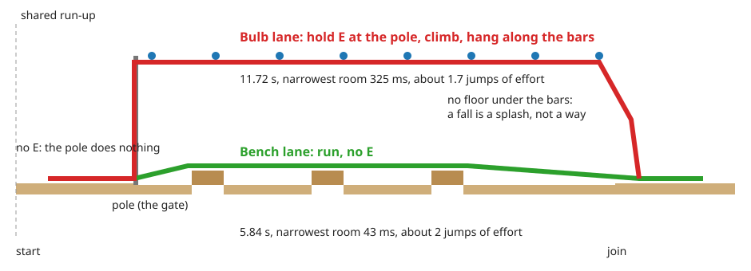
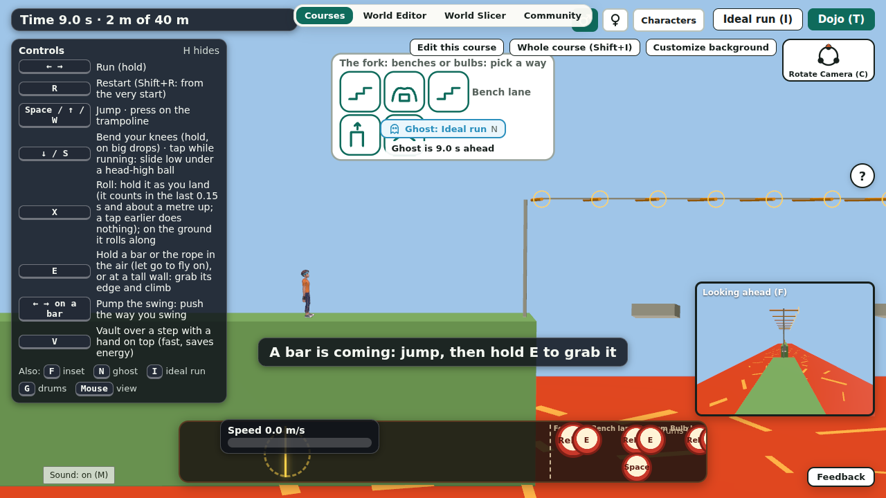
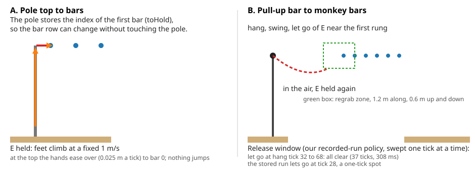
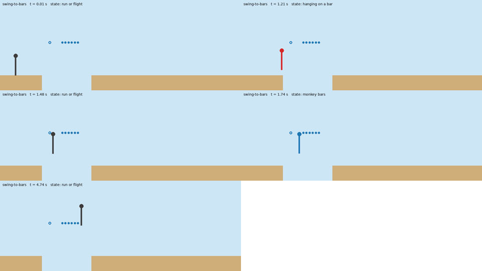
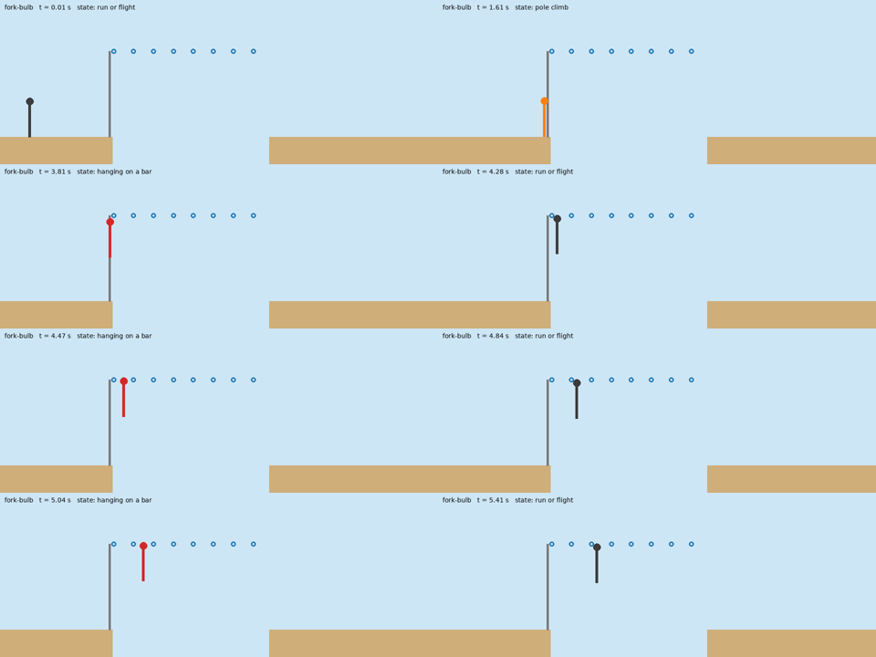
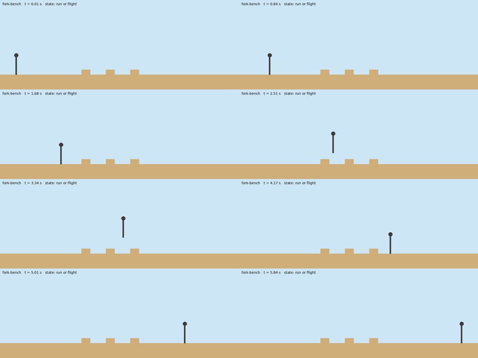

# Lesson 3: how we design moves and obstacles that meet

- Part of CC-133, written for people who want to learn game design and physics-game building from this project.
- Every number and file below was read from the repo ([fork.md](fork.md), [multi-path.md](multi-path.md), [bars.md](bars.md), [lessons.md](lessons.md)); where we did not measure something, the page says so.
- The set: [move creation](lessons-move-creation.md), [obstacle creation](lessons-obstacle-creation.md), and this lesson.

## So what: what you can do after reading
- You can offer a player a real choice between two ways through one picture without adding a new physics rule.
- You can hand a player from one move to the next without a jump or a dead spot.
- You can prove each way is clearable, say how much timing slack it leaves, and catch the leak that lets a player skip it.
- You can say which options you rejected and why, so nobody rebuilds them by accident.
- Worked example: the fork with one gate, bench lane or bulb lane ([fork.md](fork.md)), and the two hand-offs inside it and beside it.

## The 5-step recipe
1. **Name the problem: one obstacle at a time.**
   - A course is a line, so two obstacles in the same place need a rule for who meets which.
2. **Make the choice at one gate, with a move the player already knows.**
   - The choice must be a key the player presses or does not press, not a new mechanic.
3. **Design the hand-offs.**
   - Each move ends in a state the next move can start from, with a window you can measure.
4. **Prove each route alone and together.**
   - Ideal-run search or a recorded run per route, then replay on the whole course and read which route was taken.
5. **Sweep for leaks and report the room.**
   - Try to skip a route on purpose; give each route a slack number in milliseconds.

## Worked example: the fork with one gate

### The problem: one obstacle at a time
- A course holds one line of zones and one best plan; the older shortcut search treated a skip as a faster version of the same course, not as a choice ([multi-path.md](multi-path.md)).
- Demo photo 1 has two things in one picture: benches on the floor and a pole with a string of bulbs overhead.
- We wanted both to be playable, as two ways through the same stretch.

### Gates and lanes

*Notice: the pole is the only gate; running past it without E is the bench lane, and holding E at it is the bulb lane.*

- One gate: the pole stands on the shared run-up, 0.3 m before the fork line.
- Run on without E: the pole does nothing, and the runner reaches the first bench (the bench lane).
- Hold E within 0.6 m of the pole: the hands close and the body climbs (the bulb lane).
- Let go of E on the pole and the body slides down to the run-up, so the choice can be made again.
- A branch is a fork line, a join line and routes; each route owns its own floor, bars and poles, and the lane is told apart by the lowest height between the fork and the join ([multi-path.md](multi-path.md)).

*Notice: the choice is shown on the strip and the pole is standing in front of the runner; nothing says "press jump higher".*

### Why this choice (and not another)
- The choice uses E, which the player already knows from the rope, the wall and the bars.
- No new jump-higher mechanic: the bars hang 4.3 m up, above the hands' reach from a jump off the ground or off a bench, so no jump from any x on the bench lane grabs a bar (`tests/fork.test.ts`).
- Existing branch model carries it: no new lane physics, and a course with no `climbPoles` never reaches the new code, so old golden hashes did not change.
- The pay-back is clear: the bench lane is quick and tight, the bulb lane is long and forgiving, with nearly eight times the room.

### The rejected options
| Option | What it was | Why rejected or parked |
|---|---|---|
| Jump higher to reach the bars | a taller jump grabs the bar row | a new mechanic for the player to learn; the fork reuses E, which they already know |
| Two short courses and a menu | the fallback in [fork.md](fork.md) | no physics cost, but not one picture with a choice; kept as a plan B, not needed |
| B: a graph of zones | routes split and end apart | a bigger change to strip, editor and checks; choose it when a course needs three or more forks |
| C: free lanes (lane-aware ground) | every platform has a lane | the deepest change; a first form (the lane gate, CC-228) closed the leak but the pay-back target was not met |
| Make the high way win by time | bars as the faster way | the bars were slower than the ground in every sweep we ran, so the way that wins must win by risk or by room, not by seconds ([multi-path.md](multi-path.md)) |

- The old "two ways" course (CC-224) found the opposite: the bars were slower than the ground and the gap stayed small (0.35 s against a target of 1.5 s).
- The fork turns that into the point: the gap is large (5.84 s against 11.72 s), and what you buy with the slow lane is room.

### Room as a difficulty number
- Room is the narrowest window, in milliseconds, that a plan can be shifted and still clear.
- Bench lane: 5.84 s, narrowest room 43 ms, about 2 jumps of effort.
- Bulb lane: 11.72 s, narrowest room 325 ms, about 1.7 jumps of effort.
- So the quick lane asks for timing, and the slow lane asks for patience.
- The same number tells a designer when a way is unfair: a deep-drop low way in the lane-gate sweeps had a 5 ms window, which nobody can hit ([multi-path.md](multi-path.md)).
- Human-timed tries tell the same story: the high way in the two-ways course cleared about 31% of tries at 30 ms of press noise, and the low way 59% (target 90%).

## The hand-offs between moves

*Notice: panel A is a hand-over by index, panel B is a timing window; the window is a number we can measure.*

### Pole top to bars
- Hold E next to a pole: the feet rise at a fixed 1 m/s; the key sets the direction, never the speed.
- At the top with E still held, the hands pass to the first bar of the row, easing sideways 0.025 m a tick, so nothing jumps.
- The pole stores the index of that first bar (`toHold`), so only the index changes when the bar row changes.
- A test checks it: at the top with E held the hands pass to the first bar and nothing jumps (`tests/pole-climb.test.ts`).

### Pull-up bar to monkey bars (release and regrab)
- Hold E on a single bar, swing with the arrows, let go of E near the first rung, hold E again: the hands close on the rung.
- The regrab uses the same wide zone as the Lache pair: 1.2 m along, 0.6 m up and down.
- A test checks both sides: some release puts the hands on the first rung, and a release too early does not grab and does not break anything (`tests/bars.test.ts`).
- Sweeping the release one tick at a time on the demo course ([scripts/lesson-trace.ts](../scripts/lesson-trace.ts)) gave: ticks 32 to 68 of the hang all clear, which is 37 ticks or 308 ms.
- The stored recorded run lets go at tick 28, which clears alone (8 ms), so the demo works but is brittle; moving it into the wide part is a next step.
- A clip of this hand-off, one picture per four ticks of the simulator clock: swing-to-bars.mp4 (video kept outside git).

*Notice: the red body is the bar, the blue body is the row, and the grey one in between is the flight where E is held again.*

## How we prove each route
- `routeCourse` closes the other lane (removes its floor, bars and poles), so the usual search proves each lane alone.
- The bench lane uses the unchanged ideal-run search (`searchIdealRun`).
- The bulb lane uses `searchBulbLane` in `src/sim/fork.ts`: hold E at the pole, then choose how long to hang on each bar; the old search is tied to take-off edges and cannot start a plan with a pole.
- Each line is then replayed on the whole course and the lane is read from the track (`routeOfTrack`).
- A server replay of the keys clears either lane in exactly the stored time and reads which lane was taken, because the log is only keys and the simulator is deterministic ([tests/fork.test.ts](../tests/fork.test.ts)).
- Where the search does not know a move (monkey bars), a recorded key list is the proof and the limit is written down.

*Notice: the pole climb (orange), the hang (red) and the bars (grey, blue) follow each other with no jump in between.*

*Notice: the bench lane never leaves the ground much, so it is short and tight.*

- Clips from the simulator's own replay: bench lane (video kept outside git) and bulb lane (video kept outside git).

## Leak sweeps
- A leak is a way to skip a route you did not mean to allow.
- The ground is single-valued, so anything low within reach of the high deck lets a runner skip the low way; every low-way obstacle must lie 14 m or more past the fork ([multi-path.md](multi-path.md)).
- The fork's leak tests: no jump grabs a bar from the ground or a bench top, and the bulb lane on its own has no floor under the bars, so a fall is a splash, not a way.
- The lane gate (CC-228) closed a leak at its source: a platform is air until the runner has stood on the platform with that index, and courses with no gate play as before.
- Rule: after any change to geometry, rerun the sweep; the leak fix is a distance, and distances move.

## Mistakes and fixes
- **A search cut-off hid the bars.**
  - Trial time caps counted from the start, so once other obstacles came first no trial reached the bars and the search did not clear.
  - Fix: the caps count from the time the runner needs to reach the obstacle (`lead` in `src/sim/ideal.ts`, CC-164).
- **A test that also passed on the old code.**
  - The first route test of CC-164 did not prove the fix; it was rewritten so it fails on the old code ([lessons.md](lessons.md)).
  - Fix: run a new test against the old code once.
- **A weakened test that fails is "not tested", not "failed".**
  - Rule from [lessons.md](lessons.md): list what an experiment needs before running it.
- **The bars were slower than the ground.**
  - Three lane-gate sweeps (CC-228, CC-236) did not reach a 1.5 s pay-back by geometry.
  - Fix: make the choice about room, not seconds (the fork).
- **A stored answer was never read.**
  - The Slicer ran a live search for places it had already proved ([lessons.md](lessons.md), CC-90).
  - Fix: find the answer ahead of time, replay it in a test, and run the live check only when the person changes something.
- **A field in the course file moved the fingerprint.**
  - `windows` was hashed by accident (CC-224); the rule: decide if a new field changes play, and if not leave it out of the hash and add a test ([hash-design.md](hash-design.md)).

## Checklist
- [ ] The problem is named: which two things share one place.
- [ ] One gate, and the choice is a key the player already knows.
- [ ] Each route is proved alone, and together; the route taken is read from the run.
- [ ] Each hand-off has a test and a measured window.
- [ ] Each route has a room number in milliseconds.
- [ ] A leak sweep ran after the last geometry change.
- [ ] Rejected options are written down with reasons.
- [ ] Old courses and golden hashes did not change.

## Try it yourself
- Take a course with a gap and a wall one after the other.
- Draw it as two lanes with one gate, with a lane diagram like the one above, and label the key at the gate.
- Write the hand-off between the last move of lane A and the first move after the join.
- Guess which lane is tighter, give each a room in milliseconds, and then say what a player would do who values safety.
- List one leak you can think of (a jump that lands on the other lane's floor) and the distance that would close it.

## Files
- Code: [src/sim/fork.ts](../src/sim/fork.ts), [src/sim/branches.ts](../src/sim/branches.ts), [src/sim/pole-climb.ts](../src/sim/pole-climb.ts), [src/sim/bars.ts](../src/sim/bars.ts).
- Tests: [tests/fork.test.ts](../tests/fork.test.ts), [tests/pole-climb.test.ts](../tests/pole-climb.test.ts), [tests/swing-to-bars.test.ts](../tests/swing-to-bars.test.ts).
- Evidence: [data/eval/fork/README.md](../data/eval/fork/README.md), [scripts/lesson-trace.ts](../scripts/lesson-trace.ts), [scripts/lesson-film.py](../scripts/lesson-film.py).
