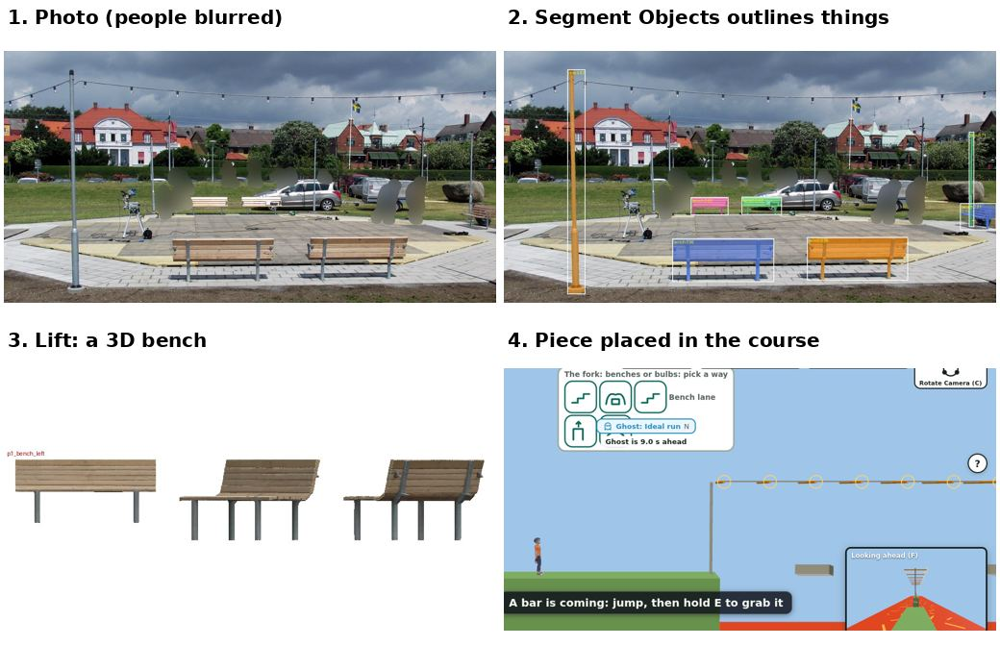
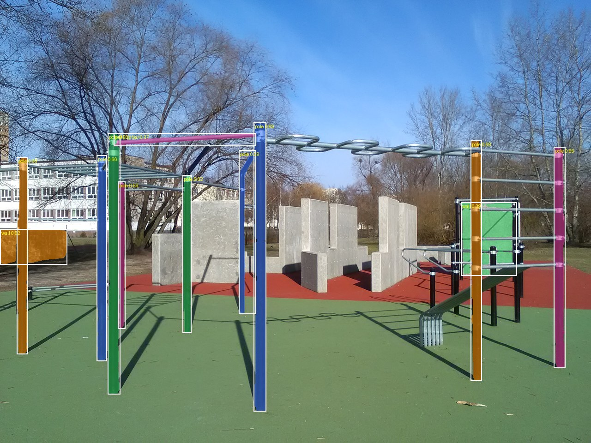
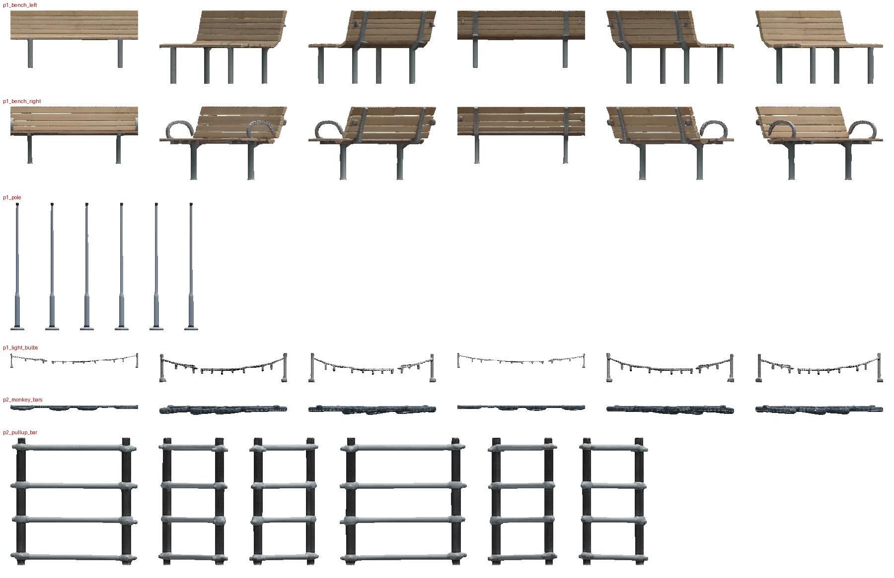
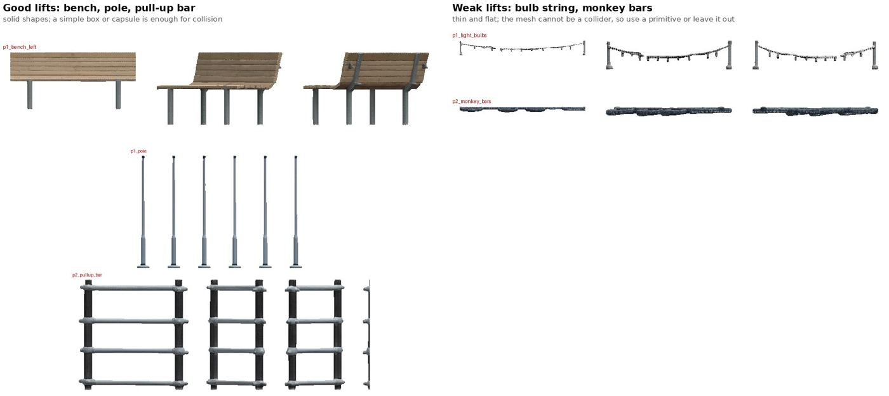
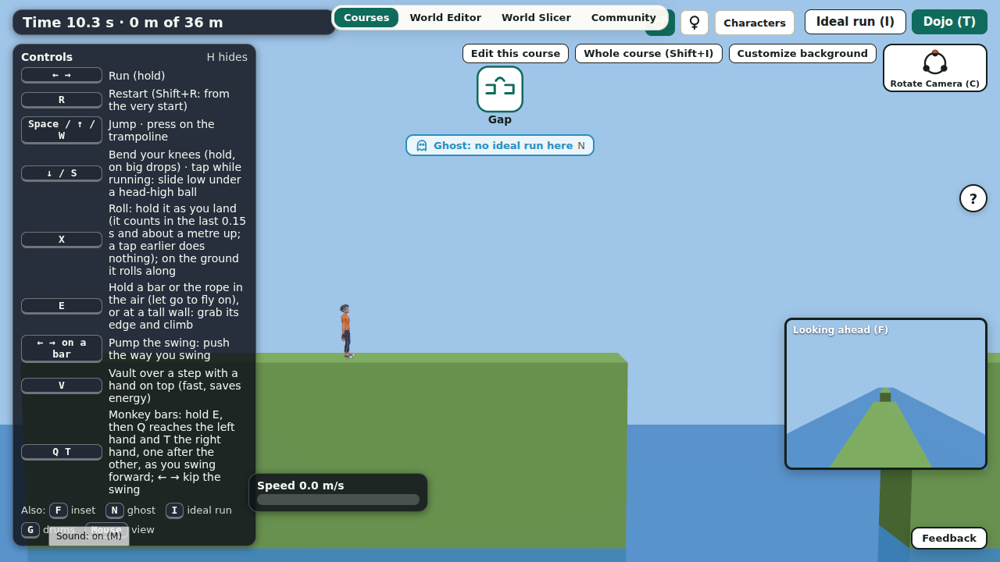

# Lesson 2: how we create an obstacle (a world object)

- Part of CC-133, written for people who want to learn game design and physics-game building from this project.
- Every number and file below was read from the repo (mostly [data/eval/demo-lifts/README.md](../data/eval/demo-lifts/README.md)); where we did not measure something, the page says so.
- The set: [move creation](lessons-move-creation.md), this lesson, and [move and obstacle interactions](lessons-move-obstacle-interactions.md).

## So what: what you can do after reading
- You can take a photo of a real place and end with a piece a runner can use in a course.
- You can tell a good lift from a weak one by eye, and know what to do with each.
- You can keep the look of an object apart from its collision, so a pretty mesh never changes the physics.
- You can record where every picture came from and under which licence, before the game uses it.
- Worked example: two Wikimedia Commons photos (a dance floor with benches, a pole and a bulb string; a street-workout park) pushed through the real Community pipeline, then the monkey-bars piece in the editor.

## The 5-step recipe
1. **Check the photo.**
   - People rule, safety check and privacy mask come before any model sees the picture.
2. **Segment Objects.**
   - One click on the whole photo outlines the things in it; the player picks, nobody draws a box.
3. **Lift.**
   - One photo, one pick and one name give one 3D piece (a skin).
4. **Give it a role and a collision proxy.**
   - The simulator reads a clean box, capsule or bar; the mesh is looks only.
5. **Prove it and record it.**
   - A row in `docs/ASSETS.md` with credit and licence, and an ideal-run or recorded-run proof of the course it sits in.

## Worked example, step by step

*Notice: the same bench goes from a flat photo to a 3D piece; the people in picture 1 are already blurred, and only blurred pictures are in the repo.*

### Step 1: the photo gate
- People rule (`scripts/photos_people.py`, limit 0.2 of the picture height): photo 1 has 12 people, the tallest 0.16, so it passes; photo 2 has none.
- The rule is loose on purpose: we reject only close-up or large people, because most street photos have small, far figures ([lessons.md](lessons.md), Street photos and people).
- Safety check (Muse Spark Open): both photos came back `ok`, reason `none`.
- Privacy mask (SAM 3): photo 1 blurred 10 people and 6 faces, 0 plates; photo 2 was unchanged.
- Rule for the repo: photo 1 shows people, so only its blurred version is committed (`photo1_privacy_after.jpg`); the original stays outside git with a checksum.
- The rules are in [CLAUDE.md](../CLAUDE.md) and [trust-and-safety.md](trust-and-safety.md).

### Step 2: Segment Objects
- The finder looks at the whole photo, tries one plain word at a time (bench, pole, wall and so on) and outlines the best things ([community-flow-guide.md](community-flow-guide.md)).
- Nothing is picked for the player, and no box is drawn.
- Photo 1: 5 benches (scores 0.91 to 0.96) and 2 poles (0.71 and 0.82), but no bulb string.
- Photo 2: 9 poles, 2 walls and one weak pull-up bar (0.37, in the wrong place); no monkey bars.

*Notice: the loops of the monkey bars along the top have no outline; the finder only knows the words we gave it.*

- Fallback: the flow's own box pick, so in the film those three objects are shown as "our own box" picks, not one-click picks.
- Next step in the README: add the phrases "monkey bars" and "string lights" to `ccpipe/suggest.py`, then rerun `scripts/run_demo_lifts.sh`.

### Step 3: the lift
- SAM 3D Objects, seed 42; a typed height gives the size.
- Cost of the job seconds: about $0.034; a realistic total with cold starts and retries is $0.30 to $0.60.

*Notice: the first three rows and the last row are solid and textured; the bulb string and the monkey bars are thin lines.*

*Notice: a thin or flat thing lifts badly, so judge a lift by turning it, not by the first view.*

| Object | How picked | Look | Collision | If weak |
|---|---|---|---|---|
| Bench (two) | Segment Objects | excellent | box | none needed |
| Pole | Segment Objects | good | capsule | none needed |
| Light bulbs | our box | weak (`lift_check` flagged it: aspect 8.4 against mask 18.7) | none | leave out, or far scenery |
| Monkey bars | our box | medium (loops show from above, a flat plank from the side) | primitive bar | show the plan view |
| Pull-up bar | our box | good | primitive bar | none needed |

- Typed height matters: the monkey bars came out 52 m wide when typed 2.4 m (that is the thin side); retyped to 0.25 m they were right.

### Step 4: the editor piece, its role, and the collision proxy
- Rule from [lessons.md](lessons.md): a photo becomes a skin, never a collider, and colour goes in a texture.
- The simulator reads a collision proxy (a box or primitive with a role and a size), which is under 1 KB; the glb is looks only ([object-catalogue.md](object-catalogue.md)).
- If the glb is missing, the course still plays with the proxy shown as a plain block.
- Roles live in `src/slice/roles.ts` (plain ground, Warped Wall, rope anchor, trampoline bed, swing bar), and the editor says in plain words what each move needs.
- Our worked piece is the monkey bars ([bars.md](bars.md)):
  - Code: [src/slice/bars-world.ts](../src/slice/bars-world.ts); the piece's `src` is `bars:<rungs>:<gap>`, so saving, copying and undo keep the knobs.
  - `roleCourse` turns it into `course.bars` (a row of first rung, height, count, spacing) and `piecesFromSource` brings it back.
  - It is overhead scenery (`noGround`), so it never changes the ground lane.
  - "Fit to selected" lays a row along the top of a chosen piece, a box or an object lifted from a photo.
  - It is behind `?bars=1`.
- The same idea for a hang bar: it is scenery, not ground, and it brings a hold at its real crossbar height (commit `58d7d35e`).

*Notice: the rungs are drawn as simple bars; the player grabs the rung height the simulator uses, not the lifted mesh.*

### Step 5: licences, rows and the proof
- Photo 1: CC BY 3.0, credit "Jonn Leffmann"; the lifted meshes follow the credit.
- Photo 2: CC BY-SA 4.0, credit "Koefbac", demo only, swap before a sale.
- Rows exist in [ASSETS.md](ASSETS.md) for both photos, the lift outputs and the fork demo course; a file with no row is not allowed in the game.
- Third-party downloads and raw GLBs stay outside git in `../conquercourse-assets/eval-full/demo-lifts/` with `SHA256SUMS`.
- Proof: the fork course with these objects as placeholder shapes is proved by the ideal-run search (bench lane 5.84 s, bulb lane 11.72 s, see [fork.md](fork.md)).
- The monkey-bars course is proved by a recorded key list, because the search does not know monkey bars yet.

## Mistakes and fixes
- **Vertex colours smeared a painted wall.**
  - Fix: bake a 1024 texture from the splat; pad a wall that fills the frame so it is not lifted as a table ([lessons.md](lessons.md), Photos to 3D objects).
- **Thin or long things fail.**
  - A shadow strip, steps, a bulb string.
  - Fix: judge by turntable, use a primitive for collision, or leave the object out.
- **A wrong typed height made a 52 m piece.**
  - Fix: type the height of the side you mean, and look at the size before placing.
- **Segment Objects missed two of the objects.**
  - Fix: show them as own-box picks, and add the phrases to the finder.
- **Only a loose people rule kept street photos usable.**
  - A strict no-person rule threw away 90 percent or more of busy photos; the product owner chose Mapillary's blur plus a size limit ([lessons.md](lessons.md)).
- **A mesh used as collision would be a trap.**
  - Fix: a clean primitive for collision, the mesh for looks.
- **The look of the piece changed nothing in the proof.**
  - That is the point: the course hash and the replay depend on the proxy, never on a glb.

## Checklist
- [ ] Photo passed the people rule, safety check and privacy mask; only blurred pictures are in git.
- [ ] Segment Objects found it, or the fallback is named.
- [ ] The lift was turned and judged; a weak one has a plan.
- [ ] The role and a clean collision proxy are set.
- [ ] A row in `docs/ASSETS.md` with credit, licence and the swap plan.
- [ ] The course that uses it is proved (ideal run or recorded run).
- [ ] Raw files are outside git with a checksum.

## Try it yourself
- Take one photo you may use (your own, or one with a CC licence) with a bench or a rail in it.
- Write its row for the assets table: file, source, credit, licence, and what you will do if the licence is share-alike.
- Predict, before any model runs, which of the things in it will lift well, and which will be thin; then check against the good-and-weak picture.
- Decide the collision shape for each (box, capsule or bar), and say what the player's hands or feet touch.

## Files
- Evidence: [data/eval/demo-lifts/](../data/eval/demo-lifts/README.md) and [scripts/lesson-strips.py](../scripts/lesson-strips.py) (builds the two pictures above from tracked, blurred evidence).
- Code: [src/slice/bars-world.ts](../src/slice/bars-world.ts), [src/slice/roles.ts](../src/slice/roles.ts).
