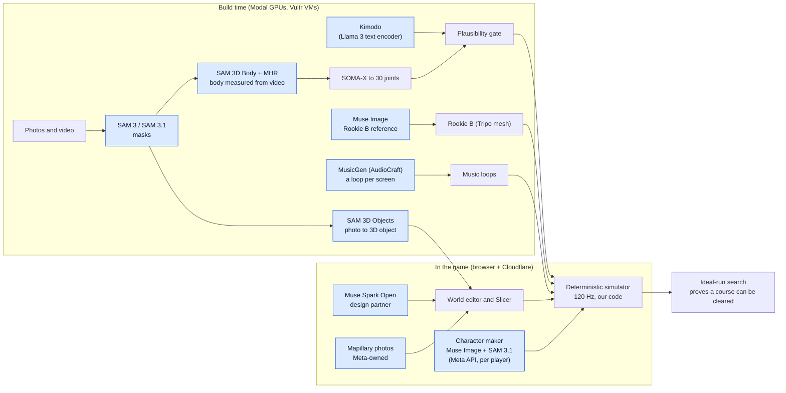
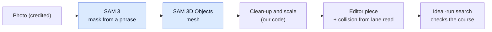
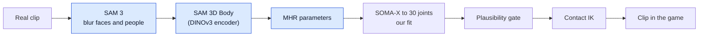
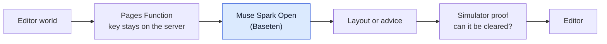
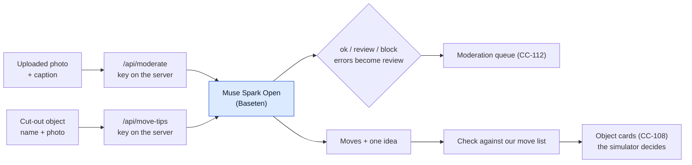
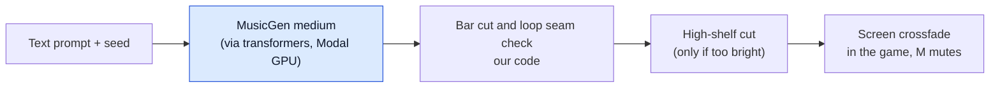
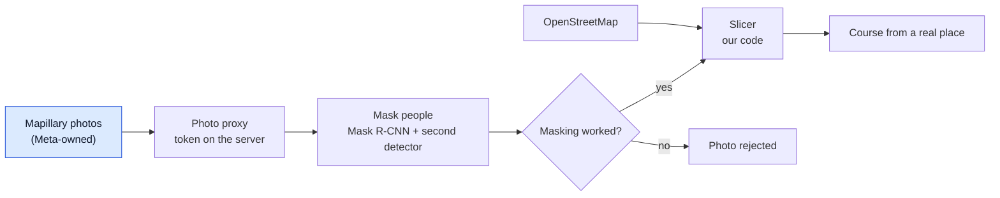

# Pipelines and Meta AI models

Serves the judges' "Use of Meta AI tooling" and "Technical depth" criteria: what data goes in, which model works on it, and what the game does with the result.
Recipes with exact settings are in `docs/pipelines.md`; this page is the map.

## How to read the diagrams
- Blue boxes are Meta models or Meta-owned data.
- Grey boxes are other open models or our own code.
- "Build time" means we run it before the game ships, and the game loads the result as a file.
- "In the game" means the player's browser or our server calls it while they play.

## The whole system

## 1. Photo to obstacle (SAM 3 and SAM 3D Objects)
- **Data in:** one photo of a real object (Wikimedia Commons or our own), credited in `docs/ASSETS.md`.
- **Models:** SAM 3 cuts the object out from a text phrase; SAM 3D Objects lifts the cut-out into a 3D mesh.
- **Where it runs:** Modal (an L4 for the mask, an L40S for the lift), build time.
- **What the game does with it:** the mesh becomes a piece in the editor's Real objects tab; the physics shape comes from the editor's own lane read, not from the mesh.
- **Result:** 19 real objects (bench, low wall, hydrant, concrete pipe, canal railing and more), grouped by the move that gets past them.
- **Cost measured (CC-110):** $0.164 for 14 photos (13 kept), about 15 s per object once the models are loaded, 0.41 MB per object on average.

## 2. Video to motion (SAM 3, SAM 3D Body, MHR)
- **Shipped from this pipeline:** the vault and climb clips (London Parkour film, CC BY), the custom-look body shape (one Pexels frame) and the measured-but-withheld Pexels clips; run, leap, land, hang, swing, reach and hurt are CMU motion capture.
- **Data in:** short real clips of a move (Pexels and Commons, credited).
- **Models:** SAM 3 blurs faces and people first (privacy); SAM 3D Body measures the body in each frame as MHR (Meta's Momentum Human Rig) parameters; its encoder is DINOv3.
- **Our code:** MHR is turned into the 30-joint skeleton (SOMA-X), put on the clip's own clock, checked by the plausibility gate and pinned to the obstacle by contact IK.
- **Where it runs:** Modal, build time.
- **What the game does with it:** nothing is shown unless it passes the gate (knees, bone lengths, no foot sliding, ballistic flight).

## 3. Generated motion (Kimodo with a Llama 3 encoder)
- **Data in:** a short text prompt and targets from the simulator's own path (take-off, landing, hands on a bar).
- **Models:** Kimodo (NVIDIA) makes the motion; its text encoder is Meta-Llama-3-8B-Instruct.
- **Our code:** the simulator's physics decides where the body goes; Kimodo only fills in how it looks, and the gate checks the result.
- **Where it runs:** Modal L4, build time.
- **Result:** the roll and slide clips on the Rookies.
- A Kimodo leap won a blind test against motion capture 3 times out of 3, but the product owner kept CMU motion capture for run, leap, land, hang and swing (2026-10-27); `kimodo_leap.json` is kept, unused.

## 4. Course design partner (Muse Spark Open)
- **Data in:** the course as the editor describes it.
- **Model:** Muse Spark Open (`meta-models/muse-spark-open-1026`) through Baseten, which the hackathon key allows.
- **Our code:** a Cloudflare Pages Function keeps the key on the server, drops the model's reasoning text, rate-limits, and returns a layout or advice.
- **Result:** the simulator checks every layout the model suggests, so the model proposes and the physics decides.
- **Not a chat tutor:** it builds and fixes courses, it does not coach a person's technique.
- **Status:** needs the `BASETEN_API_KEY` secret at deploy.

## 4b. Upload check and move tips (Muse Spark Open)
- **Upload check (CC-120):**
  - Data in: an uploaded photo or object preview, and an optional caption.
  - Model: Muse Spark Open (`meta-models/muse-spark-open-1026`) through Baseten; the call lives in `functions/api/moderate.ts` and the other routes call it directly.
  - Wording: small, far-away or unrecognisable people are fine; a child who is close or large, a readable plate, address, document or screen, or a recognisable person makes it ask for a person to look.
  - It is a language model: the same photo can get different answers on different tries.
  - Stopped photos and the reason are listed on the owner-only admin page.
  - Result: ok, review or block with one reason; the caption can only make the answer stricter; any error becomes review.
  - Measured: 19 of 19 safe photos ok, 7 of 7 text-only unsafe cases caught, 4 of 4 near misses not blocked, about $0.003 a call (`data/eval/cc-119-moderation/`).
  - Not tested: real harmful images (see [trust and safety](trust-and-safety.md)).
- **Move tips (CC-121):**
  - Data in: the object's name and its cropped photo.
  - Model: Muse Spark Open through Baseten, behind `/api/move-tips`.
  - Result: up to three moves from our fixed list and one short idea; the code drops anything outside the list.
  - Measured: 19 of 19 tips, the CC-110 move listed first for 13 of 19, about $0.01 an object (`data/eval/cc-119-move-tips/`).
  - Caveat: the prompt was tuned on the same 19 objects.
- **Status:** both need the `BASETEN_API_KEY` secret at deploy.
  - The upload check is called live by `/api/object-lift`, `/api/segment`, `/api/community-items` (Share in Community) and `/api/character` (the prompt).
  - Move tips are called from the object cards.
  - Which credit pays: [docs/model-ledger.md](model-ledger.md).

## 4c. Course Agent (dropped from the game 2026-10-31)
- **Dropped scope:** the scope is photo to object only.
  - The Course Agent started from one park photo; that input and its editor button are removed.
  - The loop (`src/slice/course-agent.ts`) and the text-only function `/api/course-agent` remain in the code, with no player entry.
  - The text-only (idea in) version has not been measured.
- **What the loop did:** the model proposed a layout; the simulator told it whether it cleared, where the best attempt stopped and which single change would clear it; the model repaired, up to 6 steps.
- **Measured results (photo in, historic):** [data/eval/cc-126-course-agent/README.md](../data/eval/cc-126-course-agent/README.md).

## 5. Characters (Muse Image, SAM 3.1, SAM 3D Objects)
- **Live character maker (CC-108):**
  - Data in: one sentence from the player.
  - Models: Muse Image draws the picture and SAM 3.1 cuts the figure out, both on the Meta Model API; SAM 3D Objects lifts it on Modal; our rigger fits the Rookie's 34 bones.
  - It runs as a Modal job (`pipelines/character_maker.py`) that holds the Meta key, started by `/api/character` after a text safety check.
  - Cost: about $0.0125 of Meta credit per character (`docs/community-characters.md`); the rest is Modal GPU time.
  - Diagram and measurements: [docs/character-pipeline.md](character-pipeline.md).
- **The two Rookies (earlier, build time):**
  - Muse Image drew one reference picture for the second Rookie in the first one's style (`/images/edits`).
  - Both Rookie meshes are Tripo output; Blender rigs them on the Kimodo skeleton and a check catches bad rigs.

## 5b. Music (MusicGen from Meta AudioCraft)
- **Data in:** a written prompt per screen and a seed; no melody, no recording and no existing song goes in.
- **Model:** MusicGen medium (`facebook/musicgen-medium`) on a Modal GPU, 30 s per clip.
- **How it is loaded:** AudioCraft's own pip package failed to build on its `av` dependency, so the same Meta weights are loaded through the transformers library.
- **Our code:** it finds the tempo, keeps whole bars, picks the start that makes the wrap continuous, checks the seam, and can cut loud highs with a gentle high-shelf (the chosen Report loop needed none).
- **In the game:** one loop per screen, on by default (`?music=0` turns it off), quiet, 2 s fade-in, crossfaded between screens, M mutes.
- **Licence, said plainly:** the weights are CC BY-NC 4.0 (non-commercial) and the code is MIT; the entry is non-commercial, and a commercial release would need the loops remade.
- **Measured, not heard:** wrap jump, bar length, tempo and the share of energy above 5 kHz (`docs/music.md`).

## 6. Real places and photos (Mapillary, masking)
- **Data in:** OpenStreetMap for the place, and Mapillary street photos (Mapillary is owned by Meta).
- **Our code:** the photo proxy keeps the Mapillary token on the server; people in photos are masked before they are shown (a Mask R-CNN person cut-out, then a second detector), and a photo is rejected when masking fails.
- **Detector note:** Mask R-CNN and Faster R-CNN come from torchvision (PyTorch); they are Meta-originated open-source tools, not part of the hackathon model list.
- **Result:** three places with photos (Edinburgh 65, Montmartre 27, Eixample 41 kept photos).

## 7. Not AI, but the core of the game
- **Simulator:** a 120 Hz deterministic physics engine in TypeScript; runs can be recorded as key presses and replayed to the same result.
- **Ideal-run search:** finds the best line for any course and proves a course can be cleared; this is what keeps model suggestions honest.
- **Plausibility gate:** every motion passes it before it is shown.

## Meta tools in development (not game features)
- These helped us build the game; the game itself does not call them, and they are not counted as game features.
- **Muse Wonder** (`muse-wonder-1.0`, Meta Model API) reviewed the simulator code (CC-133, 2026-10-29).
  - It read 4 chunks of `src/sim` and made 21 claims.
  - We checked each one with a test or by reading the code: 13 real, 7 false alarms, 1 unclear.
  - None of the real ones breaks a shipped course; 2 were fixed at once, 11 are tracked in CC-140.
  - Cost: $2.38 for the run, about $0.18 per real bug.
  - It did well on the physics code and gave nothing useful on the contraptions chunk.
  - Details: [data/eval/cc-wonder-review/README.md](../data/eval/cc-wonder-review/README.md).
- **Muse Spark Open** (on Baseten) also helped as a dev aid: bulk course drafts (CC-122) and photo triage (CC-123); the same model is what the Course Agent uses in the game.

## What we tried that did not work
- **PartLLM** (find hang points on object meshes): 2 of 9 real parts found and 11 false claims in 13 absent cases; parked (CC-49).
- **Two-stage wall climb from Kimodo clips:** neither stage passed the gate, so nothing shipped (CC-36).
- Reporting these is part of the method: a weak result is "not tested" or "failed", never hidden.
