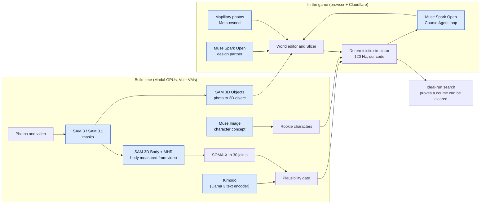
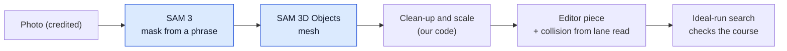
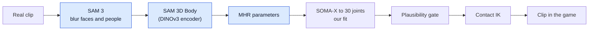
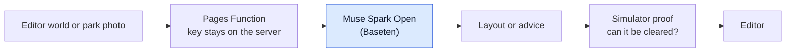
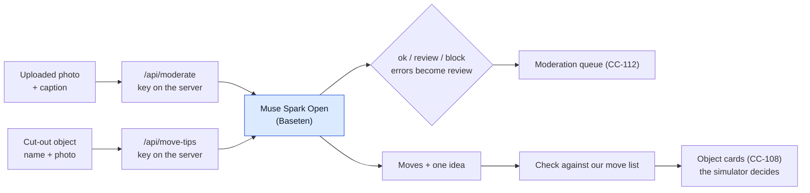
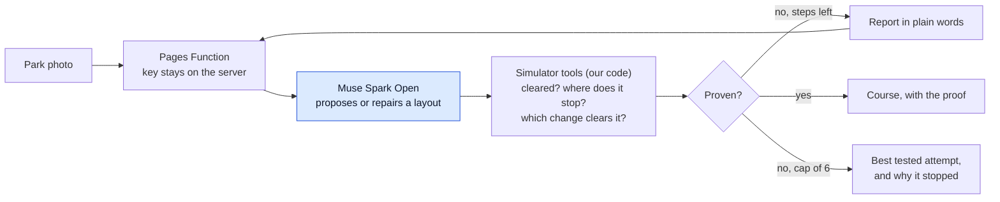
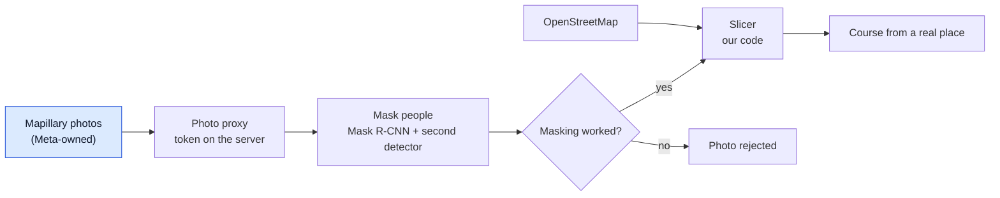

# Pipelines and Meta AI models

Serves the judges' "Use of Meta AI tooling" and "Technical depth" criteria: what data goes in, which model works on it, and what the game does with the result.
Recipes with exact settings are in `docs/pipelines.md`; this page is the map.

## How to read the diagrams
- Blue boxes are Meta models or Meta-owned data.
- Grey boxes are other open models or our own code.
- "Build time" means we run it before the game ships, and the game loads the result as a file.
- "In the game" means the player's browser or our server calls it while they play.

## The whole system

## 1. Photo to obstacle (SAM 3 and SAM 3D Objects)
- **Data in:** one photo of a real object (Wikimedia Commons or our own), credited in `docs/ASSETS.md`.
- **Models:** SAM 3 cuts the object out from a text phrase; SAM 3D Objects lifts the cut-out into a 3D mesh.
- **Where it runs:** Modal (an L4 for the mask, an L40S for the lift), build time.
- **What the game does with it:** the mesh becomes a piece in the editor's Real objects tab; the physics shape comes from the editor's own lane read, not from the mesh.
- **Result:** 19 real objects (bench, low wall, hydrant, concrete pipe, canal railing and more), grouped by the move that gets past them.
- **Cost measured (CC-110):** $0.164 for 14 photos (13 kept), about 15 s per object once the models are loaded, 0.41 MB per object on average.

## 2. Video to motion (SAM 3, SAM 3D Body, MHR)
- **Data in:** short real clips of a move (Pexels and Commons, credited).
- **Models:** SAM 3 blurs faces and people first (privacy); SAM 3D Body measures the body in each frame as MHR (Meta's Momentum Human Rig) parameters; its encoder is DINOv3.
- **Our code:** MHR is turned into the 30-joint skeleton (SOMA-X), put on the clip's own clock, checked by the plausibility gate and pinned to the obstacle by contact IK.
- **Where it runs:** Modal, build time.
- **What the game does with it:** nothing is shown unless it passes the gate (knees, bone lengths, no foot sliding, ballistic flight).

## 3. Generated motion (Kimodo with a Llama 3 encoder)
- **Data in:** a short text prompt and targets from the simulator's own path (take-off, landing, hands on a bar).
- **Models:** Kimodo (NVIDIA) makes the motion; its text encoder is Meta-Llama-3-8B-Instruct.
- **Our code:** the simulator's physics decides where the body goes; Kimodo only fills in how it looks, and the gate checks the result.
- **Where it runs:** Modal L4, build time.
- **Result:** the run, leap and hang clips on the Rookies, chosen over real motion capture 3 times out of 3 in a blind test by the product owner.

## 4. Course design partner and photo to course draft (Muse Spark Open)
- **Data in:** the course as the editor describes it, or one park photo.
- **Model:** Muse Spark Open (`meta-models/muse-spark-open-1026`) through Baseten, which the hackathon key allows.
- **Our code:** a Cloudflare Pages Function keeps the key on the server, drops the model's reasoning text, rate-limits, and returns a layout or advice.
- **Result:** the simulator checks every layout the model suggests, so the model proposes and the physics decides.
- **Not a chat tutor:** it builds and fixes courses, it does not coach a person's technique.
- **Status:** needs the `BASETEN_API_KEY` secret at deploy.

## 4b. Upload check and move tips (Muse Spark Open)
- **Upload check (CC-120):**
  - Data in: an uploaded photo or object preview, and an optional caption.
  - Model: Muse Spark Open through Baseten, behind `/api/moderate`.
  - Result: ok, review or block with one reason; the caption can only make the answer stricter; any error becomes review.
  - Measured: 19 of 19 safe photos ok, 7 of 7 text-only unsafe cases caught, 4 of 4 near misses not blocked, about $0.003 a call (`data/eval/cc-119-moderation/`).
  - Not tested: real harmful images.
- **Move tips (CC-121):**
  - Data in: the object's name and its cropped photo.
  - Model: Muse Spark Open through Baseten, behind `/api/move-tips`.
  - Result: up to three moves from our fixed list and one short idea; the code drops anything outside the list.
  - Measured: 19 of 19 tips, the CC-110 move listed first for 13 of 19, about $0.01 an object (`data/eval/cc-119-move-tips/`).
  - Caveat: the prompt was tuned on the same 19 objects.
- **Status:** both need the `BASETEN_API_KEY` secret at deploy and are not yet called from a screen.

## 4c. Course Agent: propose, test, repair, stop when proven (Muse Spark Open)
- **Data in:** one park photo.
- **Model:** Muse Spark Open (`meta-models/muse-spark-open-1026`) through Baseten, called by the same thin Pages Function pattern (`/api/course-agent`).
- **Tools the loop calls (our code):** the simulator's ideal-run search answers three questions: can this layout be cleared, where does the best attempt stop, and which single change of one obstacle is proved to clear it.
- **The loop:** the model proposes a layout; the tool tests it; if it fails, the model gets the report in plain words and writes a repaired layout; this repeats up to 6 steps.
- **It stops** at the first proof, or at the cap, and then it says so and keeps the best tested attempt.
- **Honest by construction:** it never hands back a layout the simulator has not seen.
- **Where it runs:** the loop and the simulator run in the player's browser (the simulator is there); the server function only holds the key and makes the model call.
- **What the player sees:** each step as a list: proposed, tested (stopped at item N), repaired, tested (cleared in X s).
- **Not a coach:** it builds and repairs courses from a photo; it never grades or coaches a person's technique.
- **Status:** behind the labs switch (`?labs=1` or `?agent=1`); needs the `BASETEN_API_KEY` secret at deploy.
- **Measured results:** [data/eval/cc-126-course-agent/README.md](../data/eval/cc-126-course-agent/README.md).

## 5. Characters (Muse Image)
- **Data in:** a written description and the first character's concept image as the style reference.
- **Model:** Muse Image (`muse-image-1.0`, `/images/edits`) draws the second Rookie in the first one's style.
- **Our code and tools:** Tripo makes the 3D mesh, Blender rigs it on the Kimodo skeleton, and a check catches bad rigs.
- **Result:** Rookie A and Rookie B.

## 6. Real places and photos (Mapillary, masking)
- **Data in:** OpenStreetMap for the place, and Mapillary street photos (Mapillary is owned by Meta).
- **Our code:** the photo proxy keeps the Mapillary token on the server; people in photos are masked before they are shown (a Mask R-CNN person cut-out, then a second detector), and a photo is rejected when masking fails.
- **Detector note:** Mask R-CNN and Faster R-CNN come from torchvision (PyTorch); they are Meta-originated open-source tools, not part of the hackathon model list.
- **Result:** three places with photos (Edinburgh 65, Montmartre 27, Eixample 41 kept photos).

## 7. Not AI, but the core of the game
- **Simulator:** a 120 Hz deterministic physics engine in TypeScript; runs can be recorded as key presses and replayed to the same result.
- **Ideal-run search:** finds the best line for any course and proves a course can be cleared; this is what keeps model suggestions honest.
- **Plausibility gate:** every motion passes it before it is shown.

## What we tried that did not work
- **PartLLM** (find hang points on object meshes): 2 of 9 real parts found and 11 false claims in 13 absent cases; parked (CC-49).
- **Two-stage wall climb from Kimodo clips:** neither stage passed the gate, so nothing shipped (CC-36).
- Reporting these is part of the method: a weak result is "not tested" or "failed", never hidden.
