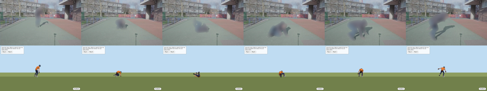

# Motion from you (CC-222)

*A person films one move with a phone or a webcam, and the Rookie does that move in the game.*
*Serves the pitch's two-way loop: the real world goes into the browser, and the browser sends the player back to the real world.*
*Serves the owner's feature 1 (2026-10-30): "Motion pipeline to let users generate in-game motions from their own movements."*

## So what
- A filmed move can already become a clean, private, game-format clip with one command, but a frontal roll does not pass the roll check yet.
  - So "My move" is built and switched off by default, and the game refuses a clip that failed either check.
- The first real run (5 s of a roll filmed head-on, 150 frames) cost about $0.13 on Modal and took about 14.5 minutes of wall time.
  - That is about $0.026 and about 167 s of waiting for each second of video.
- The body data is good: the Rookie rolls over and comes up in the stills (`data/eval/motion-from-you/roll-lp/side-by-side.png`).
  - The roll check refuses it because a head-on camera cannot see depth well, so the roll looks sideways to the check.
- Recommendation: ask for a side or three-quarter view in the player story, and make the check measure the turn along the real direction of travel.
  - Next step: the ranked list in the last section; the fallback is a library roll the player picks.

## The player story, in plain words
- You stand a phone or a webcam still, with your whole body and the floor in the picture.
- You do one move, for example a forward roll, once.
- You tap "Make my move".
- The game blurs your face, finds your body in each picture, and turns it into a short motion for the Rookie.
- It checks the motion could be done by a real body and that it shows the move you picked.
- If it passes, the Rookie does your roll when you press the roll key in the game.
- Your film is thrown away when the motion is made; only the joint positions stay, and you can delete those.
- The game never marks how well you did the move; it only turns your movement into a game move.

## The pipeline in words
1. **Film:** a still camera, one adult, the whole body in frame, a side or three-quarter view, a normal lens.
2. **Cut:** the clip is cut to the moment of the move; every picture keeps its own time from the video.
3. **Blur first:** SAM 3 finds people, faces and number plates; faces are pixelated and people blurred before any other model sees a picture.
4. **Measure:** SAM 3D Body gives the body's shape and pose in every picture (Meta's MHR body).
5. **Skeleton:** SOMA-X turns MHR into the game's 30 joints, in metres.
6. **Clean:** smooth the joints, give the bones one fixed length, find the floor from the feet, turn the body to face forward.
7. **Find the move:** the move check for the chosen move (the roll check) finds the rolling part and cuts the clip to it, with a small lead-in and get-up.
8. **Repair and gate:** knees that bend backwards are mirrored, feet are lifted to the floor, and the plausibility gate runs.
9. **Save:** a motion JSON in the format of `public/assets/motion`, with `playable` set only if the gate and the move check both pass.
10. **Play:** with `?mymove=<id>` in the address, the clip replaces the roll clip; the simulator stays the clock.

## Per stage: tool, cost, time, how it fails
| Stage | Tool | Cost and time (5 s, 150 frames) | How it fails |
|---|---|---|---|
| Film | a phone or webcam, 30 fps | free | far away, moving camera, two people, a head-on view |
| Cut | ffmpeg, then `cut_frames.py` | 20 s on the VM, free | a variable frame rate shifts times; we cut at the video's own clock |
| Blur first | SAM 3 on Modal | inside the 832 s measure run | a missed face stays sharp; the privacy receipt lists what was masked |
| Measure | MoGe 2 for the lens, SAM 3D Body for the body, on one Modal L4 | 832 s wall, about 579 container seconds, about $0.129 | a depth that wobbles; a flipped body when the person is upside down |
| Skeleton | SOMA-X MHR to SOMA | inside the measure run, 38 s | a body far from the model's training poses |
| Clean | `post.py`, CPU | 0.7 s | a person smaller than a third of their usual size is dropped; `--min-size` lowers that for one person in frame |
| Find the move | the roll check in `ccpipe/movecheck.py` | under 1 s | since CC-227 the turn is measured along the line the hips travel (the start facing only gives the sign), so a head-on roll reads in full; a sideways move still fails |
| Repair and gate | `repairs.py` and the plausibility gate | under 1 s | feet that slide on a clip with no foot lock |
| Save | `my_move.py` writes the motion JSON | under 1 s | none seen |
| Play | `?mymove=<id>` in `src/render/actor.ts` | no cost | a clip that did not pass both checks is not loaded |

- Time is the weak point: a person waits about 14 minutes for 5 s because a cold Modal container loads the models five times.
  - One warm container for the whole clip would cut that to about 5 minutes; this is not built.
- Cost is small: about $0.026 per second of video, paid by the project on pay-as-you-go, which credits do not cover.

## Built and missing
### Built
- `pipelines/my_move.py`: one command from a video range to a gated motion JSON, with `--discard` to delete frames and per-frame body numbers.
- `public/assets/experiments/mymove/<id>.json`: the output, in the format of `public/assets/motion`, with `playable` true only when the gate and the roll check both pass.
- `?mymove=<id>` in the game: the clip takes the roll slot only when it is playable; with no parameter, nothing changes.
  - The vault and climb clips and their playback are untouched.
- `pipelines/tests/test_my_move.py` and a case in `tests/motion-table.test.ts`.
- `scripts/my-move-check.mjs`: stills of the clip in the game at 1280 px.

### The run, and why it failed
- Input: "Learn Parkour: Basic Jump Roll" by London Parkour (CC BY), 45.5 to 50.5 s, one adult, a still camera, a head-on view.
- The gate passed on the trimmed clip: the flight is ballistic, the knees bend forward, nothing sinks, nothing jumps.
- The roll check first failed: the largest turn read 98 degrees, not the 300 needed.
- What the numbers said: the head-to-hips line goes through a full turn, but with a steady sideways lean, so it did not circle the forward plane of the start facing.
  - The start facing of a head-on body is read from the hip line and sits about 24 degrees off the line the roll travels.
- The fix (CC-227): the turn is measured in the plane of "up" and the line the hips travel.
  - The facing still gives the sign, so a backward somersault stays negative.
  - If the hips travel under 0.3 m, or more than 45 degrees off the facing, the facing is used as before: a cartwheel or side flip is never read as a roll.
  - No limit was changed; the travel, window, hip-height and air-time limits are the same.
- Re-check of the head-on London Parkour roll after the fix (CC-227): the turn reads 375 to 393 degrees, upside down, travel 1.7 to 2.6 m.
  - The clip is still not playable, and it should not be: it is a jump roll, so the check finds the body in the air for 0.30 s (limit 0.25 s).
  - On the untrimmed clip the hips also rise to 1.21 times standing (limit 1.05) and the turning part lasts 1.74 s (limit 1.4 s).
  - So the head-on view is no longer the blocker; this film shows a different move from the game's low roll.
  - Tests: `pipelines/tests/test_movecheck.py` covers a body filmed head-on, the shipped roll from five viewing angles, a sideways flip (fails), the shipped vault, climb, hurt, run, leap and land (fail), and this real clip.
- The 150 frames were also cut short at first: the first 2 s were dropped because the runner was small; `--min-size 0.2` keeps them.
- We did not loosen the check: a clip that fails is "not playable", and the game says so by not loading it.
  - The strip below shows the same clip forced through in a test only (the page patches the answer, the game code does not).

### Missing
- A real filmed roll that passes (none yet): the one CC BY head-on roll is a jump roll, and the Drop Roll film is a talking head from afar.
- A warm Modal container for the whole clip.
- A phone-or-webcam capture page; this slice takes a video file and a time range.
- Other moves: only the roll has a "My move" slot.

## Two more filmed rolls (2026-10-30): both refused, by design
- Both come from the same London Parkour series (CC BY, head-on, one adult) and passed the plausibility gate; the move check refused them.
- Standing roll (`roll-lp-stand`, 39.2 to 43.2 s): the body turns 309 degrees and goes upside down, but the clip does not end upright, so the check calls it unfinished.
- Crouch roll (`roll-lp-crouch`, 203.5 to 208.5 s): turn 308 degrees, starts and ends upright, but the hips read 1.51 times the standing height (limit 1.05) and the longest air time is 0.4 s (limit 0.25).
  - Both numbers look like measurement noise from a person who starts crouched and is small in frame; they are not a real flip.
- The limits stay as they are: a weakened check that passes would only mean "not tested".
- So far no filmed roll has passed both checks: the jump roll (`roll-lp`) passes the gate but not the move check (0.30 s in the air, limit 0.25 s); the player-facing story needs a side or three-quarter view (step 2 below).

## Fallback and next steps
- Fallback: the player picks a library roll (the shipped CMU/Kimodo roll, or a London Parkour roll through this same pipeline).
  - Quality: it passes both checks, but it is not their body.
- Ranked next steps:
  1. Done in CC-227: the turn is measured along the direction the hips travel.
  2. Ask for a side or three-quarter view in the capture step, with a floor mark so the player knows where to stand.
  3. Run one warm Modal container for the whole clip.
  4. Film a side-view roll (an adult, with a signed release) and run the same command.
  5. Fit the clip to a Kimodo motion when the body data is noisy.

## Privacy
- The film is processed, then deleted with `--discard`; only 30 joint positions stay.
- Faces are pixelated and people blurred before any body model sees a picture; no face is stored.
- The pipeline turns a movement into a game move; it never scores how well it was done.
- Only adults; no film of minors is used.
