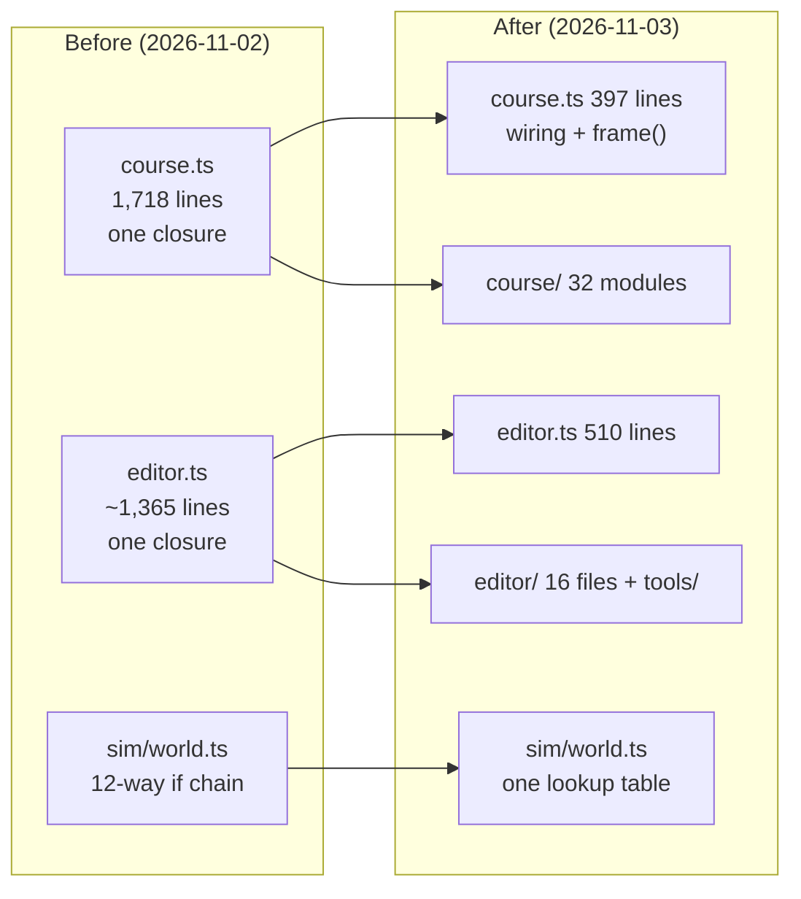
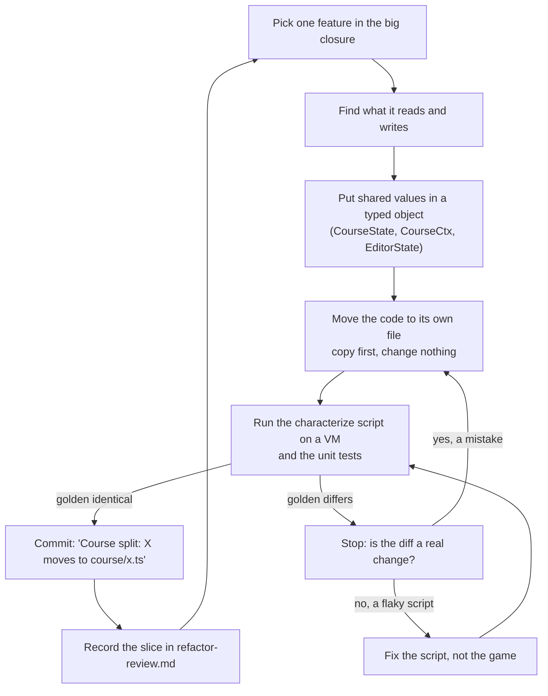
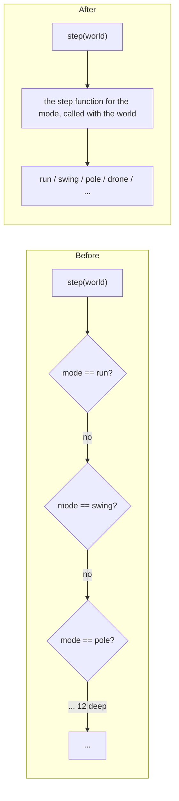
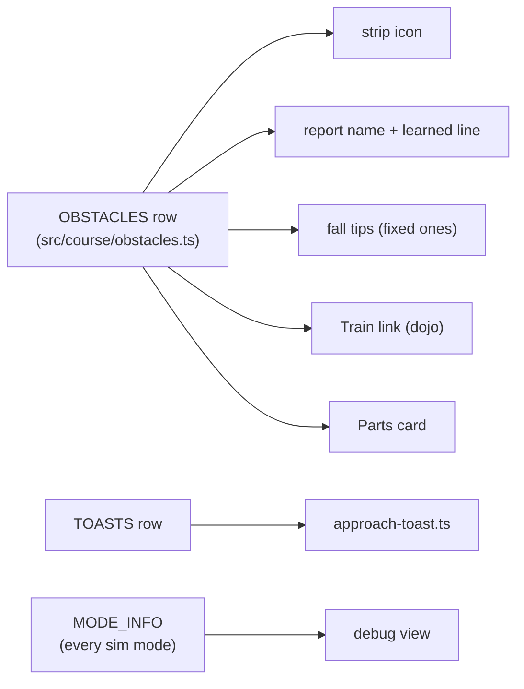
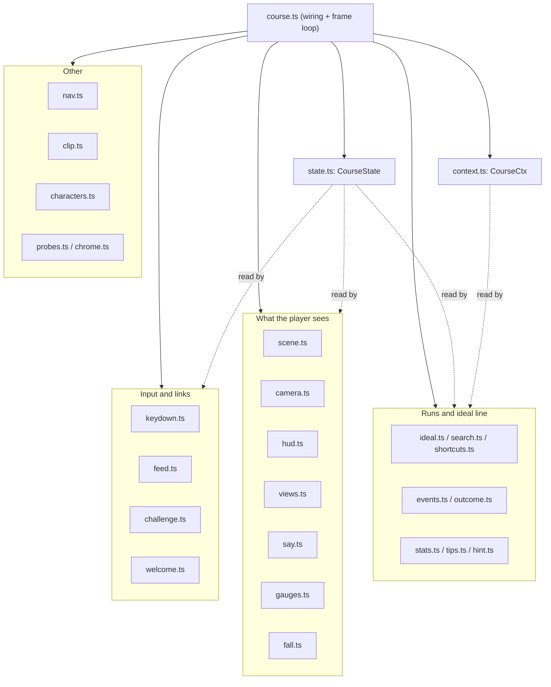
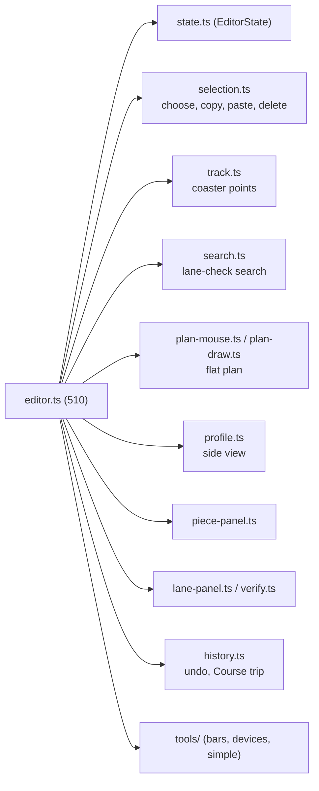

# The second refactoring: how two giant files became wiring (CC-133)

## So what
- Read this to learn how we split two 1,500-line files without changing what the game does.
  - It also tells you where a function from an old commit went.
- The method matters more than the result.
  - First build a safety net that records what the game does today.
  - Then move one feature per commit.
  - After each move, the net must say "identical".
- Adding a feature now means editing one small file, not hunting through a 1,700-line closure.
- Read it with `docs/refactor-review.md`, which holds the ranked plan; this page holds the story, the order and the reasons.

## Which refactoring is this
- Refactoring 1 (2026-10-30, small): the review itself (`6072fcfb`).
  - It ranked eight pain points by payoff per hour.
  - Its only code change turned two long `if` chains in `src/ui/debug-view.ts` into two tables.
- Refactoring 2 (2026-11-02 evening to 2026-11-03 midday, large): this page.
  - About 55 commits, all "Part of CC-133".
  - The product owner called it the second; if you count differently, the commits below are the same.

## The problem we started from
- Adding one obstacle (the drone) touched 33 source files, 8 scripts, 6 tests and 15 docs.
- Two functions held most of the UI.
  - `startCourse` in `src/modes/course.ts` was about 1,550 lines.
  - `startEditor` in `src/modes/editor.ts` was about 1,365 lines.
- Both were closures: every inner function could read and write every variable.
  - That is easy to write, and hard to move, because you cannot tell what a block depends on until you try.

## The method in one picture
- Each slice repeated the same loop.
- A slice is one feature moved out, in one commit.

## Step 0: build the safety net first (before moving anything)
- Rule we followed: never refactor code that has no recorded "what it does now".
- Three nets were built, each for a different layer.

| Layer | Net | What it records | Commit or file |
|---|---|---|---|
| Physics | `tests/sim-trace.test.ts`, `tests/golden/sim-trace.json` | a fingerprint of the whole world after every tick, for every shipped course | `731ccb45` |
| Course page | `scripts/course-characterize.mjs`, `tests/golden/course-characterize.json` | words, ids and states through a scripted session (keys, falls, toasts, the picker, the Edit trip) | earlier, re-recorded when the picker changed |
| Camera | `scripts/course-camera-characterize.mjs`, `tests/golden/camera-characterize.json` | camera position, direction and field of view for every view and film shot | recorded from unmodified main plus a probe hook |
| Editor | `scripts/editor-characterize.mjs`, `tests/golden/editor-characterize.json` | what the editor shows after a fixed list of actions | recorded before the editor slices |

- Numbers are turned into `#` in the page nets, so only words and states are compared.
  - Reason: a refactor must not change meaning, and small float noise would drown the signal.
- The page clock is stepped by the script, so two runs of one build give the same file.

## Step 1: the physics loop (the only sim edit)
- Before: `src/sim/world.ts` picked the step function with an `if` chain of 12 modes.
- After (`4304c8ee`): one lookup table from mode to step function.
  - Same functions, same arguments, same order, so the output must be bit-identical.
  - The sim-trace net from step 0 is what allowed this.
- Decision: the sim got a table and nothing more.
  - The review said "leave the 120 Hz step alone" because a bug there changes every score and every share link.
  - The table was judged safe because the fingerprint covers every tick.

## Step 2: one table for the words and pictures of an obstacle
- Before: the strip icon, the report name, the toast text, the fall tips, the Dojo link and the Parts card each had their own `if id === ...` chain.
- After (item 2a, `ffa021e1`, `b057e9a9`, `01107a99`, `02678672`): one row per obstacle in `OBSTACLES` and `TOASTS` in `src/course/obstacles.ts`.
- Decision: the mode name, machine flag and next press stayed in a separate table, `MODE_INFO` in `src/course/modes.ts`.
  - Reason: that table must cover every sim mode, including modes with no obstacle (run, swing, pole).
  - One table for both would have forced fake obstacle rows.
- A test (`tests/obstacle-table.test.ts`) pins the old maps, recorded from main before the change.
- Left alone on purpose: toast failure texts that quote numbers, because they are code, not data.

## Step 3: split the Course closure
- Prepare: tests that read `course.ts` as text now read the whole course folder through one helper (`7e7e515e`).
  - Why first: those tests would have failed the moment code left the file, and the failure would look like a regression.
- Core design decision: how do pieces share what the closure used to share?
  - Chosen: one typed `CourseState` (what changes: world, clock, keys, replay) and one `CourseCtx` (what is fixed: course, run log, guide meshes).
  - Each module takes them as arguments and returns what the frame loop needs.
- Order of slices, easiest first, so each one taught us something for the next.

| Slice | Moved out | New file | `course.ts` lines after |
|---|---|---|---|
| 1 | state, scene, zones, search, shortcuts, keydown | `state.ts`, `scene.ts`, `zones.ts`, `search.ts`, `shortcuts.ts`, `keydown.ts` | 1,501 |
| 2 | fall tips, replay numbers | `context.ts`, `tips.ts` (`c6278af1`) | 1,393 |
| 3 | hint line | `hint.ts` (`02cff28a`) | 1,324 |
| 4 | run statistics | `stats.ts` (`0fb61cd5`) | 1,262 |
| 5 | camera, clip maker, characters | `camera.ts`, `clip.ts`, `characters.ts` (`21c5bd64`, `37dce751`, `994abebf`) | 992 |
| 6 to 12 | ideal run, leaving for Dojo or editor, fall panel, HUD, first-visit chooser, link feeds, frame-loop pieces | `ideal.ts`, `nav.ts`, `fall.ts`, `hud.ts`, `welcome.ts`, `feed.ts`, `challenge.ts`, `say.ts`, `events.ts`, `outcome.ts`, `gauges.ts`, `views.ts`, `probes.ts`, `chrome.ts` (`ddb2e8c6` to `b79c284a`) | 399 |

## Step 4: split the Editor closure (same method, three designs weighed)
- The editor needed a design choice that the Course did not.
- Design A: one typed state object (`editor/state.ts`).
  - Pro: nothing is passed around, a test builds a state in one line.
  - Con: any module can write any field, so writes are kept to the module that owns them.
- Design B: a getter and a setter per value.
  - Rejected: every field needed two lines in every module, and call sites got noisier than the closure they replaced.
- Design C: a `PieceTool` seam in `editor/tools/`, one function set per special piece (`mount`, `sync`, `fix`, `panel`).
  - Pro: a new piece is one more entry in a list.
  - Con: the bar, coaster and stack buttons carry special cases, so it is done tool by tool.
- Chosen: A first, then Fix it, moves and lane maths into their own files, then C one tool at a time.
- `editor.ts`: about 1,365 lines before, 510 now.

## Step 5: smaller seams found on the way
- Feature switches: `src/switches.ts` lists every URL word with its default, doc and quiet flag (`078d8cf7`).
  - `tests/switches.test.ts` fails when a word is read in `src/` and missing from the list.
  - `src/main-loaders.ts` replaced a 9-way ternary in `main.ts` with a lookup.
- Test helpers: `tests/helpers/` now holds the shared readers and builders, so the 18 copies of `load` shrink.
  - Rule used: a moved helper must give the same value, and tests must not change what they assert.

## What went wrong and what it taught us
- A path broke after a move (`b234810e`).
  - A worker URL in `editor/helper.ts` was one folder too high once the file sat one level deeper.
  - Unit tests passed, the build failed.
  - Fix: `tests/worker-urls.test.ts` checks that every `new URL(path, import.meta.url)` in `src/` points at a real file.
  - Lesson: moving a file changes its relative paths, so add a test that resolves them.
- A characterize script was flaky.
  - A leaving toast is removed by a wall-clock timer that the stepped clock does not move.
  - Fix: the script waits until the toast stack is empty; the game was not touched.
  - Lesson: when a net disagrees with the game, check the net before the game.
- The golden had to be re-recorded once, from unmodified main, after the Courses picker card order changed.
  - Three runs gave the same file before we trusted it.
- A leftover bug was found and kept.
  - The number labels, the wall and the rope are built but their `scene.add` sits inside a comment.
  - The move kept that as it was, because fixing it would change the picture and mix two kinds of change in one commit.
- Not covered by any net: sound and the exact look of the picture.
  - Those need an eye on a screenshot.

## How to read an old commit
- Commit titles follow a fixed shape: "Course split: X moves to course/x.ts" or "Editor split: X moves to editor/x.ts".
- Find where a function went.
  - Run `git log -S"functionName" --oneline` to find the commit that moved it.
  - Or open `docs/refactor-review.md`, item 1, which lists each slice with its file.
- A move commit changes where code lives, not what it does.
  - So its diff should be mostly deletions in one file and the same lines added in another.
  - Use `git diff --color-moved` to see the blocks that only moved.

## If you refactor something yourself
- Build the net before the first move, and record it from the unmodified code.
- Pick the smallest slice that teaches you the pattern; do the hardest last.
- One feature per commit, one logical change per commit, and never mix a move with a fix.
- When two designs are possible, write down all of them and why you rejected the others.
- Run the heavy nets on a test machine, not the laptop.
- Keep the plan document updated after each slice, so the story is not rebuilt from memory.

## What is still open
- The editor's 3D and side pictures, its hints, keyboard and save and load still sit in `editor.ts`.
- The sim `if` chains outside `world.ts` (`ideal.ts`, `predict.ts`, `drums.ts`) still branch on mode.
- The course JSON field list needs a builder so a new field is added in one place.
- The server routes repeat their `json` helper in 15 files.
